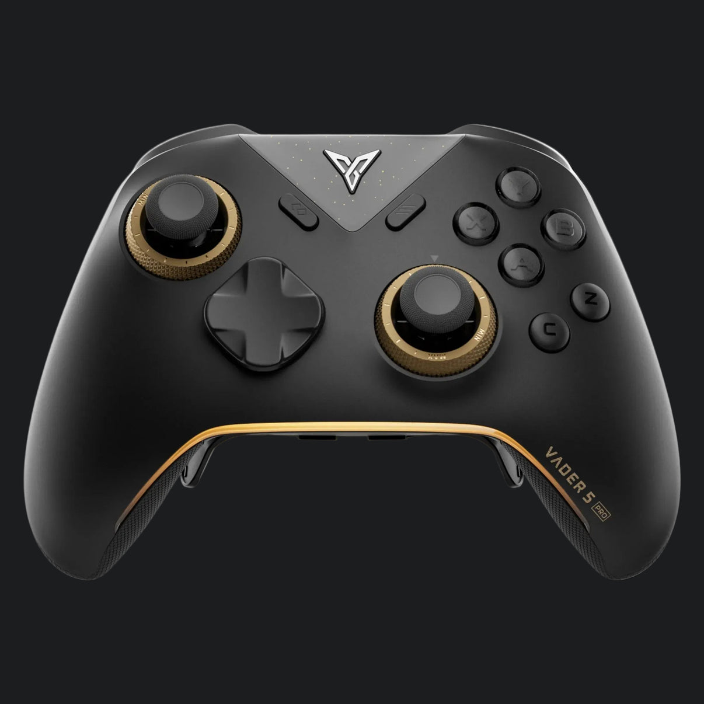

Sau một thời gian cân nhắc giữa **Direwolf 4** (tiết kiệm), **Apex 5** (full công nghệ) và **Vader 5 Pro**, cuối cùng mình đã quyết định xuống tiền rước em **Flydigi Vader 5 Pro** bản tiêu chuẩn về làm tay cầm chính cho góc PC.

Lý do khá đơn giản: mình cần phím bấm cơ học thật nảy, độ trễ thấp nhất có thể để chơi game hành động/FPS, và thật sự không quá mặn mà với màn hình LCD trên Apex 5 vì sợ tốn pin lẫn đội giá. Dưới đây là toàn bộ cảm nhận cá nhân của mình sau khi mở hộp và chiến đủ thể loại game trên em nó.

---

## 1. Mở Hộp & Cảm Nhận Ban Đầu

Hộp của Vader 5 Pro được đóng gói khá gọn gàng, sạch sẽ. Bên trong bản tiêu chuẩn gồm có:
- Tay cầm **Flydigi Vader 5 Pro** (tông đen nhám phối vòng chỉnh lực và đường viền vàng gold nhìn rất chiến).
- Đầu thu **USB Dongle 2.4GHz**.
- Dây cáp **USB-A to USB-C**.
- **2 lẫy lưng tháo rời (M3/M4)** — điểm mới rất hay so với việc gắn chết hoàn toàn.
- Sách hướng dẫn sử dụng.

> [!NOTE]
> Bản tiêu chuẩn sẽ **không** kèm theo dock sạc rời hay túi đựng cứng; nếu muốn gọn gàng đặt bàn làm việc thì bạn phải mua thêm dock riêng (hoặc chọn combo có sẵn dock từ shop).

Cảm giác đầu tiên khi cầm lên tay là **đầm, chắc chắn và ôm tay**. Bề mặt báng cầm được phủ lớp **cao su chống trượt (rubberized grip)** có vân nhám nhẹ. Với đứa hay ra mồ hôi tay như mình, lớp báng này giúp giữ tay cầm rất chắc khi combat căng thẳng, hơn hẳn vỏ nhựa trơn trên các dòng giá rẻ như Dune Fox.

---

## 2. Trải Nghiệm Thực Tế Từng Chi Tiết

### 2.1 Cần Analog FORCEFLEX™ & Vòng Chỉnh Lực (40–100gf)
Đây vẫn là "đặc sản" ăn tiền nhất của nhà Flydigi. Xung quanh hai cần analog có sẵn vòng xoay kim loại để chỉnh độ nặng nhẹ trực tiếp bằng tay mà không cần mở phần mềm:
- Khi chuyển qua **FPS / bắn súng** cần kê tâm chính xác: mình siết nặng lên một chút để cần có độ ghì, đỡ bị vẩy lố tâm.
- Khi chơi các tựa game **Đánh nhau / Hành động** (như *Street Fighter*, *Tekken*): mình để lực ở mức vừa hoặc hơi nhẹ một chút để xoay chiêu, né đòn và gạt cần chuyển hướng liên tục được nhanh, không bị mỏi ngón cái mà cần vẫn hồi tâm dứt khoát.

Cảm biến **Hall Effect** cho độ mượt rất tốt, deadzone gần như bằng 0 mà không bị trôi cần.

### 2.2 Cò FORCESWITCH™ 2 Chế Độ
Ở mặt sau có hai lẫy gạt vật lý cho phép chuyển nhanh trạng thái của cò LT/RT:
- **Chế độ Analog (Linear):** Hành trình dài, êm, phù hợp khi lái xe hoặc điều tiết ga/phanh.
- **Chế độ Micro-switch:** Hành trình cắt ngắn xuống còn vài milimet, bấm nghe tiếng *tạch tạch* như click chuột. Bắn súng hay spam skill bằng cò ở chế độ này sướng hơn hẳn cò cao su truyền thống.

### 2.3 Phím ABXY Cơ Học & D-Pad Xoay 2.0
- **Phím ABXY (Mecha-Tactile):** Bấm cực kỳ giòn, nảy và phản hồi tức thì. Nếu bạn đã quen dùng chuột gaming switch cơ thì bấm lên bộ phím này sẽ nghiện ngay lập tức vì không có cảm giác bị "lún" hay nhão. *(Điểm lưu ý nhỏ: tiếng click khá rõ, chơi đêm khuya trong phòng yên tĩnh có thể hơi ồn nhẹ với người bên cạnh).*
- **D-Pad:** Sử dụng cơ chế xoay 2.0 cải tiến. Cá nhân mình thấy độ nảy vừa tay, bấm 4 hướng tách bạch rõ ràng, hạn chế rất tốt tình trạng bấm nhầm góc chéo khi chơi game đối kháng hay chọn chiến thuật nhanh.

### 2.4 Hệ Thống 8 Nút Phụ: Thực Dụng Hay Thừa Thãi?
Vader 5 Pro nhồi tới **8 nút phụ**: 4 nút phía sau (2 nút cố định + 2 lẫy tháo rời), 2 nút vai phụ (`LM`/`RM`) ở gần cò, và cặp nút **`C` / `Z`** nằm ngay dưới cụm ABXY.
- **4 nút lưng:** Khoảng cách với ngón giữa và ngón áp út khá vừa vặn, độ nặng nút đủ để mình tì tay tự nhiên mà không bị bấm nhầm. Nếu bạn không quen dùng cả 4 nút thì cứ tháo bớt 2 lẫy `M3`/`M4` ra cho thoáng tay.
- **Nút C/Z & 2 nút vai phụ:** Ban đầu mình tưởng hơi thừa, nhưng khi gán `C`/`Z` làm nút chụp màn hình nhanh, đổi profile hoặc mở bản đồ/item trong game RPG thì lại cực kỳ tiện, đỡ phải với tay sang phím Start/Select hay bàn phím.

### 2.5 Rung 4 Motor, Độ Trễ & Pin
- **Độ trễ 1000Hz (~3–4ms):** Cắm dongle 2.4GHz vào PC chơi gần như không cảm nhận được delay, chuyển động nhân vật ăn ngay theo tay.
- **4 Motor rung:** Ngoài 2 motor lớn ở hai bên báng cầm, Vader 5 Pro còn có 2 motor nhỏ ngay cụm cò. Khi chơi game hành động hoặc bắn súng, lực rung dội lên đầu ngón tay trỏ khá đã (tuy không thể giả lập lực cản vật lý như Force Feedback trên Apex 5, nhưng ở tầm giá này đã quá ổn).
- **Pin 1.000 mAh:** Mình chơi mỗi tối khoảng 2–3 tiếng (bật đèn LED vừa phải, rung mặc định) thì tầm 4–5 ngày mới phải cắm sạc lại một lần.

---

## 3. Điểm Khen & Điểm Trừ Sau Khi Sử Dụng

### Những điểm mình rất ưng
- **Tỷ lệ hiệu năng/giá thành quá tốt:** Ở tầm giá ~1.5 triệu, khó kiếm được chiếc tay cầm nào hội tụ đủ cả cần chỉnh lực, cò 2 chế độ, phím cơ, 4 motor rung lẫn 8 nút phụ.
- **Độ tùy biến cao:** Từ phần cứng (tháo lắp lẫy lưng, gạt cò, xoay lực cần) đến phần mềm **Flydigi Space Station** (map phím, chỉnh đường cong cần analog, macro, đèn RGB).
- **Độ trễ siêu thấp:** Cảm giác phản hồi nhanh và tin cậy khi chơi các game đòi hỏi timing chuẩn như Soulslike hay FPS.

### Những điểm vẫn còn lăn tăn
- **Báng cao su lâu dài:** Dùng vài tháng đầu thì cực kỳ bám tay, nhưng theo kinh nghiệm xài đồ gear phủ cao su thì sau 1–2 năm dùng nhiều mồ hôi có thể sẽ hơi bóng hoặc mòn nhẹ nếu không vệ sinh kỹ.
- **Phần mềm nhiều mục:** *Flydigi Space Station* rất mạnh nhưng giao diện hơi nhiều thông số đối với người mới lần đầu dùng tay cầm hãng này, cần tốn chút thời gian làm quen.
- **Phụ kiện bán rời:** Bản tiêu chuẩn không có sẵn dock sạc hay hộp đựng, muốn setup gọn đẹp phải chi thêm.
- **Không hỗ trợ native Xbox / PS5:** Chủ yếu sinh ra cho hệ sinh thái PC, Switch và Mobile.

---

## 4. Tổng Kết: Có Đáng Tiền Không?

Nếu bạn đang tìm một chiếc tay cầm **dưới 2 triệu** để làm thiết bị chơi game chính trên PC, **Flydigi Vader 5 Pro** thực sự là một khoản đầu tư rất đáng tiền. Nó bỏ qua những thứ mang tính "làm màu" như màn hình LCD để tập trung toàn lực vào **cảm giác bấm, tốc độ phản hồi và khả năng tùy biến cho game thủ thực thụ**.

- **Nên mua nếu:** Bạn thích phím cơ bấm nảy, chơi đa dạng game (từ FPS, Soulslike, Fighting đến FC Online), cần nhiều nút macro và muốn độ trễ thấp nhất có thể.
- **Cân nhắc mẫu khác nếu:** Bạn thích sự êm ái yên tĩnh tuyệt đối (hãy xem **Direwolf 4**), hoặc muốn trải nghiệm cò phản hồi lực giả lập súng/cung như tay PS5 (hãy lên hẳn **Apex 5**).
