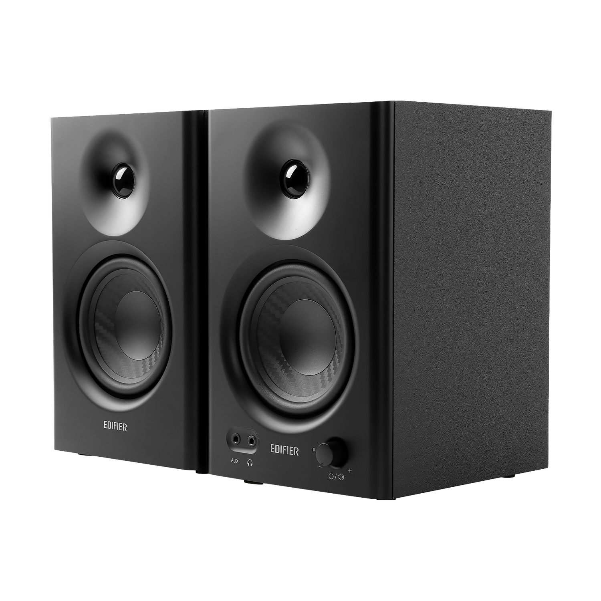
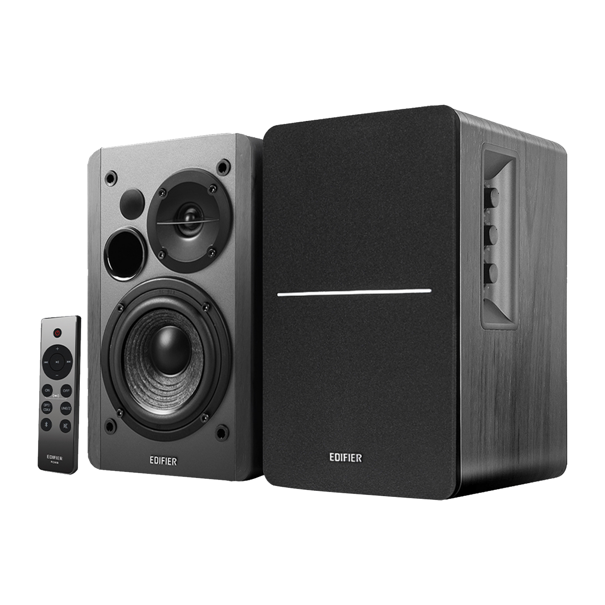
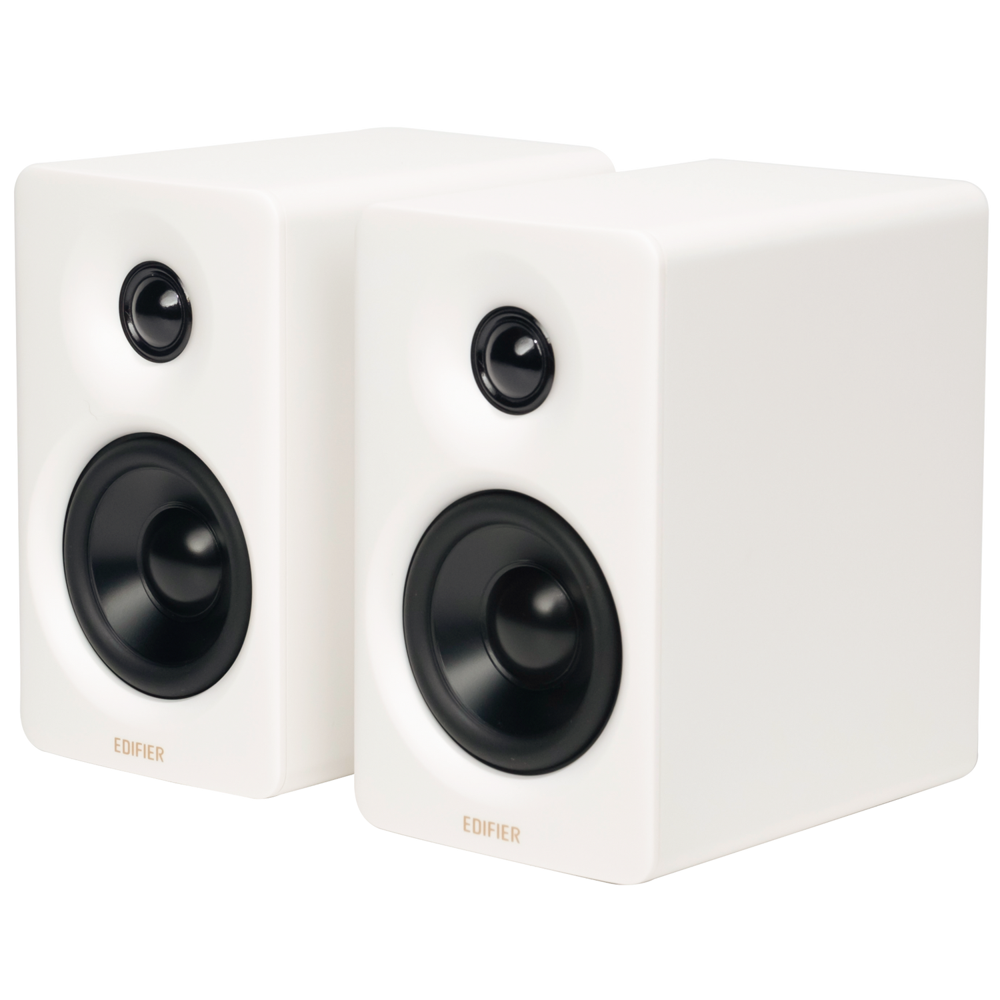

Chắc hẳn anh em nào build góc PC xong cũng từng trải qua giai đoạn đau đầu giống mình: **chọn loa gì để bàn cho vừa đẹp góc setup, vừa nghe nhạc xem phim sướng tai mà giá không bị "ngáo"?**

Hồi trước lúc mới dọn sang góc bàn mới, mình cũng phân vân đủ đường:
- Lúc thì định mua mấy con **soundbar gaming** dài dài đặt dưới màn hình cho gọn, có LED RGB nháy theo nhạc.
- Lúc lại tính lấy tạm bộ **loa 2.1 vỏ nhựa** tầm vài trăm nghìn cho tiết kiệm.
- Thậm chí có lúc suýt chốt một con **loa Bluetooth di động** để mang đi mang lại cho tiện.

May sao hôm đó ngồi cà phê than thở, ông bạn thân chơi audio mới phán một câu xanh rờn:
> *"Ngồi cố định ở bàn PC thì dẹp mấy con loa nhựa với soundbar rẻ tiền đi, âm thanh bí rì toàn bass ù. Tầm 2–3 triệu cứ làm một cặp loa bookshelf thùng gỗ của **Edifier** mà nghe, cắm lên là thấy khác bọt hoàn toàn!"*

Nghe bùi tai, tối về mình lên mạng tìm hiểu ngay về **Edifier** — và kết quả là... lại bước vào một vòng phân vân mới giữa 3 cái tên hot nhất của hãng này trên góc bàn PC: **MR4**, **R1280DBs** và **M60**.

---

## 1. Tại Sao Loa Thùng Gỗ Edifier Lại Được Dân Setup PC Chuộng Đến Vậy?

Trước khi đi vào từng mẫu, lý do lớn nhất khiến Edifier gần như "thống trị" phân khúc loa để bàn tầm trung (1.8 – 3.5 triệu) nằm ở 3 điểm:
1. **Thùng loa gỗ MDF:** Giúp triệt tiêu cộng hưởng rung, cho chất âm ấm, dày và sạch hơn hẳn loa vỏ nhựa.
2. **Thiết kế cực kỳ ăn nhập với góc làm việc:** Từ tối giản hiện đại đến cổ điển retro, đặt lên bàn nhìn sang hẳn góc máy.
3. **P/P (Hiệu năng/Giá thành) rất tốt:** Âm thanh tách bạch rõ ràng giữa giọng hát (vocal), nhạc cụ và tiếng bass, nghe lâu không bị mệt tai.

---

## 2. Đặt Lên Bàn Cân 3 Mẫu Edifier Dễ Phân Vân Nhất

### 2.1 Edifier MR4 — "Loa Quốc Dân" Cho Góc Setup Tối Giản (~1.8 – 2.2 triệu)

Đây là cặp loa mình thấy xuất hiện nhiều nhất trên các hội nhóm setup góc làm việc vì ngoại hình vuông vức, tối giản (đặc biệt bản màu trắng hoặc đen nhám).
- **Chất âm:** Thuộc dòng **loa kiểm âm (Studio Monitor)** nên âm thanh thiên về hướng **trung thực, mộc mạc và chi tiết**. Có 2 chế độ: *Monitor Mode* (âm phẳng để edit video/làm nhạc) và *Music Mode* (nghe giải trí mượt hơn).
- **Điểm cộng:** Giá dễ tiếp cận nhất trong 3 mẫu, âm sạch sẽ, bass đánh gọn gàng không lấn giọng hát.
- **Điểm cần lưu ý:** Bản MR4 tiêu chuẩn **không có Bluetooth** (chỉ cắm dây TRS 6.35mm, RCA hoặc AUX) và bass vừa đủ nghe, không phải kiểu đánh rung bàn.

---

### 2.2 Edifier R1280DBs — Cổ Điển, Đa Năng, Bass Ấm (~2.3 – 2.7 triệu)

Nếu bạn thích kiểu loa bookshelf hai bên ốp vân gỗ cổ điển và cần nhiều cổng kết nối để vừa cắm PC, vừa bắn Bluetooth từ điện thoại hoặc cắm TV thì **R1280DBs** là ứng cử viên sáng giá.
- **Chất âm:** Thiên về **nghe nhạc giải trí và xem phim**. Bass dày dặn, ấm áp và có lực hơn MR4, lại có sẵn núm vặn chỉnh Bass/Treble vật lý ngay cạnh loa.
- **Điểm cộng:** Có **Bluetooth 5.0**, **Remote điều khiển từ xa**, cổng **Optical/Coaxial** và đặc biệt là có **cổng Sub-out** (sau này thích bass rung nhà có thể cắm thêm loa sub rời).
- **Điểm cần lưu ý:** Kích thước thùng loa khá to, bàn làm việc nhỏ (dưới 1m2) đặt lên sẽ hơi chiếm diện tích.

---

### 2.3 Edifier M60 — Nhỏ Gọn, Hiện Đại, Công Suất Khủng (~2.8 – 3.3 triệu)

Đây là mẫu thế hệ mới làm mình đắn đo nhất vì ngoại hình siêu gọn nhưng thông số lại cực kỳ "khét":
- **Chất âm & Công nghệ:** Đạt chuẩn **Hi-Res Audio**, tổng công suất lên tới **66W** (rất lớn so với thân hình nhỏ nhắn). Tiếng trong trẻo, chi tiết và lực bass rất bất ngờ.
- **Điểm cộng:** Có **cổng USB-C** cắm thẳng vào PC nhận tín hiệu số cực sạch (khỏi lo nhiễu từ jack 3.5mm của mainboard), **Bluetooth 5.3 hỗ trợ codec LDAC**, phím cảm ứng mặt trên và đi kèm sẵn cặp chân đế nghiêng hướng loa thẳng lên tai người nghe.
- **Điểm cần lưu ý:** Giá nhỉnh hơn MR4 tầm 1 triệu đồng.

---

## 3. Bảng So Sánh Nhanh Để Dễ Chốt Đơn

| Tiêu chí | Edifier MR4 | Edifier R1280DBs | Edifier M60 |
| :--- | :--- | :--- | :--- |
| **Giá tham khảo** | ~1.800.000đ – 2.200.000đ | ~2.300.000đ – 2.700.000đ | ~2.800.000đ – 3.300.000đ |
| **Phong cách** | Tối giản (Monitor) | Cổ điển vân gỗ (Retro) | Hiện đại, siêu gọn |
| **Chất âm đặc trưng** | Trung thực, mộc, tách bạch | Ấm áp, bass dày giải trí | Chi tiết, mạnh mẽ (66W, Hi-Res) |
| **Bluetooth** | Không (bản tiêu chuẩn) | Có (Bluetooth 5.0) | **Có (Bluetooth 5.3 + LDAC)** |
| **Cổng kết nối nổi bật** | TRS 6.35mm, RCA, AUX | Optical, Coaxial, RCA, **Sub-out** | **USB-C**, AUX |
| **Phù hợp bàn nhỏ** | Khá ổn | Hơi to | **Rất gọn (có sẵn chân đế)** |

---

## 4. Kết Lại: Nếu Được Chọn Lại Từ Đầu Thì Chọn Con Nào?

Sau một hồi cân đo đong đếm (và nghe thử ké ở nhà ông bạn), mình rút ra công thức chọn cực kỳ đơn giản cho anh em nào cũng đang phân vân như mình hồi trước:

> [!TIP]
> - **Chọn `Edifier MR4`** nếu ngân sách quanh 2 triệu, chỉ cắm dây cố định vào PC để làm việc, edit video, nghe nhạc nhẹ/acoustic và thích góc bàn tối giản.
> - **Chọn `Edifier R1280DBs`** nếu bàn đủ rộng, thích nghe nhạc sôi động/xem phim bass ấm, cần remote và Bluetooth để nằm giường bật nhạc.
> - **Chọn `Edifier M60`** nếu bàn nhỏ nhưng muốn chất âm xịn nhất tầm 3 triệu, cắm gọn qua một sợi **USB-C** và có luôn **Bluetooth LDAC** đời mới.

Phải công nhận một điều: chuyển từ loa nhựa rẻ tiền lên một cặp loa thùng gỗ đàng hoàng như Edifier là **nâng cấp đáng giá nhất** cho góc PC — bật bài nhạc quen thuộc lên nghe tự nhiên thấy... muốn ngồi làm việc lâu hơn hẳn!
