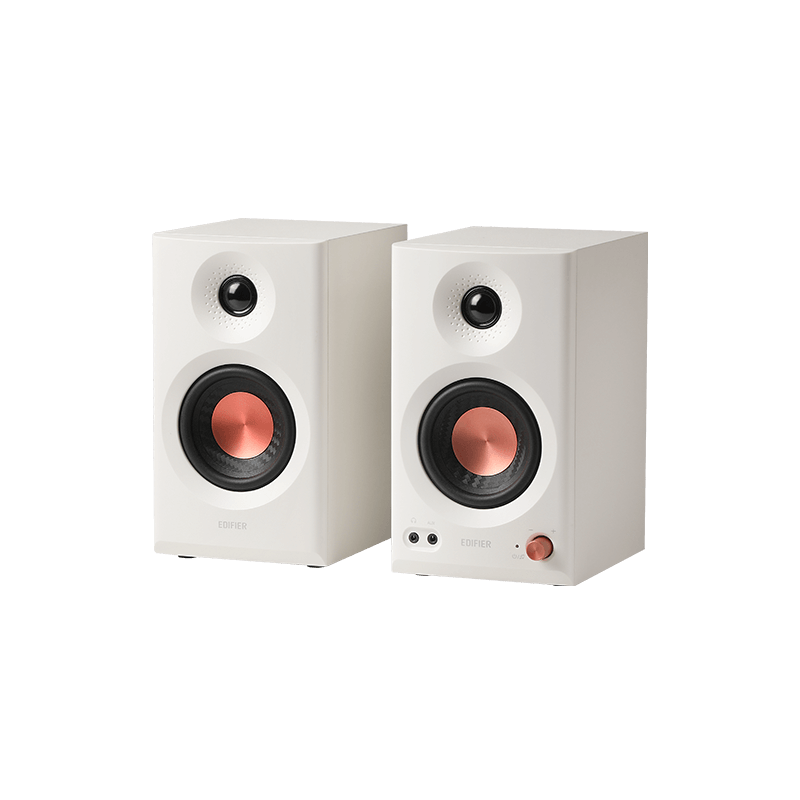
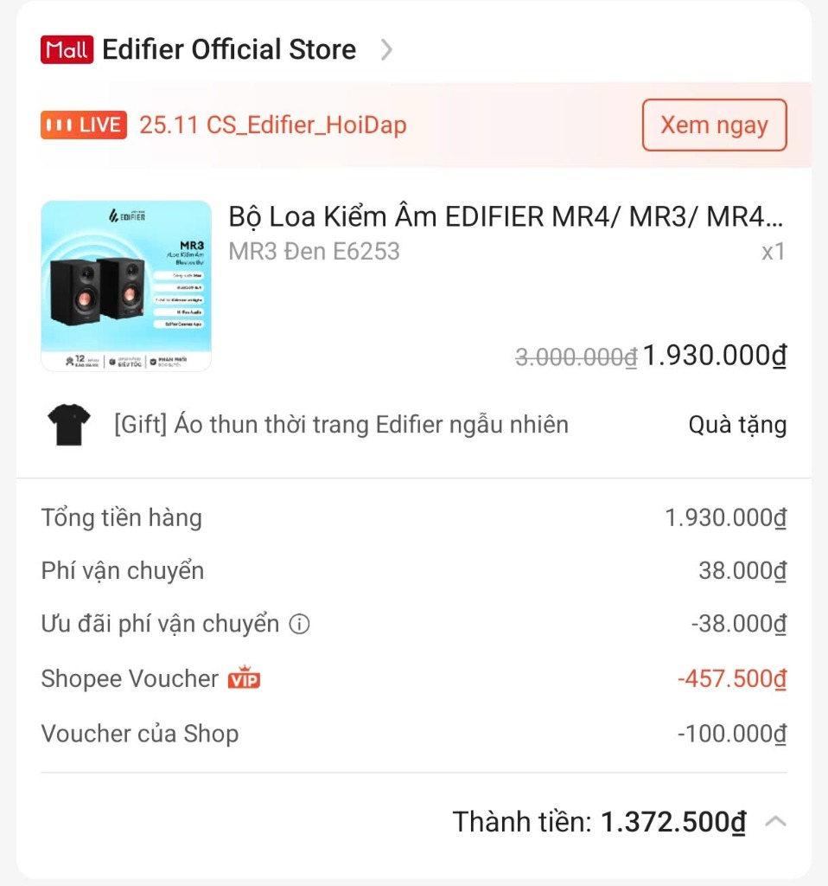
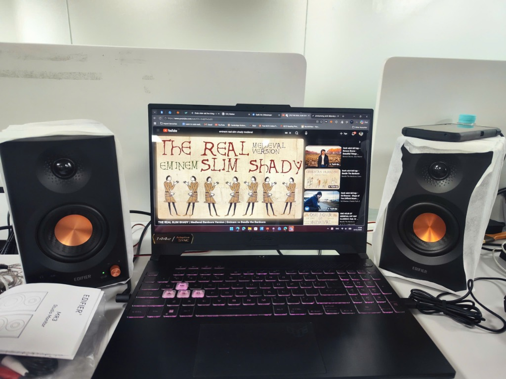

Sau khi cân não chán chê giữa **MR3** và **MR4**, mình chính thức chốt hạ mục tiêu là em **Edifier MR3** vì nhỏ gọn lại có Bluetooth 5.4. Nhưng chốt mẫu xong thì tới bài toán tiếp theo: **làm sao mua được giá thơm nhất?**

Giá niêm yết bình thường của em nó loanh quanh tầm **1.8 – 2.1 triệu**. Với tinh thần "săn được giá hời mới sướng", mình đã trải qua hẳn một tuần lễ đầy drama trước khi rước được em nó về với mức giá không tưởng: **1.300.000đ trên Shopee**!

---

## 1. Giai Đoạn 1: Lượn Hội Nhóm Pass Đồ Và Pha "Suýt Bị Scam" Nhớ Đời

Ban đầu mình nghĩ bụng: *“Thôi tìm hàng lướt anh em pass lại trên mấy hội nhóm setup/audio cho rẻ, khéo tầm 1tr3–1tr4 là có hàng đẹp fullbox rồi.”*

Thế là tối nào cũng lượn Facebook F5 liên tục. Được vài hôm thì thấy có một bài đăng pass **Edifier MR3** mới dùng 1 tháng, fullbox đẹp keng giá **1tr250**. Thấy thơm quá, mình inbox hỏi mua ngay:
- Nhắn tin hỏi tình trạng loa, video test thì trả lời rất mượt, ảnh chụp nhìn cũng nét.
- Nhưng tới đoạn chốt giao dịch: mình xin qua tận nơi xem hoặc giao dịch trung gian/COD có cọc nhẹ qua app uy tín thì bên kia bắt đầu **giục chuyển khoản cọc trước 300k–500k** với lý do *"nhiều người hỏi quá, ai cọc trước giữ cho người đó"*, gửi số tài khoản lạ hoắc, check lịch sử nick Facebook thì toàn bài chia sẻ linh tinh, bạn bè ẩn sạch.

Lúc đó chột dạ dừng lại kịp thời, lên nhóm kiểm tra lại thì đúng y như rằng — nick ảo đi scam cọc của mấy anh em ham rẻ! Hú hồn chim én, may mà tỉnh táo chứ không là mất trắng mấy trăm nghìn tiền ngu.

> [!CAUTION]
> **Bài học xương máu khi mua đồ pass trên mạng:** Thấy giá rẻ bất thường mà người bán liên tục giục chuyển khoản cọc trước, né giao dịch trực tiếp hoặc né ship COD đồng kiểm thì **99% là scam**. Cứ quay xe ngay lập tức cho lành!

---

## 2. Giai Đoạn 2: Quay Xe Về Shopee — Chuỗi Ngày Canh Voucher Như Đi Làm

Sau pha suýt "bay màu" ở hội nhóm, mình tự nhủ: **thôi mua hàng mới chính hãng trên Shopee Mall / shop uy tín cho yên tâm bảo hành**, chịu khó canh sale một chút.

Thế là công cuộc "cày cuốc" bắt đầu:
- Sáng trưa chiều tối đều mở app **Shopee** điểm danh, lưu sẵn loạt mã giảm giá ngành hàng Điện tử, mã freeship và voucher của shop.
- Chờ đúng ngày sale giữa tháng / ngày đôi, canh khung giờ **0h và 12h** để săn mã % giảm sâu.
- Kết hợp thêm **Shopee Xu** tích góp bấy lâu nay nữa.

Khoảnh khắc áp đủ combo trên **Edifier Official Store (Shopee Mall)**: **Giá sale 1.930.000đ + Freeship (-38.000đ) + Shopee Voucher VIP (-457.500đ) + Voucher của Shop (-100.000đ)**, nhìn tổng thanh toán tụt xuống còn **1.372.500đ** cho một cặp loa **mới nguyên seal, bảo hành chính hãng** lại còn được tặng kèm thêm **1 chiếc áo thun Edifier** — cảm giác nó đã gì đâu! Bấm đặt hàng luôn trong vòng 3 nốt nhạc kẻo hết lượt mã.

---

## 3. Thành Quả & Cảm Nhận Khi Bóc Seal Em Nó

Vài ngày sau shipper giao tới, khui thùng ra mùi đồ mới thơm phức. Đặt vội cặp **Edifier MR3 bản Đen** (vẫn còn nguyên túi xốp bọc bảo vệ hai bên) lên bàn cạnh con laptop là phải mở ngay YouTube test thử tiếng liền:

Cảm nhận thực tế khi nghe thử mới thấy quyết định không mua hàng pass trôi nổi và chịu khó săn sale là chuẩn không cần chỉnh:
- **Gọn gàng bất ngờ:** Thùng loa nhỏ nhắn đặt hai bên màn hình nhìn cực kỳ cân đối, không bị choán chỗ.
- **Chất âm vượt tầm giá 1tr3:** Bật thử mấy bài Acoustic với Lo-fi lên, giọng hát (vocal) tách bạch, trong trẻo, bass gọn gàng vừa đủ nghe mà không bị ù. So với mấy con loa vi tính vài trăm nghìn trước đây đúng là một trời một vực.
- **Bluetooth 5.4 quá tiện:** Tối tắt PC nằm giường vẫn kết nối điện thoại qua loa chill nhẹ vài bài trước khi ngủ, chỉnh EQ thêm trên app *Edifier ConneX* nữa là hết bài.

Với mức giá **1tr3 hàng mới nguyên hộp** săn được trên Shopee, thực sự đến giờ mình vẫn thấy đây là một trong những kèo mua gear hời nhất từ trước tới nay của bản thân. Anh em nào đang nhắm **Edifier MR3** thì cứ kiên nhẫn canh sale + gom voucher Shopee nhé — vừa an toàn, vừa có bảo hành, lại không lo dính bẫy cọc trên mạng!
