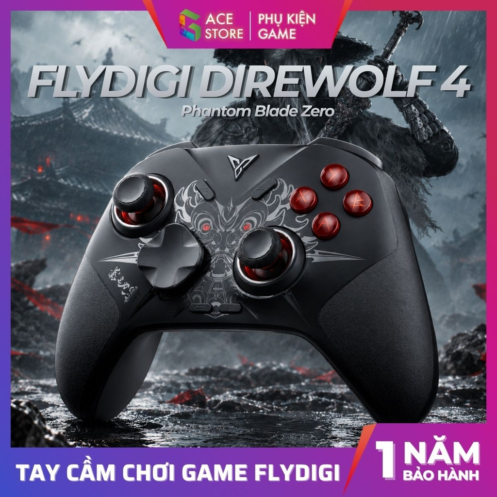
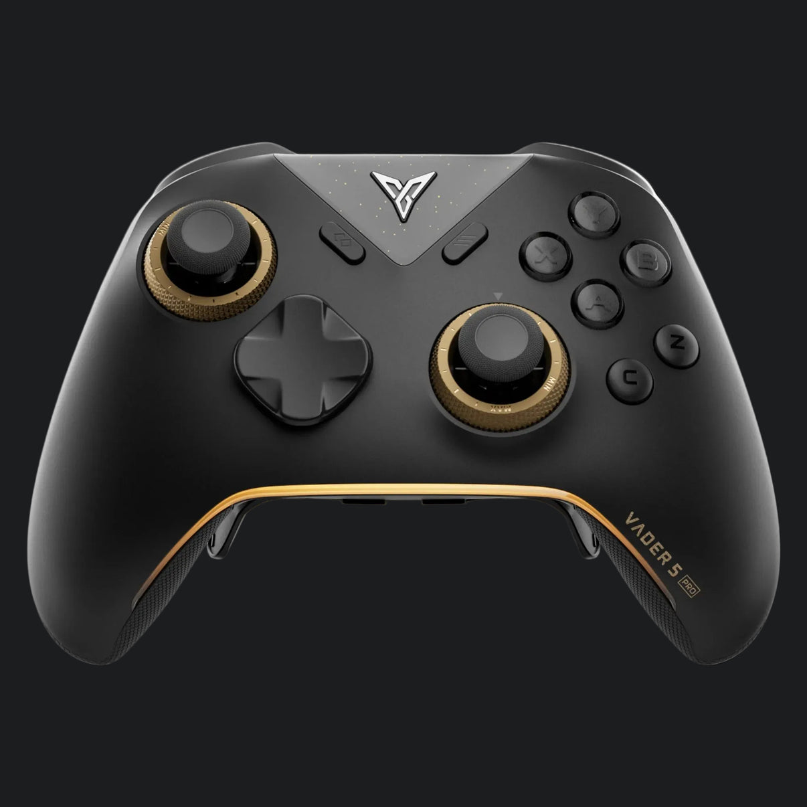

Thú thật với anh em, trước khi rước em **Vader 5 Pro** về góc bàn, chính bản thân mình cũng từng đứng hình mất mấy ngày trời trước ngã rẽ kinh điển của nhà Flydigi: **chọn `Direwolf 4` (~750k) cho nhẹ ví, hay cố gấp đôi tiền lên hẳn `Vader 5 Pro` (~1.5 triệu)?**

Cứ thêm vào giỏ hàng rồi lại xóa, xem hết chục cái video review vì con **Direwolf 4** năm nay quá ngon — từ vòng chỉnh lực cần analog, cò 2 chế độ đến Polling Rate 1000Hz đều có đủ. Nhưng cuối cùng, máu "try-hard" nổi lên, mình quyết định **cắn răng nhịn cơm ăn mì gói vài tuần** để chốt luôn **Vader 5 Pro** cho đỡ phải lăn tăn "biết thế...".

Vậy số tiền chênh lệch **~700.000đ – 800.000đ** đánh đổi bằng mấy thùng mì tôm đó thực chất mua được những gì? Dưới đây là góc nhìn thực tế của mình để anh em dễ chọn!

---

## 1. Những Điểm Giống Nhau (Lý Do Khiến Bạn Phân Vân)

Trước khi soi điểm khác, hãy nhìn vào những thứ mà **cả hai đều làm rất tốt**:
- **Cần Analog Hall Effect chỉnh lực:** Cả hai đều có vòng xoay chỉnh độ nặng nhẹ trực tiếp trên cần và chống trôi cần tuyệt đối.
- **Cò 2 chế độ (Trigger Lock):** Đều có lẫy gạt phía sau để chuyển giữa cò hành trình dài (đua xe) và cò bấm ngắn dạng Micro-switch (bắn súng).
- **Polling Rate 1000Hz:** Cả hai đều đạt tốc độ phản hồi 1000Hz mượt mà qua cả dây lẫn đầu thu 2.4GHz.
- **Gyro 6 trục & Kết nối 3 mode:** Đều hỗ trợ PC, Nintendo Switch, Android, iOS qua Dây / 2.4GHz / Bluetooth và chỉnh qua phần mềm *Flydigi Space Station*.

Nói cách khác, nếu chỉ xét trên giấy tờ cơ bản, **Direwolf 4 đã giải quyết tới 80% nhu cầu chơi game thông thường**.

---

## 2. Bảng So Sánh Những Điểm Khác Biệt Cốt Lõi

| Tiêu chí | Flydigi Direwolf 4 | Flydigi Vader 5 Pro |
| :--- | :--- | :--- |
| **Giá tham khảo** | ~700.000đ – 785.000đ | ~1.450.000đ – 1.590.000đ |
| **Phím ABXY** | Màng cao su (êm, ít ồn) | **Phím cơ Mecha-Tactile** (giòn, nảy) |
| **Dải chỉnh lực cần** | 40 – 80gf | **40 – 100gf** (FORCEFLEX™) |
| **Số nút phụ (Macro)** | 2 nút mặt lưng | **8 nút** (4 lưng + 2 vai `LM`/`RM` + `C`/`Z`) |
| **Hệ thống rung** | 2 motor (ở tay cầm) | **4 motor** (2 tay cầm + 2 cụm cò) |
| **Báng cầm (Grip)** | Nhựa nhám tiêu chuẩn | **Phủ cao su chống trượt** |
| **Trọng lượng & Pin** | ~233g — Pin 800 mAh | Đầm tay hơn — Pin **1.000 mAh** |

---

## 3. Chênh ~750k Để Lên Vader 5 Pro: Bạn Nhận Được Gì?

### 3.1 Phím cơ Mecha-Tactile vs Phím cao su
Đây là khác biệt bạn cảm nhận rõ nhất ngay từ lần bấm đầu tiên:
- **Direwolf 4** dùng phím cao su truyền thống: bấm êm, dịu tay và **rất yên tĩnh**.
- **Vader 5 Pro** dùng switch cơ học: độ nảy cực cao, hành trình ngắn, phản hồi tức thì với tiếng *click* giòn tan như chuột gaming. Nếu bạn hay chơi game hành động tốc độ cao hoặc game đối kháng cần bấm combo liên tục, phím cơ cho cảm giác sướng hơn hẳn.

### 3.2 Hệ sinh thái 8 nút phụ so với 2 nút lưng
- **Direwolf 4** có 2 nút phụ mặt lưng — vừa đủ để gán né đòn (Dodge) hoặc chạy nhanh (Sprint).
- **Vader 5 Pro** cho tới **8 nút phụ** (4 nút lưng có 2 lẫy tháo rời, 2 nút vai phụ và cặp `C`/`Z`). Nếu bạn chơi FPS chuyên sâu, MMO/ARPG nhiều kỹ năng hoặc muốn gán macro tiện ích, Vader 5 Pro hoàn toàn vượt trội.

### 3.3 Rung 4 motor & Báng cầm cao su
Trên **Vader 5 Pro**, 2 motor rung phụ nằm ngay ở cụm cò LT/RT giúp bạn cảm nhận độ giật súng hoặc ma sát mặt đường rõ rệt hơn ở đầu ngón tay trỏ. Kèm theo đó là lớp báng cao su chống trượt giúp cầm chắc tay hơn khi chơi lâu ra mồ hôi, đồng thời pin 1.000 mAh cũng nhỉnh hơn mức 800 mAh trên Direwolf 4.

### 3.4 Độ nhẹ tay hay độ đầm
**Direwolf 4** chỉ nặng khoảng **233g** — rất nhẹ, cầm lâu nhiều giờ liền không bị mỏi cổ tay. Ngược lại, **Vader 5 Pro** đầm tay và chắc khối hơn.

---

## 4. Chốt Hạ: Bạn Nên Chọn Chiếc Nào?

Hãy chọn theo đúng thói quen và ngân sách của bạn:

> [!TIP]
> **Chọn `Flydigi Direwolf 4` nếu:**
> - Ngân sách muốn giữ gọn trong khoảng **dưới 1 triệu** (tiết kiệm được ~750k để mua game hoặc dock sạc).
> - Bạn thích sự **nhẹ nhàng (~233g)**, bấm **êm ái yên tĩnh** khi chơi đêm không làm phiền người xung quanh.
> - Bạn chơi giải trí đa thể loại (FC Online, AAA, Switch, đi cảnh) và chỉ cần 2 nút phụ mặt lưng là đủ.

> [!IMPORTANT]
> **Cố lên `Flydigi Vader 5 Pro` nếu:**
> - Bạn **nghiện cảm giác bấm phím cơ** giòn tan, độ trễ siêu thấp (~3–4ms) và cần siết lực cần analog nặng hơn (tới 100gf) để aim FPS.
> - Bạn chơi game nhiều tổ hợp phím, cần **nhiều nút macro** (4 nút lưng + 2 nút vai + `C`/`Z`).
> - Bạn thích tay cầm **đầm tay, báng cao su bám tay**, rung 4 motor đã tay hơn và pin trâu hơn để cày game dài hơi.

**Tóm lại một câu:** *Direwolf 4* là lựa chọn **kinh tế và thực dụng nhất**, còn *Vader 5 Pro* là lựa chọn **đầu tư một lần cho cảm giác bấm sướng nhất** mà không cần phải vung tiền lên tới dòng Apex. Riêng cá nhân mình sau khi "cắn răng" ăn mì chốt đơn em Vader 5 Pro thì thấy hoàn toàn xứng đáng — cầm lên bấm mấy phím cơ *tạch tạch* là quên luôn cả vị mì tôm!
