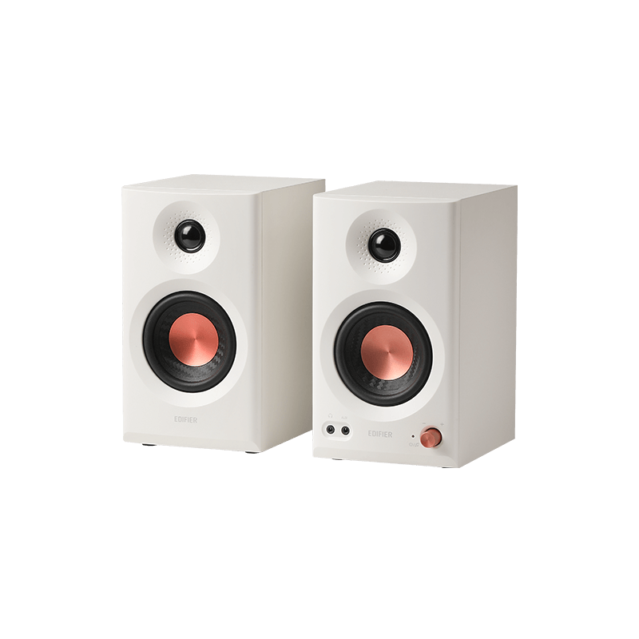
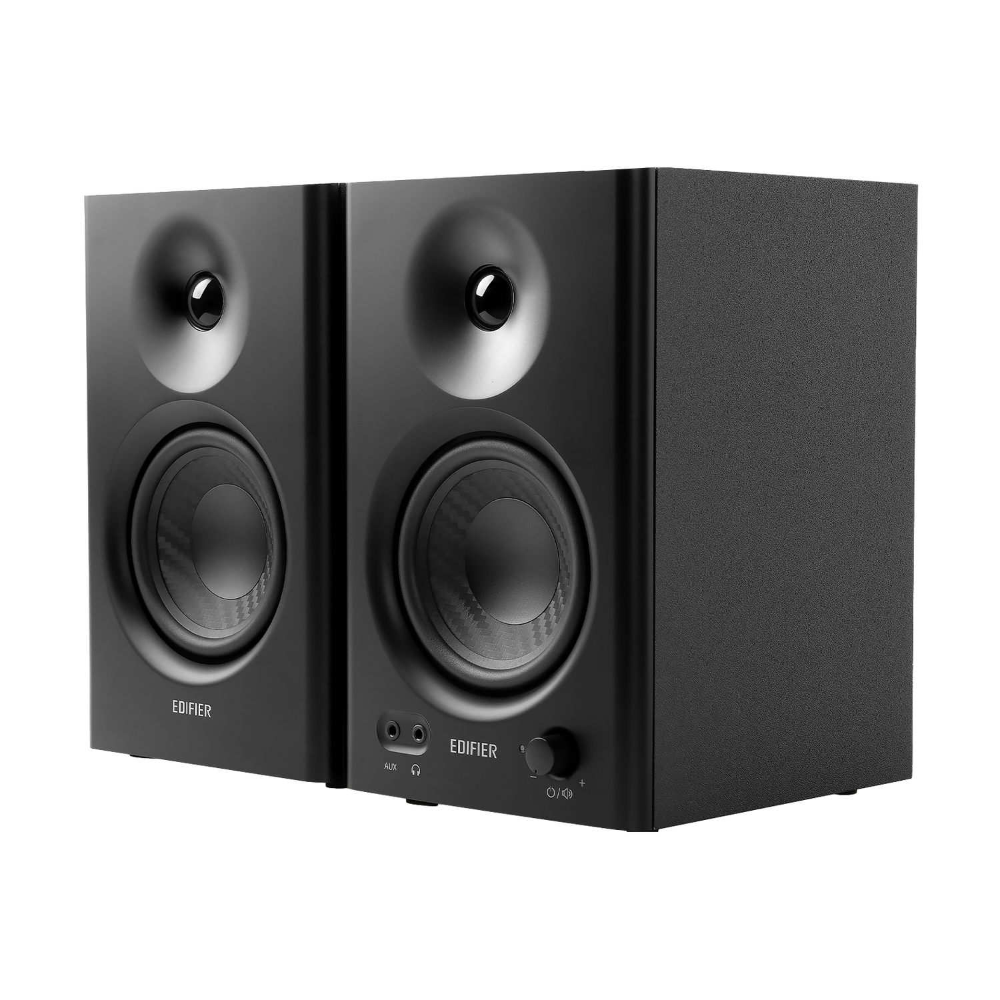

Sau khi tìm hiểu về dòng loa thùng gỗ của Edifier, rất nhiều anh em (trong đó có cả mình) đều bị khựng lại ở một câu hỏi cực kỳ khó chịu: **Chọn `Edifier MR4` ("loa quốc dân" đi trước) hay `Edifier MR3` (đàn em ra sau nhỏ gọn hơn nhưng nhiều công nghệ mới hơn)?**

Thoạt nhìn bên ngoài, hai anh em nhà MR này trông giống nhau như đúc — đều là thiết kế loa kiểm âm tối giản, thùng gỗ MDF với hai tông màu Đen/Trắng cực kỳ hợp góc setup PC. Nhưng soi kỹ vào phần ruột và tính năng bên trong, đây lại là hai lựa chọn phục vụ hai thói quen dùng rất khác nhau.

---

## 1. Bảng So Sánh Thông Số Edifier MR3 vs MR4

| Tiêu chí | Edifier MR3 | Edifier MR4 |
| :--- | :--- | :--- |
| **Củ loa Bass / Mid-Low** | 3.5 inch | **4 inch** |
| **Loa Treble** | 1 inch Silk Dome (có waveguide) | 1 inch Silk Dome |
| **Công suất (RMS)** | 36W (18W + 18W) | **42W** (21W + 21W) |
| **Dải tần đáp ứng** | **52 Hz – 40 kHz** | 60 Hz – 20 kHz |
| **Chứng nhận Hi-Res Audio** | **Có** (24-bit/96kHz) | Không |
| **Bluetooth** | **Có (Bluetooth 5.4 + Multipoint)** | **Không** (chỉ cắm dây) |
| **Hỗ trợ App điện thoại** | **Có (Edifier ConneX)** | Không |
| **Cổng cắm dây** | TRS 6.35mm, RCA, AUX 3.5mm | TRS 6.35mm, RCA, AUX 3.5mm |
| **Cổng tai nghe mặt trước** | Có (3.5mm) | Có (3.5mm) |
| **Kích thước & Trọng lượng** | ~125.5 × 220 × 185 mm (~3.85 kg) | ~140 × 228 × 197.5 mm (~4.5 kg) |

---

## 2. 4 Điểm Khác Biệt Quyết Định Khi Xuống Tiền

### 2.1 Bluetooth 5.4 + Multipoint: Điểm Ăn Tiền Tuyệt Đối Của MR3
Đây là nâng cấp lớn nhất khiến nhiều người quay xe từ MR4 sang **MR3**:
- **MR4** thuần loa kiểm âm cắm dây 100%, không có Bluetooth. Muốn phát nhạc từ điện thoại hay iPad khi nằm giường là bạn phải cắm thêm cục thu Bluetooth rời khá vướng víu.
- **MR3** tích hợp sẵn **Bluetooth 5.4** có **Multipoint** (kết nối 2 thiết bị cùng lúc). Ngồi máy tính thì nghe qua dây TRS/AUX, tối nằm lướt điện thoại thì bắn Bluetooth sang loa nghe luôn, cực kỳ tiện.

### 2.2 Chứng Nhận Hi-Res Audio & App Edifier ConneX
- **MR3** được trang bị mạch khuếch đại Class-D của Texas Instruments hỗ trợ xử lý âm thanh **Hi-Res 24-bit/96kHz**, dải tần mở rộng tới **52 Hz – 40 kHz**. Đi kèm với đó là app **Edifier ConneX** trên điện thoại giúp bạn chỉnh EQ, bù âm phòng (room compensation) và chuyển chế độ âm thanh mượt mà.
- **MR4** không có Hi-Res và không dùng app, mọi thứ đều chỉnh qua núm xoay vật lý trên loa (chuyển giữa *Monitor Mode* và *Music Mode*).

### 2.3 Công Suất & Kích Thước Củ Loa
- **MR4** nhỉnh hơn về mặt vật lý với củ loa **4 inch** và công suất **42W RMS** (so với **3.5 inch** và **36W RMS** trên MR3). Nếu phòng bạn rộng hoặc hay mở âm lượng lớn hết cỡ, MR4 có phần lực hơn một chút.
- Ngược lại, **MR3** gọn gàng hơn hẳn (chiều ngang chỉ ~12.5 cm), đặt trên bàn làm việc 1m2 hay góc setup có màn hình phụ sẽ thoáng mắt hơn rất nhiều.

### 2.4 Chất Âm Thực Tế
Cả hai đều giữ chất âm đặc trưng của dòng MR: **trong trẻo, tách bạch, trung thực và không bị ù bass**. MR3 nhờ thiết kế waveguide mới ở loa treble cho dải cao tơi và chi tiết hơn nhẹ, còn MR4 có thân thùng lớn hơn nên âm lượng tổng thể đầy đặn hơn khi ngồi xa.

---

## 3. Vậy Nên Chọn MR3 Hay MR4?

> [!TIP]
> **Chọn `Edifier MR3` nếu:**
> - Bạn cần một cặp loa đa năng: vừa cắm dây cố định cho PC, vừa có **Bluetooth 5.4** phát nhạc từ điện thoại/laptop.
> - Bạn thích sự **gọn gàng** trên bàn làm việc, thích vọc vạch EQ qua **app Edifier ConneX** và muốn có chuẩn **Hi-Res Audio**.

> [!NOTE]
> **Chọn `Edifier MR4` nếu:**
> - Bạn chỉ cắm dây 100% vào PC hoặc Soundcard/Audio Interface, không bao giờ dùng tới Bluetooth hay App.
> - Bàn làm việc rộng rãi và bạn ưu tiên củ loa 4 inch + công suất 42W lớn hơn một chút.

Cá nhân mình sau khi soi kỹ bảng này thì nghiêng hẳn về **Edifier MR3** — vì ngồi bàn PC nhưng tối vẫn hay nằm giường mở nhạc từ điện thoại, có Bluetooth 5.4 và kích thước gọn hơn đúng là chân ái!
