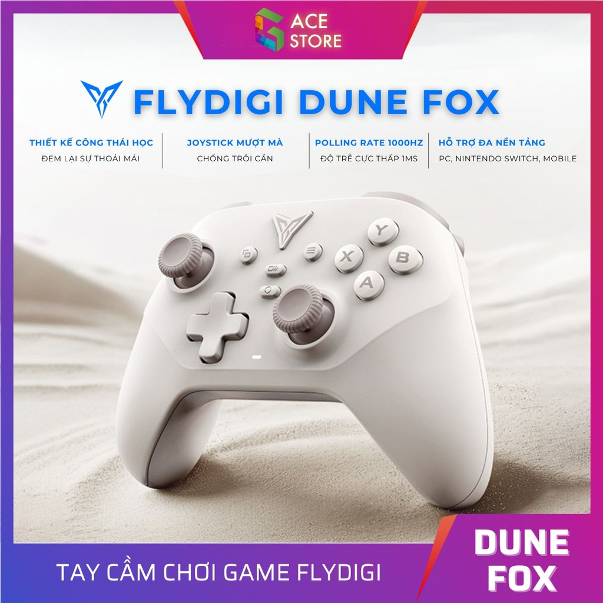
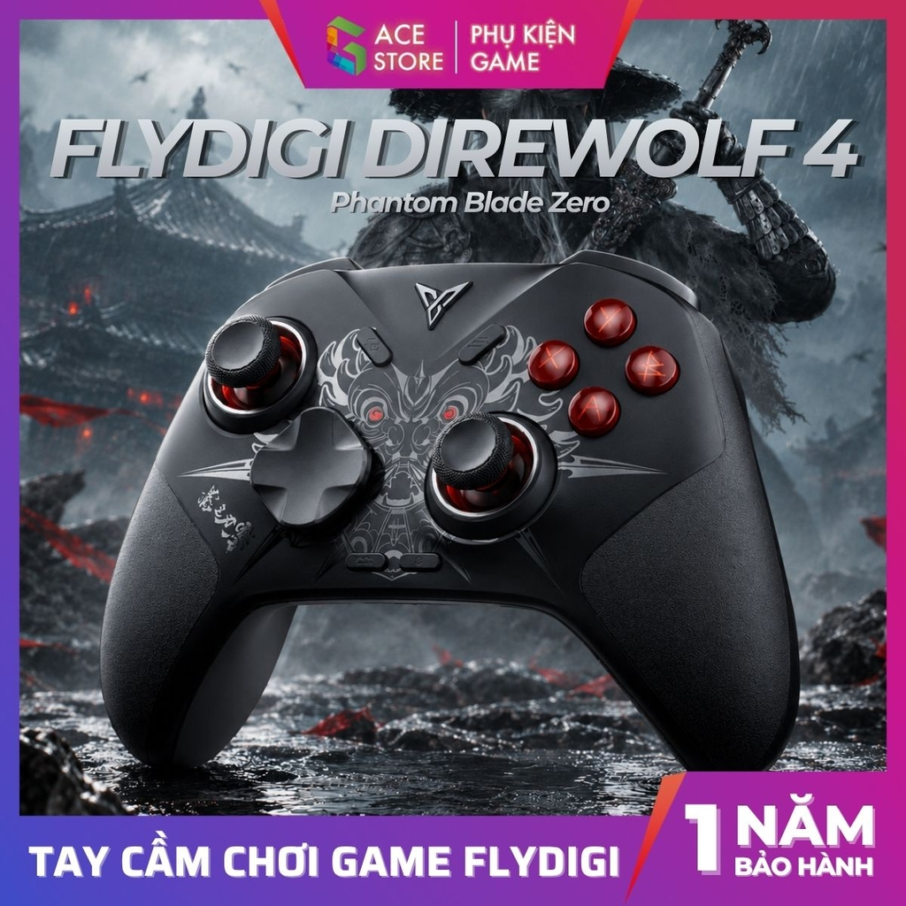
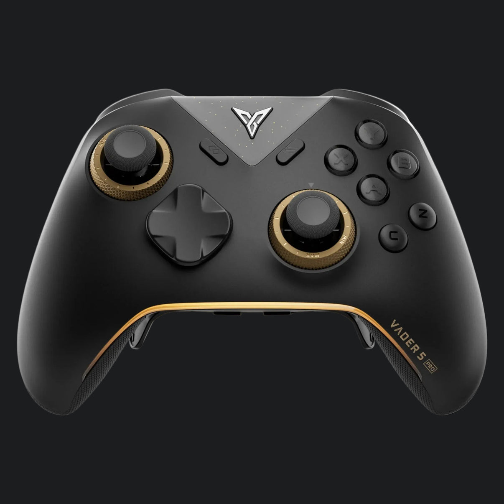
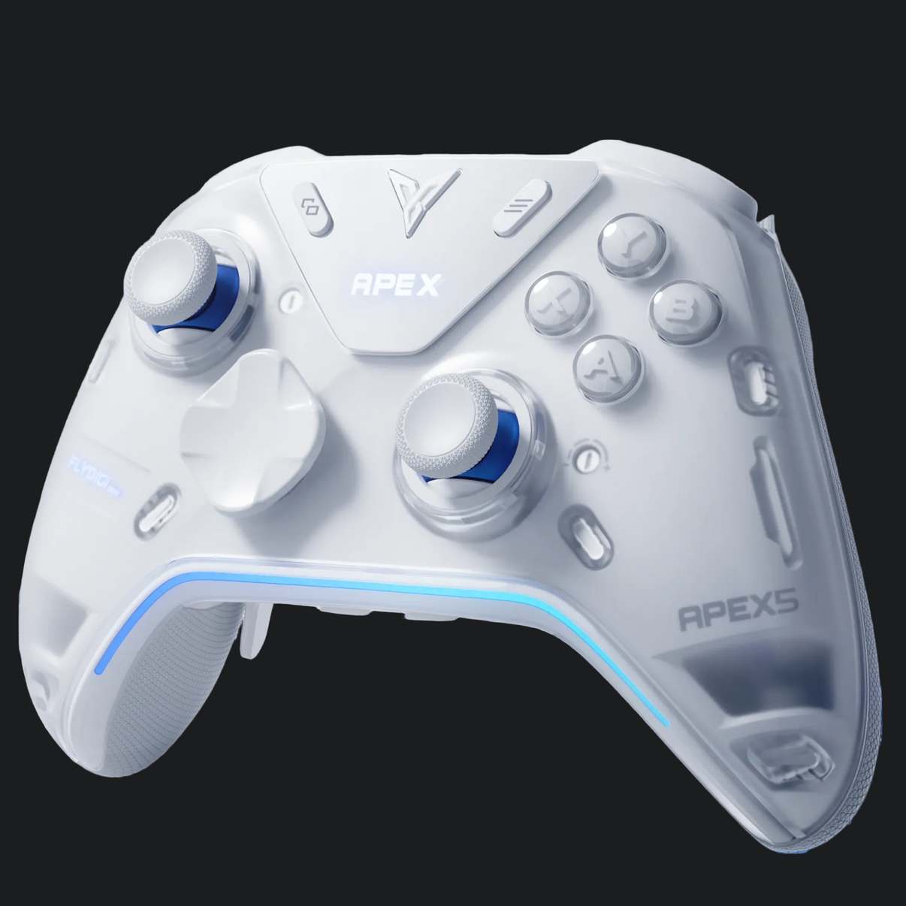

Nếu bạn đang tìm mua một chiếc tay cầm chơi game (gamepad) cho PC, Nintendo Switch hay Mobile ở thời điểm hiện tại, **Flydigi** gần như là cái tên không thể bỏ qua. Hãng này nổi tiếng với việc phổ cập công nghệ **Hall Effect** (chống trôi cần) xuống tận phân khúc bình dân, đồng thời liên tục đi đầu về công nghệ cần analog chỉnh lực và cò phản hồi lực ở phân khúc cao cấp.

Bài viết này sẽ đặt lên bàn cân **4 đại diện tiêu biểu trải dài từ thấp đến cao** của Flydigi:
1. **Flydigi Dune Fox** — Tân binh giá rẻ (~410k – 500k)
2. **Flydigi Direwolf 4** — "Ông vua tầm trung" (~700k – 800k)
3. **Flydigi Vader 5 Pro** — Vũ khí Try-hard / Esport (~1.45tr – 1.6tr)
4. **Flydigi Apex 5** — Flagship đỉnh cao nhất (~2.1tr – 2.2tr+ cho bản tiêu chuẩn)

---

## 1. Bảng So Sánh Thông Số Tổng Quan

| Tiêu chí | Dune Fox | Direwolf 4 | Vader 5 Pro | Apex 5 (Mới nhất) |
| :--- | :--- | :--- | :--- | :--- |
| **Phân khúc** | Giá rẻ (Entry-level) | Tầm trung (Mid-range) | Cận cao cấp (Pro) | Flagship (Cao cấp nhất) |
| **Giá tham khảo (VN)** | ~410.000đ – 500.000đ | ~700.000đ – 785.000đ | ~1.450.000đ – 1.590.000đ | ~2.090.000đ – 2.200.000đ |
| **Joystick** | Hall Effect | Hall Effect + **Chỉnh lực (40–80gf)** | **FORCEFLEX™ Hall Effect** (40–100gf) | **Hall Effect 2.0** (trục bi, chỉnh lực 30–100gf) |
| **Trigger (Cò)** | Hall Effect (Linear) | **2 chế độ** (Linear / Micro-switch) | **FORCESWITCH™ 2 chế độ** (Linear / Micro) | **Force-Feedback (FORCEADAPT™)** giả lập lực |
| **Phím ABXY** | Màng cao su (Membrane) | Màng cao su (êm, nảy) | **Phím cơ (Mecha-Tactile)** | **Mecha-Tactile 2.0** (~0.1ms) |
| **Nút phụ (Macro)** | Không | 2 nút lưng | **8 nút** (4 lưng + 2 vai + C/Z) | **6 nút** (4 lưng + 2 vai trên) |
| **Polling Rate** | ~500Hz (dây) / 350Hz (2.4G) | **1000Hz** | **1000Hz** (~3–4ms độ trễ) | **1000Hz+ (NearLink)** (~5.5ms) |
| **Rung & Gyro** | 2 motor, không Gyro | 2 motor + Gyro 6 trục | **4 motor rung** + Gyro 6 trục | Rung đa điểm + Gyro 6 trục |
| **Màn hình LCD** | Không | Không | Không | **Có (Màn hình màu 150 FPS)** |
| **Pin** | 600 mAh (10–15h) | 800 mAh | 1.000 mAh | 1.500 mAh (~20h) |
| **Kết nối** | 3 chế độ (Dây / 2.4G / BT) | 3 chế độ (Dây / 2.4G / BT) | 3 chế độ (Dây / 2.4G / BT) | 3 chế độ (Dây / 2.4G NearLink / BT) |

> [!NOTE]
> Cả 4 mẫu tay cầm đều hỗ trợ đa nền tảng: **PC (Windows), Nintendo Switch, Android, iOS** và tùy chỉnh sâu qua phần mềm **Flydigi Space Station**. Tuy nhiên, không mẫu nào hỗ trợ native cho PlayStation hay Xbox.

---

## 2. Đánh Giá Chi Tiết Từng Phân Khúc

### 2.1 Flydigi Dune Fox — "Phá Đảo" Phân Khúc Dưới 500k

**Dune Fox** là quân bài chiến lược của Flydigi nhằm đánh chiếm phân khúc giá rẻ vốn trước đây toàn các mẫu tay cầm trôi cần hoặc kết nối chập chờn.

- **Điểm sáng lớn nhất:** Với mức giá chỉ loanh quanh hơn 400 nghìn đồng, bạn vẫn có **Joystick Hall Effect và Trigger Hall Effect** chống trôi cần tuyệt đối, đi kèm **3 chế độ kết nối** (có sẵn USB Receiver 2.4GHz) và pin 600mAh dùng thoải mái 10–15 tiếng.
- **Cảm giác sử dụng:** Phím ABXY dùng màng cao su nhưng độ nảy tốt, êm tay, không bị lún hay nhão. Form cầm công thái học dễ làm quen, trọng lượng vừa phải.
- **Điểm đánh đổi:** Vỏ nhựa bề mặt hơi trơn nếu tay ra nhiều mồ hôi, không có nút macro phía sau, không có khóa cò (trigger lock) và cũng không có cảm biến con quay hồi chuyển (Gyro).

> [!TIP]
> **Phù hợp với:** Sinh viên, người mới chơi tay cầm lần đầu, chơi **FC Online (FIFA)**, game đi cảnh, coop giải trí nhẹ nhàng với ngân sách tiết kiệm.

---

### 2.2 Flydigi Direwolf 4 — "Kẻ Hủy Diệt" Tầm Trung

Nếu Dune Fox là bước khởi đầu, thì **Direwolf 4** là cú nhảy vọt về hiệu năng trên giá thành (P/P). Đây là dòng tay cầm mang hàng loạt công nghệ từng chỉ có trên phân khúc trên 1.5 triệu xuống tầm giá ~750k.

- **Nâng cấp đáng tiền:**
  - **Vòng chỉnh lực Joystick (40–80gf):** Tính năng cực hiếm ở tầm giá dưới 1 triệu, cho phép bạn vặn trực tiếp để chỉnh độ nặng/nhẹ của cần analog tùy theo game bắn súng hay đá bóng.
  - **Cò 2 chế độ (Switchable Trigger):** Gạt lẫy phía sau để chuyển giữa cò hành trình dài (đua xe) và cò bấm ngắn dạng Micro-switch (bắn súng FPS).
  - **Polling Rate 1000Hz:** Độ trễ thấp, phản hồi cực nhanh qua cả dây lẫn đầu thu 2.4GHz.
  - **Có 2 nút macro mặt lưng + Gyro 6 trục + Pin 800mAh.**
- **Điểm trừ nhỏ:** Vẫn dùng phím mặt ABXY dạng cao su (êm, ít ồn nhưng không có tiếng click giòn tan như phím cơ trên Vader/Apex).

> [!TIP]
> **Phù hợp với:** Đa số game thủ PC/Switch muốn một chiếc tay cầm **"ngon - bổ - đủ dùng"** để chơi từ AAA, Soulslike (Wukong, Elden Ring) đến FPS và FC Online mà không cần chi quá 1 triệu.

---

### 2.3 Flydigi Vader 5 Pro — Vũ Khí Tối Thượng Cho Dân Try-Hard

Bước lên dòng **Vader 5 Pro**, mọi thứ đều được thiết kế xoay quanh tốc độ, độ chính xác và khả năng tùy biến phím bấm cho game thủ nghiêm túc.

- **Điểm ăn tiền:**
  - **Hệ thống phím mở rộng "khủng":** Sở hữu tới **8 nút phụ** gồm 4 nút lưng, 2 nút vai phụ và cặp nút **C/Z** ở mặt trước — thiên đường cho game đối kháng, MOBA hoặc các tựa game nhiều tổ hợp phím.
  - **Cần FORCEFLEX™ & Phím cơ Mecha-Tactile:** Vòng chỉnh lực dải rộng hơn (**40–100gf**), độ trễ không dây siêu thấp (~3–4ms), kết hợp với bộ phím ABXY công tắc cơ học bấm cực kỳ giòn và nảy.
  - **4 Motor rung:** Hai motor ở tay cầm + hai motor rung riêng ở cụm cò, mang lại phản hồi rung lập thể rất đã tay khi bắn súng hay vào cua.
  - **Cò FORCESWITCH™ 2 chế độ** chuyển đổi mượt mà giữa Hall Effect và Micro-switch.
- **Điểm cần lưu ý:** Không có màn hình LCD và không có công nghệ cò phản hồi lực chủ động (Force Feedback) như dòng Apex.

> [!TIP]
> **Phù hợp với:** Game thủ **try-hard FPS, Action RPG tốc độ cao, Fighting game**, người thích cảm giác bấm phím cơ clicky và cần nhiều nút macro để gán combo.

---

### 2.4 Flydigi Apex 5 — Đỉnh Cao Công Nghệ Flagship

**Apex 5** là mẫu flagship mới nhất của Flydigi (ra mắt giữa năm 2025), sinh ra để khắc phục điểm yếu về độ trễ cần analog trên Apex 4 và nâng tầm trải nghiệm sang trọng lên mức tối đa.

- **Những công nghệ chỉ có trên Apex 5:**
  - **Cò phản hồi lực FORCEADAPT™ (Force-Feedback Triggers):** Thay vì chỉ dùng lẫy khóa cơ học, mô-tơ bên trong cò sẽ tự tạo lực cản thực tế — ví dụ như độ nặng khi kéo dây cung, độ giật nảy của cò súng, hay độ rung sần sùi khi phanh gấp trên đường đua (hỗ trợ hơn 60 tựa game AAA).
  - **Màn hình thông minh 150 FPS:** Màn hình màu sắc nét ngay trung tâm tay cầm, cho phép đổi profile, chỉnh rung/LED nhanh mà không cần mở app, đồng thời chèn ảnh GIF cá nhân hóa cực đẹp.
  - **Joystick Hall Effect 2.0 + Độ trễ chỉ ~5.5ms:** Sử dụng cấu trúc trục bi và cơ chế đòn bẩy giúp cần quay về tâm chuẩn xác tuyệt đối (bền tới 20 triệu lần gạt), khắc phục hoàn toàn độ trễ ~50ms từng bị phàn nàn trên thế hệ Apex 4.
  - **Công nghệ kết nối NearLink & Pin 1500mAh:** Sóng cực kỳ ổn định, chống nhiễu tốt hơn Bluetooth/2.4G thông thường và thời lượng pin lên tới ~20 giờ.
  - **6 nút phụ** (4 lẫy lưng có thể tháo lắp + 2 nút vai trên).

> [!TIP]
> **Phù hợp với:** Người chơi thích **trải nghiệm công nghệ cao cấp nhất**, mê game cốt truyện AAA cần độ nhập vai tối đa (Force Feedback), thích thiết kế hầm hố có màn hình hiển thị và không ngại đầu tư ngân sách trên 2 triệu đồng.

---

## 3. Tóm Lại: Bạn Nên Mua Chiếc Nào?

Việc chọn tay cầm Flydigi thực chất rất rõ ràng theo **ngân sách và gu chơi game**:

1. **Ngân sách ~400k – 500k → Chọn `Dune Fox`:** Không có đối thủ trong tầm giá về độ bền chống trôi cần và kết nối 3 mode.
2. **Ngân sách ~700k – 800k → Chọn `Direwolf 4`:** Lựa chọn **"Quốc dân"** đáng tiền nhất. Có 1000Hz, chỉnh lực cần, khóa cò 2 chế độ và Gyro — đủ cân mọi thể loại game.
3. **Ngân sách ~1.5 triệu → Chọn `Vader 5 Pro`:** Nếu bạn ưu tiên **phím cơ nảy, độ trễ thấp nhất và thật nhiều nút macro** (C/Z + 4 nút lưng) để cày rank hoặc đánh boss khó.
4. **Ngân sách từ 2 triệu trở lên → Chọn `Apex 5`:** Dành cho bạn nếu muốn **sự hoàn thiện cao cấp nhất**, màn hình màu độc đáo và trải nghiệm **cò phản hồi lực (Force Feedback)** tương tự DualSense của PS5 nhưng trên nền tảng PC.
