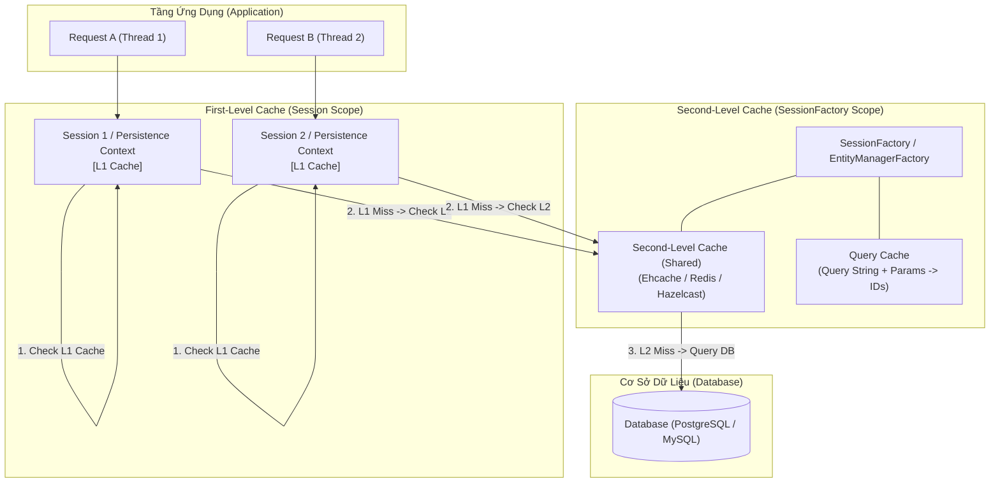
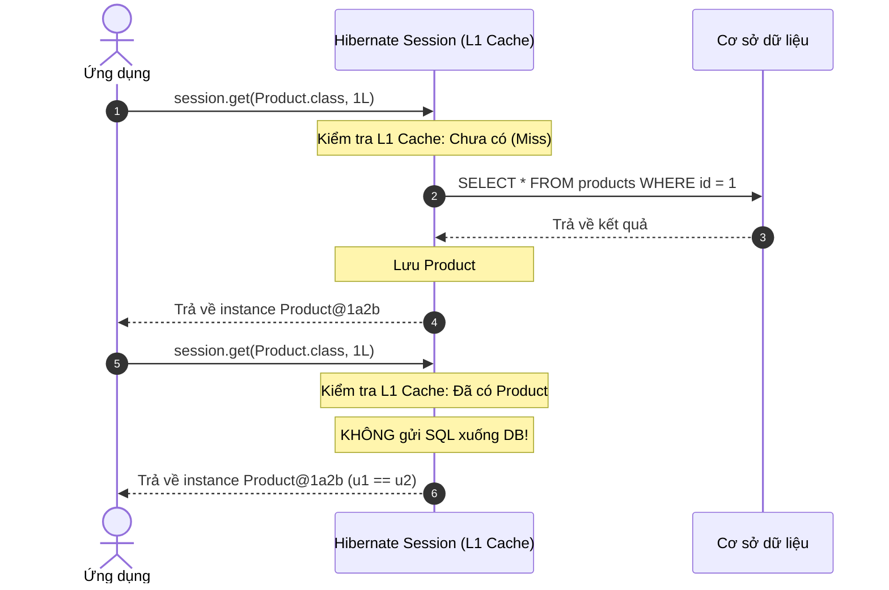
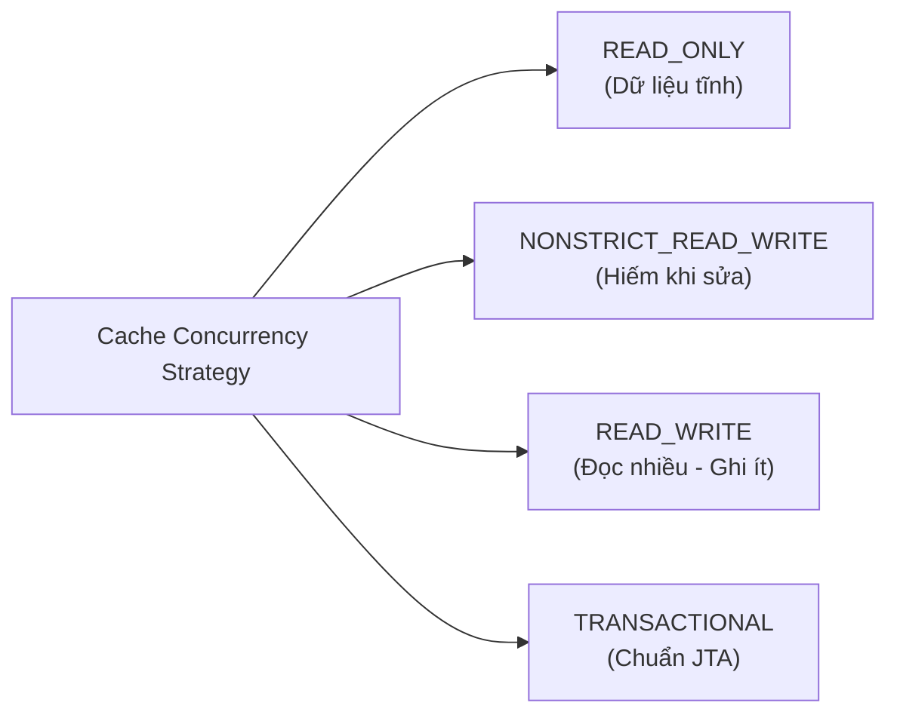
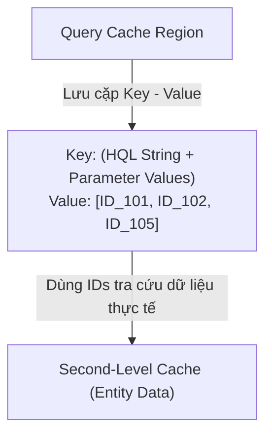

Trong các ứng dụng doanh nghiệp sử dụng **Hibernate ORM / JPA**, cơ sở dữ liệu quan hệ (RDBMS) luôn là nút thắt cổ chai (bottleneck) lớn nhất về hiệu năng (I/O Disk, Network latency, Connection Pool limits). Mỗi câu truy vấn `SELECT` gửi đến DB đều tiêu tốn tài nguyên đáng kể.

Để tối ưu hóa thông lượng (throughput) và giảm thiểu số lần truy vấn xuống đĩa cứng, Hibernate cung cấp một kiến trúc **Bộ nhớ đệm đa tầng (Multi-level Caching)** cực kỳ tinh vi:
1. **First-Level Cache (L1 Cache - Cache cấp 1)**
2. **Second-Level Cache (L2 Cache - Cache cấp 2)**
3. **Query Cache (Bộ nhớ đệm câu truy vấn)**

Bài viết này sẽ mổ xẻ toàn diện cơ chế hoạt động bên dưới, cách cấu hình thực chiến và những cạm bẫy chí mạng cần tránh khi triển khai Caching trong Hibernate.

---

## 1. Kiến Trúc Caching Đa Tầng Trong Hibernate



### Luồng xử lý khi truy xuất một thực thể theo ID (`session.get(Product.class, 100L)`):
1. **Kiểm tra L1 Cache:** Hibernate tìm kiếm thực thể trong `Session` hiện tại. Nếu có (Cache Hit) $\rightarrow$ trả về đối tượng ngay lập tức ($O(1)$, không tốn I/O).
2. **Kiểm tra L2 Cache (nếu được bật):** Nếu L1 Cache Miss, Hibernate chuyển tiếp truy vấn lên `SessionFactory` để tra cứu trong L2 Cache. Nếu tìm thấy $\rightarrow$ giải nén dữ liệu (*hydrate*), nạp vào L1 Cache của Session hiện tại và trả về.
3. **Truy vấn Cơ sở dữ liệu:** Nếu cả L1 và L2 đều Miss $\rightarrow$ Hibernate gửi câu lệnh `SELECT ... WHERE id = ?` xuống Database, nạp bản ghi vào L1 Cache, đưa vào L2 Cache (nếu cấu hình) rồi trả về cho ứng dụng.

---

## 2. First-Level Cache (Bộ Nhớ Đệm Cấp 1)

### 2.1 Bản chất & Vòng đời
- **Phạm vi (Scope):** Gắn liền với một đối tượng **`Session`** (hoặc `EntityManager` trong JPA) và sống trong **`Persistence Context`** của Session đó.
- **Tính mặc định:** **Luôn luôn được bật (Mandatory)** trong Hibernate, lập trình viên không thể tắt bỏ.
- **An toàn luồng (Thread-safety):** Vì mỗi `Session` được thiết kế để chỉ phục vụ một Transaction/Thread duy nhất, nên L1 Cache hoàn toàn an toàn luồng mà không cần cơ chế đồng bộ hóa khóa (locking overhead).

### 2.2 Mục đích cốt lõi
1. **Giảm thiểu các câu truy vấn dư thừa:** Nếu bạn gọi `session.get(User.class, 1L)` 10 lần liên tiếp trong cùng một transaction, Hibernate chỉ gửi đúng **1 câu lệnh SQL** duy nhất xuống DB; 9 lần sau lấy trực tiếp từ L1 Cache.
2. **Đảm bảo tính đồng nhất danh tính (Repeatable Read / Identity Map):** Đảm bảo rằng hai lần nạp cùng một bản ghi trong một Session sẽ trả về **cùng một tham chiếu đối tượng trong bộ nhớ Heap**:
   ```java
   User u1 = session.get(User.class, 1L);
   User u2 = session.get(User.class, 1L);

   // Kết quả luôn là TRUE (cùng địa chỉ vùng nhớ)
   System.out.println(u1 == u2); 
   ```
3. **Dirty Checking & Write-Behind:** Cho phép Hibernate theo dõi trạng thái đối tượng (Snapshot). Chỉ khi gọi `flush()` hoặc commit transaction, Hibernate mới so sánh đối tượng hiện tại với bản snapshot để tự động tạo câu lệnh `UPDATE` tương ứng.



### 2.3 Quản lý L1 Cache thủ công
Trong một số tình huống đặc thù, bạn cần chủ động điều khiển L1 Cache thông qua các phương thức của `Session`:

```java
// 1. Kiểm tra đối tượng có đang nằm trong L1 Cache không
boolean isCached = session.contains(product);

// 2. Trục xuất (Evict) một đối tượng cụ thể ra khỏi L1 Cache
// Đối tượng chuyển từ trạng thái Persistent sang Detached
session.evict(product);

// 3. Xóa sạch toàn bộ thực thể trong L1 Cache của Session hiện tại
session.clear();

// 4. Đồng bộ các thay đổi chưa lưu xuống DB ngay lập tức (không commit transaction)
session.flush();

// 5. Nạp lại dữ liệu mới nhất từ DB đè lên đối tượng trong L1 Cache
session.refresh(product);
```

### 2.4 Cạm bẫy kinh điển: OutOfMemoryError khi xử lý Batch
Khi thực hiện import hoặc cập nhật số lượng lớn bản ghi (ví dụ: $100,000$ đơn hàng), L1 Cache sẽ giữ toàn bộ các thực thể này trong bộ nhớ Heap cho đến khi đóng Session. Hậu quả là ứng dụng bị treo và ném ra ngoại lệ `java.lang.OutOfMemoryError: Java heap space`.

```java
// ❌ CÁCH LÀM SAI: Gây tràn bộ nhớ Heap
for (int i = 0; i < 100_000; i++) {
    Order order = new Order("ORD-" + i);
    session.persist(order); // L1 Cache phình to liên tục!
}
transaction.commit();
```

```java
// ✅ CÁCH GIẢI QUYẾT: Batch Processing kết hợp flush() và clear()
int BATCH_SIZE = 50;
for (int i = 0; i < 100_000; i++) {
    Order order = new Order("ORD-" + i);
    session.persist(order);

    if (i % BATCH_SIZE == 0 && i > 0) {
        // Đẩy toàn bộ câu lệnh INSERT tích lũy xuống DB
        session.flush();
        // Xóa sạch L1 Cache để giải phóng RAM cho Garbage Collector thu hồi
        session.clear();
    }
}
transaction.commit();
```

---

## 3. Second-Level Cache (Bộ Nhớ Đệm Cấp 2)

### 3.1 Bản chất & Vòng đời
- **Phạm vi (Scope):** Gắn liền với **`SessionFactory`** (hoặc `EntityManagerFactory`). Nó tồn tại xuyên suốt vòng đời của ứng dụng và được **chia sẻ cho tất cả các Session/Thread**.
- **Tính mặc định:** **Mặc định TẮT (Disabled)**. Cần cấu hình kích hoạt và tích hợp thư viện Cache Provider bên ngoài.
- **Cơ chế lưu trữ đặc biệt (Disassembled State):**  
  > [!IMPORTANT]
  > L2 Cache **không lưu trữ trực tiếp instance của Java Object**!  
  > Thay vào đó, nó lưu dữ liệu thực thể dưới dạng một mảng các giá trị thuộc tính thô (*hydrated state / disassembled array*) kết hợp cùng ID.  
  > Khi một Session khác yêu cầu entity, Hibernate lấy mảng dữ liệu này ra và tạo một đối tượng Java mới (*assembled*) trên Heap của Session đó. Do đó:
  > ```java
  > // Ở hai Session khác nhau:
  > Product p1 = session1.get(Product.class, 1L);
  > Product p2 = session2.get(Product.class, 1L);
  > System.out.println(p1 == p2);      // FALSE (hai đối tượng khác nhau trên Heap)
  > System.out.println(p1.equals(p2)); // TRUE (cùng dữ liệu ID)
  > ```

### 3.2 Các Thư Viện Cache Provider Phổ Biến

| Provider | Kiến trúc | Khi nào sử dụng? |
| :--- | :--- | :--- |
| **Ehcache (v3)** | In-Memory / Off-heap / Disk | Ứng dụng chạy trên **1 server đơn lẻ (Single JVM)**, tốc độ cực nhanh |
| **Redis (via Redisson)** | Distributed Cache (Server riêng) | Hệ thống **Microservices / Multi-node Cluster** cần chia sẻ cache đồng nhất |
| **Infinispan** | Distributed Peer-to-Peer Cluster | Hệ sinh thái JBoss / Quarkus / WildFly doanh nghiệp |
| **Hazelcast** | In-Memory Data Grid (IMDG) | Ứng dụng phân tán yêu cầu tính toán song song trong bộ nhớ |

---

### 3.3 Bốn Chiến Lược Đồng Thời (Cache Concurrency Strategies)

Khi cấu hình L2 Cache cho một Entity, bạn phải chỉ định chiến lược quản lý tranh chấp đồng thời (`@Cache(usage = ...)`):



#### 1. `READ_ONLY`
- **Đặc điểm:** Dành riêng cho dữ liệu không bao giờ thay đổi sau khi được tạo.
- **Cơ chế:** Nhanh nhất, không tốn chi phí khóa (lock). Nếu cố tình gọi `update()`, Hibernate sẽ ném ngoại lệ `UnsupportedOperationException`.
- **Ứng dụng:** Bảng mã quốc gia (`Country`), loại tiền tệ (`Currency`), quyền hệ thống (`Permission`).

#### 2. `NONSTRICT_READ_WRITE`
- **Đặc điểm:** Dành cho dữ liệu rất hiếm khi được cập nhật và hệ thống chấp nhận khả năng xảy ra dữ liệu cũ tạm thời (*stale data*).
- **Cơ chế:** Khi có giao dịch cập nhật DB, cache sẽ bị xóa sau khi transaction commit (không dùng lock). Nếu có 2 transaction đồng thời, có thể xảy ra race condition.

#### 3. `READ_WRITE` (Phổ biến nhất)
- **Đặc điểm:** Dành cho dữ liệu đọc nhiều, thỉnh thoảng có ghi (*Read-heavy, Write-rare*).
- **Cơ chế:** Sử dụng cơ chế **Soft-Lock**. Khi một Transaction bắt đầu cập nhật bản ghi, nó đặt một soft lock lên cache entry. Các transaction khác đọc lúc này sẽ buộc phải query trực tiếp DB thay vì lấy cache cũ cho đến khi transaction cập nhật commit thành công.

#### 4. `TRANSACTIONAL`
- **Đặc điểm:** Cung cấp mức độ cô lập giao dịch cao nhất, hỗ trợ chuẩn phân tán **JTA (Java Transaction API)**.
- **Yêu cầu:** Chỉ hoạt động với các cache provider đặc thù hỗ trợ XA transactions (như Infinispan hoặc Hazelcast).

---

## 4. Query Cache (Bộ Nhớ Đệm Câu Truy Vấn)

Nhiều lập trình viên lầm tưởng L2 Cache tự động cache kết quả của các câu lệnh HQL/JPQL như:
```java
List<Product> products = session.createQuery("FROM Product WHERE category = :cat", Product.class)
    .setParameter("cat", "Electronics")
    .getResultList();
```
👉 **Thực tế:** L2 Cache **chỉ hoạt động với các thao tác truy xuất theo ID** (`get`, `find`, hoặc `load`). Để cache kết quả của câu lệnh truy vấn phức tạp, bạn bắt buộc phải bật thêm **Query Cache**.



> [!CAUTION]
> **Cạm bẫy N+1 Truy Vấn với Query Cache:**
> Query Cache **chỉ lưu danh sách các ID kết quả**, KHÔNG lưu dữ liệu thuộc tính của Entity!  
> 1. Khi truy vấn được gọi lần 2, Hibernate lấy ra danh sách `[ID_1, ID_2, ..., ID_N]` từ Query Cache.  
> 2. Sau đó, nó duyệt từng ID để tìm dữ liệu trong L2 Cache.  
> 3. **Nếu bạn không bật L2 Cache cho chính Entity đó:** Hibernate sẽ buộc phải phát sinh $N$ câu lệnh `SELECT ... WHERE id = ?` xuống DB để lấy dữ liệu cho từng ID! Đây chính là thảm họa hiệu năng N+1!

---

## 5. Bảng So Sánh Toàn Diện: L1 Cache vs L2 Cache

| Tiêu chí | First-Level Cache (L1) | Second-Level Cache (L2) |
| :--- | :--- | :--- |
| **Phạm vi (Scope)** | `Session` / `EntityManager` đơn lẻ | `SessionFactory` / Toàn bộ ứng dụng / Cluster |
| **Vòng đời** | Sống và chết cùng `Session` (ngắn hạn) | Sống cùng `SessionFactory` (dài hạn) |
| **Trạng thái mặc định** | Luôn luôn **BẬT** (Bắt buộc) | Mặc định **TẮT** (Tùy chọn) |
| **Vị trí lưu trữ** | Bộ nhớ Heap của JVM trong Session | Heap / Off-heap / Disk / Remote Server (Redis) |
| **Tính an toàn luồng** | An toàn tuyệt đối (mỗi thread 1 session) | Phải xử lý đa luồng (Khóa, Cache Concurrency) |
| **Dữ liệu lưu trữ** | Thực thể Java sống nguyên bản (`Entity instance`) | Mảng dữ liệu thô đã giải nén (`Disassembled state`) |
| **Cùng ID ở 2 lần gọi** | `e1 == e2` luôn trả về `true` | `e1 == e2` trả về `false` (nếu ở 2 Session khác nhau) |
| **Nhà cung cấp** | Tích hợp sẵn trong core Hibernate | Cần bên thứ 3 (Ehcache, Redisson, Hazelcast) |

---

## 6. Hướng Dẫn Cấu Hình Thực Chiến (Spring Boot & Hibernate)

### 6.1 Cấu hình Maven / Gradle Dependencies
Khai báo tích hợp Hibernate JCache và Ehcache:

```xml
<!-- Hibernate JCache Integration -->
<dependency>
    <groupId>org.hibernate.orm</groupId>
    <artifactId>hibernate-jcache</artifactId>
</dependency>

<!-- Ehcache 3 Implementation -->
<dependency>
    <groupId>org.ehcache</groupId>
    <artifactId>ehcache</artifactId>
    <classifier>jakarta</classifier>
</dependency>
```

### 6.2 Cấu hình trong `application.yml`
```yaml
spring:
  jpa:
    properties:
      hibernate:
        # 1. Kích hoạt Second-Level Cache
        cache:
          use_second_level_cache: true
          # 2. Kích hoạt Query Cache
          use_query_cache: true
          # 3. Khai báo Cache Region Factory chuẩn JCache (JSR-107)
          region:
            factory_class: org.hibernate.cache.jcache.JCacheRegionFactory
        # 4. Đường dẫn file cấu hình Ehcache
        javax:
          persistence:
            sharedCache:
              mode: ENABLE_SELECTIVE # Chỉ cache các entity có gắn annotation
```

### 6.3 Đánh dấu Entity & Collection cần Cache

```java
import jakarta.persistence.*;
import org.hibernate.annotations.Cache;
import org.hibernate.annotations.CacheConcurrencyStrategy;
import java.util.ArrayList;
import java.util.List;

@Entity
@Table(name = "categories")
@Cacheable // Annotation chuẩn của JPA
@Cache(usage = CacheConcurrencyStrategy.READ_WRITE, region = "categoryCache")
public class Category {

    @Id
    @GeneratedValue(strategy = GenerationType.IDENTITY)
    private Long id;

    @Column(nullable = false, unique = true)
    private String name;

    // Cache cả tập hợp con (Collection Cache)
    @OneToMany(mappedBy = "category", cascade = CascadeType.ALL)
    @Cache(usage = CacheConcurrencyStrategy.READ_WRITE, region = "categoryProductsCache")
    private List<Product> products = new ArrayList<>();

    // Constructors, Getters, Setters...
}
```

### 6.4 Kích hoạt Caching trên Query
```java
// Khi dùng Spring Data JPA
public interface ProductRepository extends JpaRepository<Product, Long> {

    @QueryHints(@QueryHint(name = "org.hibernate.cacheable", value = "true"))
    List<Product> findByCategoryName(String categoryName);
}
```

---

## 7. Các Cạm Bẫy Thực Chiến Chí Mạng (Gotchas)

### 1. Thực hiện Bulk UPDATE / DELETE làm sai lệch Cache
Khi bạn sử dụng câu lệnh JPQL/HQL dạng hàng loạt:
```java
session.createQuery("UPDATE Product SET price = price * 1.1 WHERE category = 'Books'").executeUpdate();
```
> [!WARNING]
> Câu lệnh trên thực thi **trực tiếp xuống cơ sở dữ liệu** mà hoàn toàn bỏ qua Persistence Context!  
> Kết quả: Các thực thể đang nằm trong L1 Cache và L2 Cache **không hề biết dữ liệu đã bị sửa**, dẫn đến hiện tượng đọc phải dữ liệu rác cũ (*Stale Data*).  
> **Khắc phục:** Luôn gọi `session.clear()` hoặc quản lý việc trục xuất region tương ứng sau các thao tác bulk modification.

### 2. Lạm dụng L2 Cache cho các bảng Ghi Nhiều (Write-heavy)
Nếu một bảng có tần suất `UPDATE`/`INSERT` liên tục (ví dụ: bảng log, bảng tọa độ GPS, lịch sử giao dịch chứng khoán), việc đặt L2 Cache sẽ phản tác dụng:
- Mỗi lần ghi, Hibernate phải hủy bỏ (*evict/invalidate*) cache entry trên toàn cluster.
- Chi phí đồng bộ hóa khóa, serialize/deserialize dữ liệu lớn hơn nhiều so với việc truy vấn trực tiếp DB.
- **Quy tắc vàng:** Chỉ đặt L2 Cache cho các bảng có tỷ lệ **Đọc / Ghi $\ge$ 80 / 20**.

---

## 8. Câu Hỏi Phỏng Vấn Chuyên Sâu Về Hibernate Cache

### Q1: Có thể tắt bỏ First-Level Cache trong Hibernate không?
- **Trả lời:** **Không thể.** First-Level Cache gắn chặt với cơ chế Persistence Context, đóng vai trò đảm bảo toàn vẹn giao dịch, Dirty Checking và ngăn ngừa vòng lặp tham chiếu tuần hoàn khi nạp đồ thị đối tượng. Nếu không có L1 Cache, Hibernate không thể hoạt động.

### Q2: Điều gì xảy ra nếu hai Session cùng đọc một bản ghi từ L2 Cache?
- **Trả lời:** Cả hai Session đều nhận được dữ liệu từ L2 Cache. Tuy nhiên, Hibernate sẽ lấy dữ liệu thô (*disassembled array*) để dựng thành **hai đối tượng Java độc lập** trên Heap của từng Session. Do đó `s1_entity != s2_entity`, bảo đảm tính cô lập của mỗi transaction.

### Q3: Phân biệt `@Cacheable` của Spring Framework và `@Cacheable` của JPA?
- **Spring `@Cacheable` (org.springframework.cache.annotation):** Hoạt động ở tầng Service/Method bằng AOP Proxy, cache lại giá trị trả về của một hàm bất kỳ (dùng cho Redis, Caffeine...).
- **JPA `@Cacheable` (jakarta.persistence.Cacheable):** Hoạt động ở tầng Entity ORM, thông báo cho Hibernate biết thực thể này đủ điều kiện để lưu trữ trong Second-Level Cache.

---

## 9. Tài Liệu Tham Khảo

> [!TIP]
> - 📖 **Tài liệu chính thức:** [Hibernate ORM User Guide - Caching](https://docs.jboss.org/hibernate/orm/current/userguide/html_single/Hibernate_User_Guide.html#caching)
> - 📘 **Sách nâng cao:** *High-Performance Java Persistence (Vlad Mihalcea)*.
> - 🔗 **Bài viết liên quan:** Đọc lại [Hibernate ORM & JPA Overview](/posts/hibernate/overview) để nắm vững chu trình vòng đời Entity.

