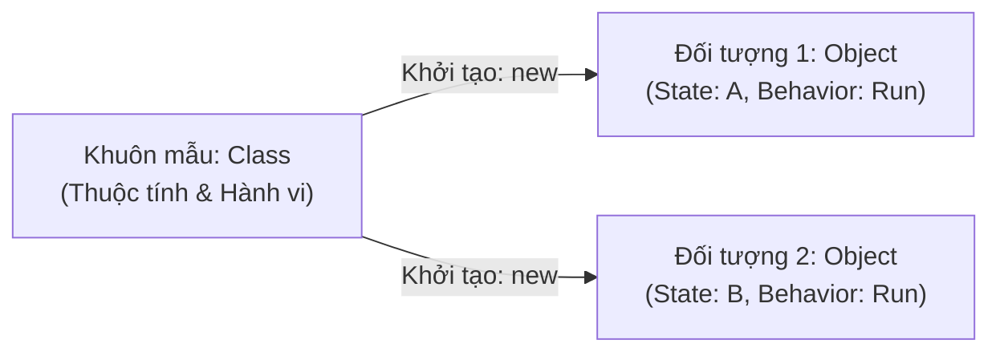
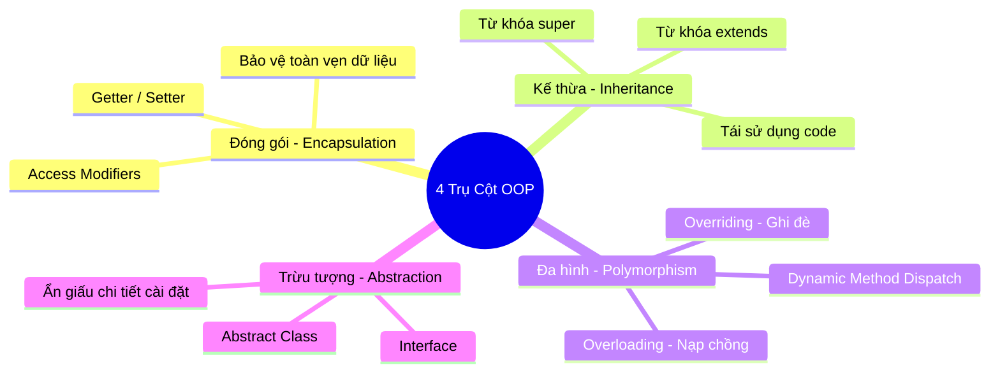
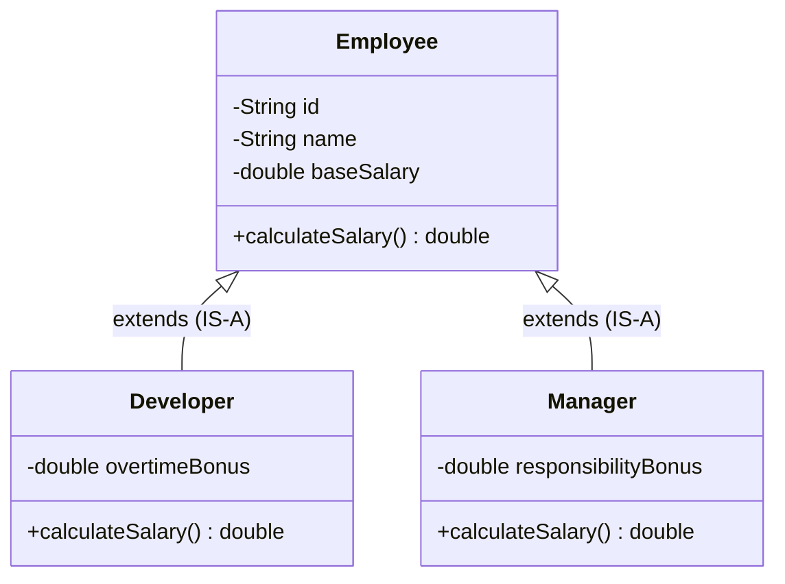
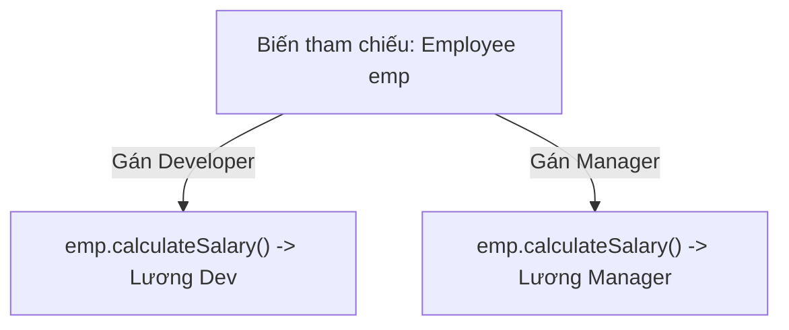
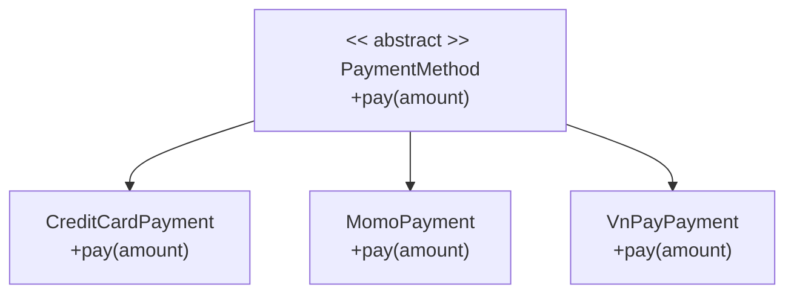
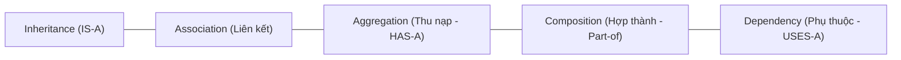
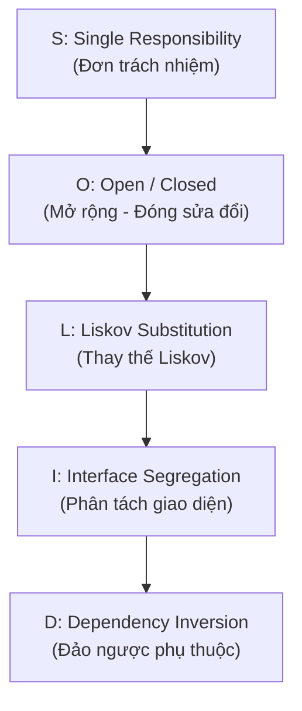
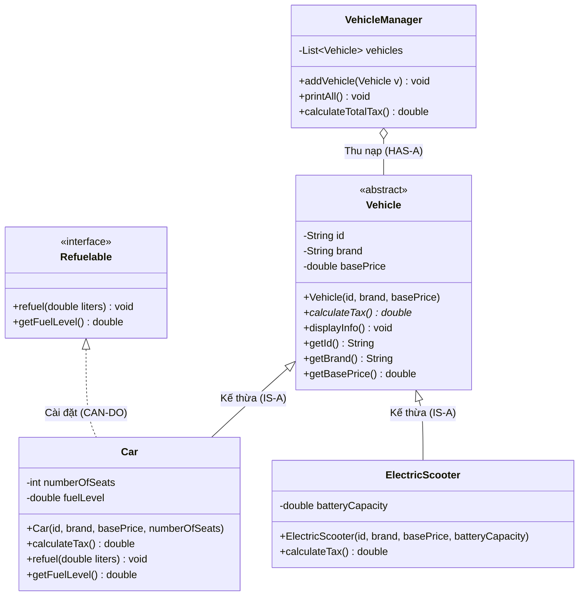

Lập trình hướng đối tượng (**Object-Oriented Programming - OOP**) là phương pháp luận lập trình cốt lõi định hình nên toàn bộ hệ sinh thái Java. Khác với tư duy thủ tục (procedural programming) chia nhỏ chương trình thành các hàm và thủ tục, OOP mô hình hóa thế giới thực thành các **đối tượng (Objects)** chứa đựng cả **dữ liệu (trạng thái)** và **hành vi (phương thức)**.

Bài viết này cung cấp khung kiến trúc và hệ thống đề mục chuẩn chỉnh về OOP trong Java từ lý thuyết nền tảng đến các nguyên lý thiết kế nâng cao, phục vụ cho quá trình học tập và ôn luyện phỏng vấn kỹ thuật.

---

## 1. Tổng Quan: Lớp (Class) & Đối Tượng (Object)



### 1.1 Khái niệm cơ bản

- **Lớp (Class):** Là một bản thiết kế (blueprint) hoặc khuôn mẫu định nghĩa các thuộc tính (dữ liệu) và phương thức (hành vi) chung cho một nhóm đối tượng cùng loại. Bản thân Class không chiếm không gian bộ nhớ Heap trong thời gian chạy cho đến khi được nạp vào bộ nhớ (Method Area/Metaspace).
- **Đối tượng (Object):** Là một thực thể cụ thể (instance) được khởi tạo từ Class thông qua từ khóa `new`. Mỗi đối tượng có không gian bộ nhớ riêng trên **Heap** để lưu trữ giá trị các thuộc tính (trạng thái), trong khi biến tham chiếu (reference variable) lưu địa chỉ đối tượng được giữ trên vùng nhớ **Stack**.

### 1.2 Cấu trúc của một Class trong Java

Một lớp hoàn chỉnh trong Java thông thường bao gồm 4 thành phần nòng cốt:
1. **Thuộc tính (Fields / State):**
   - *Instance Variables:* Biến trạng thái riêng biệt của từng đối tượng, tồn tại cùng vòng đời đối tượng trên Heap.
   - *Static Variables (Class Variables):** Biến dùng chung cho toàn bộ các thực thể của Class, chỉ có duy nhất một bản sao trong bộ nhớ.
2. **Phương thức (Methods / Behavior):** Định nghĩa các thao tác, tính toán và xử lý nghiệp vụ trên trạng thái của đối tượng.
3. **Hàm khởi tạo (Constructor):** Phương thức đặc biệt cùng tên với Class, không có kiểu trả về (kể cả `void`), được JVM tự động gọi khi cấp phát đối tượng:
   - *Default Constructor:* Trình biên dịch tự động sinh ra constructor không tham số nếu trong class chưa khai báo bất kỳ constructor nào.
   - *Parameterized Constructor:* Constructor nhận tham số đầu vào để gán trạng thái ban đầu cho đối tượng.
   - *Constructor Overloading:* Khai báo nhiều constructor với danh sách tham số khác nhau để linh hoạt khởi tạo.
4. **Từ khóa `this`:**
   - Dùng để tham chiếu đến chính đối tượng hiện tại (giải quyết xung đột tên biến giữa tham số hàm và thuộc tính: `this.name = name`).
   - Dùng để gọi constructor khác trong cùng một class: `this(...)` (bắt buộc phải là dòng lệnh đầu tiên trong thân constructor).

```java
public class Student {
    // 1. Fields (Thuộc tính đóng gói)
    private String id;
    private String fullName;
    private double gpa;

    // Biến tĩnh dùng chung (Static field)
    private static int totalStudents = 0;

    // 2. Constructors (Nạp chồng Constructor)
    public Student() {
        this("N/A", "Chưa xác định", 0.0);
    }

    public Student(String id, String fullName, double gpa) {
        this.id = id;
        this.fullName = fullName;
        setGpa(gpa);
        totalStudents++;
    }

    // 3. Methods (Hành vi & Nghiệp vụ)
    public void displayInfo() {
        System.out.printf("[%s] %-20s | GPA: %.2f | Xếp loại: %s\n",
                id, fullName, gpa, getAcademicRank());
    }

    public String getAcademicRank() {
        if (gpa >= 3.6) return "Xuất sắc";
        if (gpa >= 3.2) return "Giỏi";
        if (gpa >= 2.5) return "Khá";
        return "Trung bình / Yếu";
    }

    // 4. Getters & Setters có validation
    public String getId() { return id; }
    public void setId(String id) { this.id = id; }

    public String getFullName() { return fullName; }
    public void setFullName(String fullName) { this.fullName = fullName; }

    public double getGpa() { return gpa; }
    public void setGpa(double gpa) {
        if (gpa < 0.0 || gpa > 4.0) {
            throw new IllegalArgumentException("Điểm GPA phải nằm trong khoảng từ 0.0 đến 4.0");
        }
        this.gpa = gpa;
    }

    public static int getTotalStudents() {
        return totalStudents;
    }
}
```

---

## 2. Bốn Trụ Cột Cốt Lõi Của OOP (The 4 Pillars)



---

### 2.1 Tính Đóng Gói (Encapsulation)

**Tính đóng gói** là kỹ thuật che giấu thông tin trạng thái nội bộ của đối tượng (Data Hiding) và chỉ cho phép truy xuất hoặc biến đổi thông qua các phương thức công khai được kiểm soát chặt chẽ.

> [!IMPORTANT]
> **Ý nghĩa thực tiễn trong thiết kế:**
> - **Bảo vệ tính toàn vẹn dữ liệu:** Ngăn chặn các tác động tùy tiện từ bên ngoài làm sai lệch logic nghiệp vụ (ví dụ: số dư tài khoản không được âm, tuổi người dùng không thể dưới 0).
> - **Tăng tính linh hoạt & bảo trì:** Cho phép thay đổi kiến trúc lưu trữ nội bộ (internal implementation) mà không làm ảnh hưởng đến mã nguồn của các lớp phụ thuộc bên ngoài.
> - **Kiểm soát quyền truy cập:** Dễ dàng tạo các trường chỉ đọc (Read-only - chỉ có Getter) hoặc chỉ ghi (Write-only - chỉ có Setter).

#### Bảng phạm vi truy cập (Access Modifiers)

| Modifier | Cùng Class | Cùng Package | Lớp con (Khác Package) | Toàn dự án (World) |
| :--- | :---: | :---: | :---: | :---: |
| `private` | ✅ | ❌ | ❌ | ❌ |
| `default` (no modifier) | ✅ | ✅ | ❌ | ❌ |
| `protected` | ✅ | ✅ | ✅ | ❌ |
| `public` | ✅ | ✅ | ✅ | ✅ |

#### Ví dụ minh họa tính đóng gói chuẩn mực:
```java
public class BankAccount {
    // 1. Dữ liệu nhạy cảm được bảo vệ bằng private
    private final String accountNumber;
    private double balance;

    public BankAccount(String accountNumber, double initialBalance) {
        if (accountNumber == null || accountNumber.trim().isEmpty()) {
            throw new IllegalArgumentException("Số tài khoản không được rỗng");
        }
        this.accountNumber = accountNumber;
        setBalance(initialBalance);
    }

    // 2. Kiểm soát nghiệp vụ nạp tiền qua phương thức nghiệp vụ
    public void deposit(double amount) {
        if (amount <= 0) {
            throw new IllegalArgumentException("Số tiền nạp phải lớn hơn 0");
        }
        this.balance += amount;
    }

    // 3. Nghiệp vụ rút tiền có kiểm tra tính khả dụng của số dư
    public void withdraw(double amount) {
        if (amount <= 0) {
            throw new IllegalArgumentException("Số tiền rút phải lớn hơn 0");
        }
        if (amount > this.balance) {
            throw new IllegalStateException("Số dư không đủ để thực hiện giao dịch");
        }
        this.balance -= amount;
    }

    // 4. Getter chỉ cho phép đọc dữ liệu
    public String getAccountNumber() {
        return this.accountNumber;
    }

    public double getBalance() {
        return this.balance;
    }

    // 5. Setter nội bộ để tái sử dụng kiểm tra ràng buộc
    private void setBalance(double balance) {
        if (balance < 0) {
            throw new IllegalArgumentException("Số dư ban đầu không thể âm");
        }
        this.balance = balance;
    }
}
```

---

### 2.2 Tính Kế Thừa (Inheritance)

**Tính kế thừa** cho phép một lớp mới (Lớp con - Subclass / Derived Class) tái sử dụng các thuộc tính và phương thức từ một lớp đã có (Lớp cha - Superclass / Base Class). Kế thừa biểu diễn mối quan hệ **IS-A** ("Là một").

> [!NOTE]
> **Đặc trưng kế thừa trong Java:**
> - **Đơn kế thừa (Single Inheritance):** Một lớp trong Java chỉ được phép kế thừa trực tiếp từ đúng **một** lớp cha duy nhất (`extends MộtLớp`) để tránh xung đột Diamond Problem.
> - **Cơ chế Constructor Chaining:** Khi một đối tượng lớp con được khởi tạo, Constructor của lớp cha luôn luôn được thực thi trước. Nếu lớp con không khai báo `super(...)` một cách tường minh, trình biên dịch sẽ tự động chèn `super()` không tham số lên đầu constructor con.
> - **Từ khóa `super`:** Dùng để gọi constructor của cha (`super(args...)`) hoặc truy cập phương thức/thuộc tính của cha bị che khuất (`super.method()`).
> - **Lớp `final`:** Lớp được đánh dấu `final` sẽ bị cấm kế thừa (ví dụ: `java.lang.String`, `java.lang.Math`).



#### Code minh họa kế thừa & Constructor Chaining:
```java
// Lớp cha (Superclass)
public class Employee {
    protected String id;
    protected String name;
    protected double baseSalary;

    public Employee(String id, String name, double baseSalary) {
        this.id = id;
        this.name = name;
        this.baseSalary = baseSalary;
    }

    public double calculateSalary() {
        return baseSalary;
    }
}

// Lớp con (Subclass) kế thừa từ Employee
public class Developer extends Employee {
    private double overtimeBonus;

    public Developer(String id, String name, double baseSalary, double overtimeBonus) {
        super(id, name, baseSalary); // Bắt buộc ở dòng đầu tiên
        this.overtimeBonus = overtimeBonus;
    }

    // Tái sử dụng logic cha và cộng thêm tiền thưởng làm ngoài giờ
    @Override
    public double calculateSalary() {
        return super.calculateSalary() + overtimeBonus;
    }
}
```

---

### 2.3 Tính Đa Hình (Polymorphism)

**Tính đa hình** (Polymorphism - nghĩa đen là "nhiều hình thái") là khả năng mà cùng một thông điệp (lời gọi phương thức) có thể phản hồi theo nhiều hành vi khác nhau tùy thuộc vào đối tượng cụ thể tiếp nhận nó tại thời điểm thực thi.



#### 1. Đa hình lúc biên dịch (Compile-time Polymorphism - Static Binding)
Đạt được thông qua **Method Overloading (Nạp chồng phương thức)**. Trình biên dịch sẽ xác định chính xác phương thức cần gọi dựa trên danh sách tham số (số lượng, thứ tự và kiểu dữ liệu) ngay lúc dịch mã:
- Tên phương thức phải giống nhau.
- Danh sách tham số phải khác nhau.
- *Lưu ý:* Kiểu trả về **không** được dùng làm căn cứ để nạp chồng phương thức.

#### 2. Đa hình lúc chạy (Runtime Polymorphism - Dynamic Binding)
Đạt được thông qua **Method Overriding (Ghi đè phương thức)** kết hợp cơ chế **Dynamic Method Dispatch** của JVM:
- Lớp con cung cấp cài đặt riêng cho phương thức đã có ở lớp cha.
- Khi gọi phương thức qua biến tham chiếu của lớp cha trỏ tới đối tượng con (`Employee emp = new Developer(...)`), JVM sẽ tra bảng ảo (vtable) tại runtime để thực thi phương thức của lớp thực tế (`Developer`).

#### Quy tắc bắt buộc khi Ghi đè phương thức (`@Override`):
1. **Signature:** Tên phương thức và danh sách tham số phải giống hệt lớp cha.
2. **Kiểu trả về (Covariant Return Type):** Phải giống hệt hoặc là lớp con của kiểu trả về ở lớp cha.
3. **Phạm vi truy cập (Access Modifier):** Không được hẹp hơn lớp cha (VD: cha là `protected` thì con phải là `protected` hoặc `public`).
4. **Ngoại lệ (Exceptions):** Không được ném ra Checked Exception mới hoặc bao quát hơn ngoại lệ của lớp cha.
5. **Không thể ghi đè:** Các phương thức `private`, `static` hoặc `final`.

#### Bảng so sánh Overloading vs Overriding

| Đặc điểm | Nạp chồng (Overloading) | Ghi đè (Overriding) |
| :--- | :--- | :--- |
| **Thời điểm (Binding)** | Compile-time (Static binding) | Runtime (Dynamic binding) |
| **Vị trí** | Trong cùng một class (hoặc kế thừa) | Giữa lớp cha và lớp con |
| **Tên phương thức** | Bắt buộc giống nhau | Bắt buộc giống nhau |
| **Tham số (Signature)** | Phải khác nhau (số lượng hoặc kiểu dữ liệu) | Bắt buộc giống hệt |
| **Kiểu trả về** | Có thể tùy biến | Phải giống hoặc kiểu con (covariant) |
| **Từ khóa chú thích** | Không bắt buộc | Khuyến nghị dùng `@Override` |

#### Minh họa Runtime Polymorphism trong danh sách quản lý:
```java
import java.util.List;

public class PayrollService {
    public static void printAllSalaries(List<Employee> employees) {
        for (Employee emp : employees) {
            // JVM tự động dispatch đến calculateSalary của Developer hoặc Manager tương ứng
            System.out.printf("Nhân viên: %-15s - Lương: %,.0f VNĐ\n", emp.name, emp.calculateSalary());
        }
    }
}
```

---

### 2.4 Tính Trừu Tượng (Abstraction)

**Tính trừu tượng** là quá trình tập trung vào các đặc tính cốt lõi của đối tượng (đối tượng làm được việc gì - **WHAT**) và ẩn đi các chi tiết cài đặt phức tạp, chi tiết thuật toán bên trong (đối tượng làm việc đó như thế nào - **HOW**).

> [!NOTE]
> **Hai công cụ xây dựng tính trừu tượng trong Java:**
> 1. **Lớp trừu tượng (Abstract Class):** Đạt được mức độ trừu tượng một phần (0% - 100%). Chứa ít nhất một hoặc nhiều phương thức trừu tượng (`abstract method`), không thể khởi tạo đối tượng trực tiếp bằng `new`.
> 2. **Giao diện (Interface):** Cung cấp mức độ trừu tượng hóa toàn diện (100% contract hành vi). Mọi lớp cài đặt interface đều cam kết thực hiện đúng các hành vi đã quy định.



---

## 3. So Sánh Chuyên Sâu: Abstract Class vs Interface


| Tiêu chí | Lớp trừu tượng (Abstract Class) | Giao diện (Interface) |
| :--- | :--- | :--- |
| **Mục đích thiết kế** | Định nghĩa bản chất danh tính chung (**IS-A**) | Định nghĩa hợp đồng năng lực/hành vi (**CAN-DO**) |
| **Đa kế thừa** | Đơn kế thừa (`extends` đúng 1 class) | Đa kế thừa (`implements` nhiều interface) |
| **Biến (Variables)** | Chứa mọi loại biến: instance, static, final, non-final | Chỉ chấp nhận hằng số: ngầm định `public static final` |
| **Phương thức** | Tự do khai báo abstract, concrete, static, final | Chủ yếu là abstract; Java 8+ thêm `default`, `static`; Java 9+ thêm `private` |
| **Hàm khởi tạo (Constructor)**| Có constructor (dùng cho lớp con gọi qua `super`) | Tuyệt đối **không** có constructor |
| **Tốc độ thực thi** | Nhanh hơn (tìm kiếm bảng phương thức trực tiếp) | Chậm hơn đôi chút do cơ chế dynamic lookup đa kế thừa |
| **Nguyên tắc lựa chọn** | Dùng khi các lớp có họ hàng thân thiết, cần chia sẻ trạng thái | Dùng khi cần tích hợp hành vi cho các lớp không có họ hàng |

---
Trong thực tế phát triển phần mềm, quy tắc cốt lõi để chọn giữa hai khái niệm này dựa trên câu hỏi: **Bạn đang định nghĩa "Năng lực" (Interface) hay đang xây dựng "Bản thể và Khung sườn" (Abstract Class)?**


### 1. Khi nào dùng Interface? (Quan hệ "CAN-DO" & Đa hình)

Dùng Interface khi muốn tạo ra một **bản hợp đồng (Contract)** ép các class phải tuân thủ hành vi, hoặc gán một **năng lực** cho các đối tượng hoàn toàn không có họ hàng huyết thống với nhau.

#### Ví dụ 1: Gắn năng lực xuất file (`Exportable`) cho nhiều đối tượng khác nhau

Trong hệ thống quản trị, cả `User`, `Invoice` (Hóa đơn) và `Product` đều cần xuất ra PDF hoặc Excel. Ba đối tượng này không thể chung một cha (User không phải là Invoice), nhưng chúng đều **CAN-DO** (có thể xuất file):

```java
public interface Exportable {
    byte[] exportToPdf();
    byte[] exportToExcel();
}

// User kế thừa BaseUser/Person, nhưng triển khai thêm năng lực Exportable
public class User extends Person implements Exportable {
    @Override public byte[] exportToPdf() { /* Tạo PDF thông tin user */ }
    @Override public byte[] exportToExcel() { /* Tạo Excel hồ sơ user */ }
}

// Invoice không liên quan gì tới User, nhưng vẫn chung hợp đồng Exportable
public class Invoice implements Exportable {
    @Override public byte[] exportToPdf() { /* Tạo PDF hóa đơn kèm thuế */ }
    @Override public byte[] exportToExcel() { /* Tạo bảng kê hóa đơn */ }
}

```

Nhờ đó, một service xuất file tổng quát chỉ cần nhận tham số `Exportable obj` mà không quan tâm bên trong là User hay Invoice.

#### Ví dụ 2: Tách rời phụ thuộc (Decoupling / Strategy Pattern)

Trong các dự án Spring Boot, tầng Service luôn giao tiếp qua Interface để đổi triển khai (Implementation) hoặc Mock trong Unit Test:

```java
public interface NotificationService {
    void send(String to, String message);
}

// Lúc chạy thật: gửi qua Firebase/Twilio
@Service
public class TwilioSmsService implements NotificationService {
    @Override public void send(String to, String message) { /* Gọi API Twilio */ }
}

// Khi viết Unit Test: mock một class in log để không tốn tiền SMS
public class MockNotificationService implements NotificationService {
    @Override public void send(String to, String message) { System.out.println("Mock send"); }
}

```

---

### 2. Khi nào dùng Abstract Class? (Quan hệ "IS-A" & Chia sẻ trạng thái/Template)

Dùng Abstract Class khi các class con là **cùng một loại thực thể (IS-A)**, cần **dùng chung thuộc tính lưu trạng thái (state)** hoặc cần **cố định quy trình xử lý qua Template Method Pattern**.

#### Ví dụ 1: Template Method Pattern (Quy trình xuất nhập khẩu file)

Một quy trình xử lý dữ liệu luôn đi qua 3 bước: *Đọc file $\rightarrow$ Phân tích dữ liệu $\rightarrow$ Lưu DB $\rightarrow$ Ghi Audit Log*. Bạn muốn cố định thứ tự các bước để tránh lỗi, nhưng để lớp con tự quyết định cách đọc file cụ thể (CSV, Excel hay JSON):

```java
public abstract class DataImporter {
    // Thuộc tính lưu trạng thái dùng chung cho các lớp con
    protected int successCount = 0;
    protected int failureCount = 0;

    // TEMPLATE METHOD: Đặt là final để lớp con KHÔNG THỂ thay đổi quy trình chuẩn
    public final void importData(File file) {
        openFile(file);
        parseAndSave();
        logSummary(); // Hành vi chung ghi log kết quả
    }

    private void openFile(File file) {
        System.out.println("Opening file: " + file.getName());
    }

    // Các bước con để lớp con tự hiện thực (protected để không lộ ra ngoài)
    protected abstract void parseAndSave();

    private void logSummary() {
        System.out.printf("Done! Success: %d, Failed: %d\n", successCount, failureCount);
    }
}

// Class con chỉ tập trung vào nghiệp vụ đọc file Excel
public class ExcelImporter extends DataImporter {
    @Override
    protected void parseAndSave() {
        // Đọc từng dòng Excel bằng Apache POI
        // Tăng biến successCount, failureCount của class cha
        this.successCount += 10;
    }
}

```

> **Tại sao Interface không làm được việc này?**
> Interface không có thuộc tính thực thể (`successCount`, `failureCount`) và các phương thức trừu tượng trong Interface bắt buộc phải là `public`, không thể đặt `protected` để ẩn chi tiết triển khai nội bộ.

#### Ví dụ 2: Base Entity trong JPA / Database

Khi mọi bảng trong cơ sở dữ liệu đều cần các trường kiểm toán (Audit Fields):

```java
@MappedSuperclass
public abstract class BaseEntity {
    @Id
    @GeneratedValue(strategy = GenerationType.IDENTITY)
    private Long id;

    @Column(updatable = false)
    private LocalDateTime createdAt = LocalDateTime.now();

    private LocalDateTime updatedAt;

    // Getters / Setters chung cho toàn bộ Entity
    public Long getId() { return id; }
}

@Entity
public class Product extends BaseEntity {
    private String name;
    private double price;
    // Tự động sở hữu id, createdAt, updatedAt mà không cần viết lại
}

```

---

### 3. Mô hình kết hợp thực tế: "Interface + Skeletal Abstract Class"

Trong các thư viện chuẩn của Java (Java Collections Framework) hay các dự án Enterprise, mô hình mạnh nhất là **kết hợp cả hai**:

* **Interface:** Đứng ở tầng cao nhất định nghĩa API công khai.
* **Abstract Class:** Nằm ở giữa, hiện thực sẵn 80% logic xử lý chung (validation, logging, caching).
* **Concrete Class:** Chỉ việc kế thừa Abstract Class và viết 20% logic đặc thù.

```
       [ <<Interface>> PaymentGateway ]          <-- Client chỉ phụ thuộc vào interface này
                       ^
                       | implements
         [ AbstractPaymentGateway ]               <-- Kiểm tra số tiền, format chuỗi, ghi log DB
          ^                      ^
          | extends              | extends
[ VnPayGateway ]           [ MomoGateway ]        <-- Chỉ cần viết hàm gửi request cụ thể tới nhà mạng

```

```java
public interface PaymentGateway {
    PaymentResult pay(PaymentRequest request);
}

public abstract class AbstractPaymentGateway implements PaymentGateway {
    @Override
    public PaymentResult pay(PaymentRequest request) {
        // 1. Kiểm tra tính hợp lệ chung
        if (request.getAmount() <= 0) {
            throw new IllegalArgumentException("Amount must be positive");
        }
        
        // 2. Ghi log trước khi giao dịch
        logInit(request);

        // 3. Gọi cổng cụ thể (lớp con tự xử lý)
        PaymentResult result = executePayment(request);

        // 4. Lưu lịch sử vào DB
        saveAudit(result);
        return result;
    }

    protected abstract PaymentResult executePayment(PaymentRequest request);
    private void logInit(PaymentRequest req) { /* Log to file */ }
    private void saveAudit(PaymentResult res) { /* Save to DB */ }
}

public class VnPayGateway extends AbstractPaymentGateway {
    @Override
    protected PaymentResult executePayment(PaymentRequest request) {
        // Chỉ cần tập trung tạo checksum SHA256 và gọi URL VnPay
        return new PaymentResult("SUCCESS");
    }
}

```
---

## 4. Mối Quan Hệ Giữa Các Đối Tượng (Object Relationships)



- **Inheritance (Kế thừa - IS-A):** Lớp con là một dạng cụ thể của lớp cha (`Car is a Vehicle`).
- **Association (Liên kết):** Quan hệ giữa 2 đối tượng độc lập (`Teacher` và `Student`).
- **Aggregation (Thu nạp - HAS-A):** Quan hệ yếu, thành phần con có thể tồn tại độc lập với thành phần cha (`Department` có `Professor`).
- **Composition (Hợp thành):** Quan hệ sống còn, thành phần con không thể tồn tại độc lập nếu cha bị hủy (`Car` có `Engine`).
- **Dependency (Phụ thuộc):** Một lớp tạm thời sử dụng lớp khác qua tham số hàm hoặc biến cục bộ.

---

## 5. Các Nguyên Lý Thiết Kế SOLID (Design Principles)



### 5.1 Single Responsibility Principle (SRP - Đơn Trách Nhiệm)

> **"A class should have one, and only one, reason to change."**  
> Mỗi lớp chỉ nên đảm nhiệm một chức năng nghiệp vụ duy nhất và chỉ có duy nhất một lý do để phải thay đổi mã nguồn.

- **Dấu hiệu vi phạm (God Class):** Một lớp `OrderService` vừa tính tổng tiền đơn hàng, vừa format in hóa đơn ra giấy, vừa gửi email thông báo cho khách hàng và kết nối trực tiếp database để lưu dữ liệu. Khi định dạng email đổi, `OrderService` bị sửa đổi; khi database đổi, `OrderService` lại bị sửa đổi!
- **Chuẩn hóa thiết kế:**
  - `OrderService`: Chỉ xử lý logic tính toán đơn hàng.
  - `InvoicePrinter`: Chuyên trách việc xuất hóa đơn.
  - `EmailNotificationService`: Chuyên trách gửi email.
  - `OrderRepository`: Chuyên trách lưu trữ xuống cơ sở dữ liệu.

---

### 5.2 Open/Closed Principle (OCP - Mở Rộng & Đóng Sửa Đổi)

> **"Software entities should be open for extension, but closed for modification."**  
> Một hệ thống tốt cần cho phép bổ sung tính năng mới dễ dàng (Open for extension) mà không cần can thiệp hoặc sửa đổi mã nguồn cũ đang chạy ổn định (Closed for modification).

- **Dấu hiệu vi phạm:** Lạm dụng các khối `if-else` hoặc `switch-case` để kiểm tra kiểu đối tượng:
  ```java
  // ❌ VI PHẠM OCP: Mỗi lần thêm cổng thanh toán mới phải vào sửa đổi hàm này
  public void processPayment(String type, double amount) {
      if (type.equals("MOMO")) { /* logic Momo */ }
      else if (type.equals("VNPAY")) { /* logic VNPay */ }
  }
  ```
- **Chuẩn hóa với Abstraction (Polymorphism / Strategy Pattern):**
  ```java
  // ✅ TUÂN THỦ OCP: Định nghĩa Interface chung
  public interface PaymentMethod {
      void pay(double amount);
  }

  // Khi có phương thức mới như ZaloPay, chỉ cần tạo class mới implements PaymentMethod
  public class PaymentProcessor {
      public void execute(PaymentMethod method, double amount) {
          method.pay(amount); // Không bao giờ cần sửa đổi code của PaymentProcessor!
      }
  }
  ```

---

### 5.3 Liskov Substitution Principle (LSP - Thay Thế Liskov)

> **"Subtypes must be substitutable for their base types."**  
> Các đối tượng của lớp con phải có khả năng thay thế hoàn toàn cho các đối tượng của lớp cha mà không làm sai lệch tính đúng đắn của chương trình.

- **Nghịch lý kinh điển (Hình chữ nhật & Hình vuông):** Trong toán học, Hình vuông là một hình chữ nhật đặc biệt. Nhưng trong OOP, nếu cho `Square extends Rectangle`:
  ```java
  // ❌ VI PHẠM LSP
  public class Rectangle {
      protected int width, height;
      public void setWidth(int w) { this.width = w; }
      public void setHeight(int h) { this.height = h; }
      public int getArea() { return width * height; }
  }

  public class Square extends Rectangle {
      @Override
      public void setWidth(int w) { this.width = this.height = w; }
      @Override
      public void setHeight(int h) { this.width = this.height = h; }
  }
  ```
  Nếu một hàm client nhận `Rectangle rect`, đặt `rect.setWidth(5)` và `rect.setHeight(4)` rồi mong đợi diện tích là $20$. Nếu truyền `Square` vào, diện tích sẽ thành $16$! Điều này vi phạm tính tương thích hành vi của lớp cha.
- **Chuẩn hóa:** Cả `Square` và `Rectangle` đều nên cùng cài đặt một interface trừu tượng `Shape` với phương thức `getArea()`.

---

### 5.4 Interface Segregation Principle (ISP - Phân Tách Giao Diện)

> **"Clients should not be forced to depend upon interfaces that they do not use."**  
> Không nên ép buộc client phụ thuộc vào các interface chứa những phương thức mà họ không bao giờ dùng đến. Tránh tạo ra các "Fat Interface" (giao diện quá khổ).

- **Dấu hiệu vi phạm:** Một interface `Worker` chứa cả `work()`, `eat()`, và `sleep()`. Khi tạo lớp `RobotWorker implements Worker`, con robot bắt buộc phải cài đặt cả hàm `eat()` và `sleep()` với thân hàm ném ngoại lệ `UnsupportedOperationException`.
- **Chuẩn hóa thiết kế (Chia nhỏ thành các Thin Interfaces):**
  ```java
  public interface Workable {
      void work();
  }

  public interface Feedable {
      void eat();
  }

  // Con người làm cả 2 việc
  public class HumanWorker implements Workable, Feedable {
      @Override public void work() { /* làm việc */ }
      @Override public void eat() { /* ăn cơm */ }
  }

  // Robot chỉ cần Workable
  public class RobotWorker implements Workable {
      @Override public void work() { /* làm việc liên tục */ }
  }
  ```

---

### 5.5 Dependency Inversion Principle (DIP - Đảo Ngược Phụ Thuộc)

> **"High-level modules should not depend on low-level modules. Both should depend on abstractions."**  
> 1. Các module cấp cao (chứa logic nghiệp vụ cốt lõi) không nên phụ thuộc trực tiếp vào các module cấp thấp (chi tiết kỹ thuật như cơ sở dữ liệu, mạng, thiết bị lưu trữ). Cả hai nên phụ thuộc vào Abstraction (Interface).  
> 2. Sự trừu tượng không phụ thuộc vào chi tiết; ngược lại, chi tiết phải phụ thuộc vào sự trừu tượng.

- **Ứng dụng sống còn trong Spring Framework (IoC & DI):**
  ```java
  // 1. Abstraction (Giao diện trừu tượng)
  public interface NotificationSender {
      void send(String message, String recipient);
  }

  // 2. Chi tiết cài đặt cấp thấp (Low-level module)
  public class EmailSender implements NotificationSender {
      @Override
      public void send(String message, String recipient) {
          System.out.println("Gửi Email đến " + recipient + ": " + message);
      }
  }

  // 3. Module cấp cao (High-level module) - Không tự new EmailSender!
  public class OrderNotificationService {
      private final NotificationSender sender;

      // Dependency Injection thông qua Constructor
      public OrderNotificationService(NotificationSender sender) {
          this.sender = sender;
      }

      public void notifyCustomer(String customerEmail) {
          sender.send("Đơn hàng của bạn đã được đóng gói thành công!", customerEmail);
      }
  }
  ```

---

## 6. Bài Thực Hành: Thiết Kế Hệ Thống Quản Lý Phương Tiện (Vehicle Management)

> [!TIP]
> **Mục tiêu thực chiến:** Áp dụng kết hợp cả 4 tính chất OOP (Đóng gói, Kế thừa, Đa hình, Trừu tượng) cùng Interface và nguyên lý SOLID vào bài toán thiết kế hướng đối tượng thực tế.

### 6.1 Sơ đồ kiến trúc lớp (Class Diagram)



### 6.2 Cài đặt mã nguồn chi tiết

#### 1. Lớp Trừu Tượng `Vehicle` (Encapsulation & Abstraction)
```java
public abstract class Vehicle {
    private final String id;
    private final String brand;
    private double basePrice;

    public Vehicle(String id, String brand, double basePrice) {
        if (basePrice < 0) {
            throw new IllegalArgumentException("Giá gốc không được âm");
        }
        this.id = id;
        this.brand = brand;
        this.basePrice = basePrice;
    }

    // Phương thức trừu tượng buộc các lớp con phải ghi đè theo công thức thuế riêng
    public abstract double calculateTax();

    public void displayInfo() {
        System.out.printf("[%s] Hãng: %-12s | Giá gốc: %,14.0f VNĐ | Thuế: %,12.0f VNĐ\n",
                id, brand, basePrice, calculateTax());
    }

    public String getId() { return id; }
    public String getBrand() { return brand; }
    public double getBasePrice() { return basePrice; }
}
```

#### 2. Giao Diện `Refuelable` (Interface & Contract)
```java
public interface Refuelable {
    void refuel(double amount);
    double getFuelLevel();
}
```

#### 3. Lớp Con `Car` (Inheritance, Polymorphism & Interface Implementation)
```java
public class Car extends Vehicle implements Refuelable {
    private final int numberOfSeats;
    private double fuelLevel;

    public Car(String id, String brand, double basePrice, int numberOfSeats) {
        super(id, brand, basePrice);
        this.numberOfSeats = numberOfSeats;
        this.fuelLevel = 0.0;
    }

    @Override
    public double calculateTax() {
        // Thuế ô tô: 10% VAT + 30% Thuế tiêu thụ đặc biệt nếu > 5 chỗ
        double vat = getBasePrice() * 0.10;
        double specialTax = (numberOfSeats > 5) ? getBasePrice() * 0.30 : getBasePrice() * 0.20;
        return vat + specialTax;
    }

    @Override
    public void refuel(double amount) {
        if (amount > 0) {
            this.fuelLevel += amount;
            System.out.printf("Xe [%s] đã nạp thêm %.1f lít xăng (Hiện có: %.1fL)\n", 
                    getId(), amount, this.fuelLevel);
        }
    }

    @Override
    public double getFuelLevel() {
        return fuelLevel;
    }
}
```

#### 4. Lớp Con `ElectricScooter` (Xe máy điện - Thân thiện môi trường)
```java
public class ElectricScooter extends Vehicle {
    private final double batteryCapacity; // Dung lượng pin (kWh)

    public ElectricScooter(String id, String brand, double basePrice, double batteryCapacity) {
        super(id, brand, basePrice);
        this.batteryCapacity = batteryCapacity;
    }

    @Override
    public double calculateTax() {
        // Xe điện được nhà nước ưu đãi thuế ưu tiên chỉ 5%
        return getBasePrice() * 0.05;
    }
}
```

#### 5. Quản Lý & Thực Thi Đa Hình `VehicleManager`
```java
import java.util.ArrayList;
import java.util.List;

public class VehicleManager {
    private final List<Vehicle> vehicles = new ArrayList<>();

    public void addVehicle(Vehicle vehicle) {
        vehicles.add(vehicle);
    }

    public void displayAllVehicles() {
        System.out.println("\n============= DANH SÁCH PHƯƠNG TIỆN =============");
        for (Vehicle v : vehicles) {
            // Đa hình tại runtime: JVM tự động gọi đúng displayInfo và calculateTax của từng loại xe
            v.displayInfo();
        }
    }

    public double calculateTotalTax() {
        double total = 0.0;
        for (Vehicle v : vehicles) {
            total += v.calculateTax();
        }
        return total;
    }

    public static void main(String[] args) {
        VehicleManager manager = new VehicleManager();

        manager.addVehicle(new Car("CAR01", "Toyota Camry", 1_050_000_000, 5));
        manager.addVehicle(new Car("CAR02", "Ford Everest", 1_450_000_000, 7));
        manager.addVehicle(new ElectricScooter("SCOOT01", "VinFast Feliz", 29_000_000, 3.5));

        manager.displayAllVehicles();
        System.out.printf("\n💰 Tổng tiền thuế dự kiến thu: %,.0f VNĐ\n", manager.calculateTotalTax());
    }
}
```

---

## 7. Bộ Câu Hỏi Phỏng Vấn OOP Thường Gặp & Đáp Án Trọng Tâm

### Q1: Phân biệt toán tử `==` và phương thức `.equals()` trong Java?
- **`==`**: So sánh trực tiếp giá trị bit. Với kiểu nguyên thủy (`primitive`), nó so sánh giá trị thô. Với kiểu đối tượng (`reference`), nó so sánh **địa chỉ vùng nhớ** của 2 tham chiếu trên Heap xem có cùng trỏ vào một instance hay không.
- **`.equals()`**: Phương thức của `java.lang.Object`. Mặc định của Object cũng dùng `==`, nhưng phương thức này được thiết kế để các lớp con ghi đè (`override`) nhằm **so sánh ngữ nghĩa giá trị thực tế** (ví dụ: `String`, `Integer`, `Date` hay thực thể nghiệp vụ so sánh theo mã `id`).

### Q2: Tại sao phải ghi đè `hashCode()` khi ghi đè `equals()`?
- **Hợp đồng (Contract) giữa `equals` và `hashCode`:** Nếu hai đối tượng bằng nhau theo `equals()`, thì phương thức `hashCode()` của chúng **bắt buộc phải trả về cùng một số nguyên `int`**.
- **Hệ quả nếu vi phạm hợp đồng:** Khi đối tượng được lưu vào các cấu trúc dữ liệu bảng băm (`HashMap`, `HashSet`, `Hashtable`):
  1. `HashMap` sẽ dùng `hashCode()` để tính bucket index lưu trữ.
  2. Nếu không ghi đè `hashCode()`, hai đối tượng có cùng thuộc tính sẽ sinh ra 2 mã băm khác nhau và nằm ở 2 bucket khác nhau.
  3. Dẫn đến hậu quả nghiêm trọng: `map.get(new Student("SV01"))` sẽ trả về `null` dù sinh viên đã tồn tại, hoặc `HashSet` sẽ cho phép lưu 2 phần tử trùng lặp!

### Q3: Hàm khởi tạo (Constructor) có thể khai báo là `final`, `static` hoặc `abstract` không?
- **Hoàn toàn KHÔNG:**
  - Không thể là `final`: `final` dùng để ngăn chặn việc ghi đè phương thức ở lớp con. Mà Constructor **không được kế thừa** nên không bao giờ có khái niệm ghi đè constructor.
  - Không thể là `static`: `static` thuộc về lớp (Class-level), trong khi Constructor dùng để khởi tạo trạng thái cho một thực thể cụ thể (Instance-level).
  - Không thể là `abstract`: `abstract` yêu cầu lớp con phải viết thân hàm cài đặt, nhưng constructor không thể kế thừa và phải có thân hàm thực thi khởi tạo instance.

### Q4: Java có hỗ trợ Đa kế thừa với Lớp (Class) không? Tại sao?
- **Không hỗ trợ đa kế thừa với Lớp:** Java cấm một lớp `extends` nhiều lớp nhằm loại bỏ hoàn toàn bài toán **"Diamond Problem"** (Vấn đề kim cương). Khi hai lớp cha cùng định nghĩa một phương thức có cùng tên và kiểu tham số, nếu lớp con kế thừa cả hai thì JVM sẽ không thể xác định được nên thực thi phương thức của lớp cha nào.
- **Giải pháp:** Java hỗ trợ **Đa cài đặt Interface (`implements nhiều interface`)**. Từ Java 8, interface có `default method`. Nếu có xung đột giữa 2 interface có cùng default method, trình biên dịch sẽ ép buộc lớp con phải chủ động ghi đè (`override`) và chỉ định rõ muốn gọi của ai thông qua cú pháp:
  ```java
  InterfaceA.super.methodName();
  ```

### Q5: Phân biệt Shallowed Copy (Sao chép nông) vs Deep Copy (Sao chép sâu)?
- **Shallow Copy (Sao chép nông):** Tạo một đối tượng mới, sao chép các trường nguyên thủy, nhưng đối với các trường tham chiếu (Object Reference), nó chỉ sao chép địa chỉ con trỏ. Kết quả là cả hai đối tượng cùng trỏ tới một vùng nhớ con; nếu đối tượng này sửa đổi trường con, đối tượng kia cũng bị ảnh hưởng.
- **Deep Copy (Sao chép sâu):** Tạo một đối tượng mới và đồng thời đệ quy tạo mới toàn bộ các đối tượng tham chiếu phụ thuộc bên trong nó. Cả hai thực thể hoàn toàn độc lập với nhau trong bộ nhớ Heap.

### Q6: Tại sao phương châm thiết kế lại là *"Favor Composition Over Inheritance"*?
- **Kế thừa (`Inheritance - IS-A`)** tạo ra mối liên kết rất chặt chẽ (*tight coupling*). Mọi sự thay đổi về chữ ký phương thức hoặc hành vi ở lớp cha đều có nguy cơ làm gãy logic của toàn bộ các lớp con (*Fragile Base Class problem*).
- **Hợp thành (`Composition - HAS-A`)** giữ một tham chiếu đến đối tượng khác bên trong lớp mình thông qua Interface. Điều này mang lại sự linh hoạt tuyệt đối:
  - Có thể thay đổi hành vi động tại runtime (chuyển đổi implementation).
  - Độc lập kiểm thử (dễ dàng Mock/Stub trong Unit Test).
  - Tránh phơi bày các phương thức không cần thiết của lớp cha ra ngoài.

---

## 8. Tài Liệu Tham Khảo & Luyện Đề

> [!TIP]
> - 📖 **Sách kinh điển:** *Effective Java (Joshua Bloch)*, *Head First Design Patterns*.
> - 🧠 **Thực hành bài tập:** Cài đặt đầy đủ các bài toán OOP trên repo cá nhân và kiểm thử bằng Unit Test (JUnit 5).
> - 🔗 **Lộ trình tiếp theo:** Khám phá bài viết [Java Core Overview](/posts/java/overview) để nắm vững toàn cảnh lộ trình 10 chương Java Fresher.

