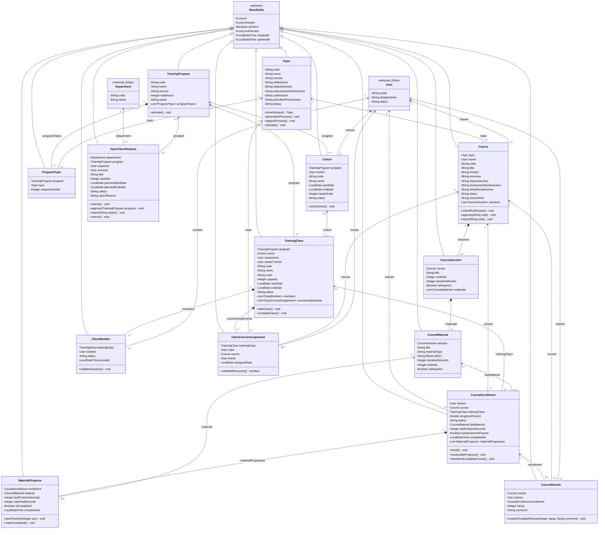

Trong các dự án phần mềm doanh nghiệp, đặc biệt là các hệ thống quản trị đào tạo quy mô vừa và lớn như **FAMS (Fresher Academy Management System)** hay **LMS (Learning Management System)**, việc xây dựng mô hình dữ liệu (Domain Model / Class Diagram) đóng vai trò là "xương sống" quyết định tính mở rộng, hiệu năng và tốc độ triển khai mã nguồn.

Một bài toán thực tế thường gặp khi bắt đầu một Sprint phát triển phần mềm (đặc biệt trong các kỳ **Mock Project kéo dài chỉ 1 tuần**) là: **Làm sao để cân bằng giữa sự chặt chẽ của tài liệu đặc tả (SRS - Software Requirement Specification) và thời gian hiện thực hóa mã nguồn Backend?** Nếu chuẩn hóa cơ sở dữ liệu quá sâu (3NF+ với hàng chục bảng trung gian), đội ngũ sẽ kiệt sức vì các câu lệnh JOIN phức tạp và các tầng DTO/Entity rườm rà. Ngược lại, nếu thiết kế quá sơ sài, hệ thống sẽ gãy đổ ngay khi kiểm thử các luồng nghiệp vụ phức tạp như luồng phê duyệt, kiểm soát sức chứa lớp học hay tính toán tiến độ học viên theo thời gian thực.

Bài viết này hệ thống hóa toàn bộ kiến trúc **Class Diagram của dự án**, phân tích sâu 12 thực thể cốt lõi, chiến lược kế thừa `BaseEntity`, nguyên lý gom nhóm dữ liệu qua JSON và ma trận truy vết đối chiếu trực tiếp với yêu cầu SRS.

---

## 1. Tổng Quan Sơ Đồ Lớp Nghiệp Vụ (Class Diagram)

Hệ thống được tổ chức xoay quanh **12 lớp nghiệp vụ cốt lõi**, 1 lớp nền tảng trừu tượng (`BaseEntity`) và 2 thực thể liên kết dùng chung từ phân hệ quản trị (`User`, `Department`).

### Nguyên Tắc Thiết Kế Trọng Tâm

Kiến trúc trên được định hình dựa trên 3 nguyên tắc bất di bất dịch:
1. **Độc lập vòng đời (Lifecycle Isolation):** Mỗi thực thể đại diện cho một đối tượng có trạng thái (State Machine) riêng hoặc giải quyết một mối quan hệ N-N bắt buộc trong SRS.
2. **Chiến lược Phi chuẩn hóa có kiểm soát (Pragmatic JSON Denormalization):** Các bảng cấu hình phụ (mục tiêu, ma trận kỹ năng, tiêu chí đánh giá, outline AI) được gom thành các trường chuỗi JSON nhằm triệt tiêu các bảng phụ không cần thiết, giúp tiết kiệm thời gian viết truy vấn JOIN phức tạp.
3. **Thừa kế hạ tầng bảo mật & kiểm toán (Inheritance from BaseEntity):** Tái sử dụng trọn vẹn hạ tầng phân quyền đa tổ chức (`tenantId`), khóa lạc quan (`lockVersion`), xóa mềm (`isActive`) và dấu vết thời gian (`createdAt`, `updatedAt`).

---

## 2. Phân Tích Chi Tiết 7 Nhóm Thực Thể Nghiệp Vụ

### 2.1 Nhóm Nền Tảng & Hệ Thống Dùng Chung (`BaseEntity`, `User`, `Department`)

#### `BaseEntity` (Lớp Cha Trừu Tượng)
- **Mục đích:** Đóng gói toàn bộ các thuộc tính hệ thống cốt lõi bao gồm khóa chính định danh (`id`), mã định danh tổ chức (`tenantId`), cờ xóa mềm (`isActive`), phiên bản khóa chống ghi đè (`lockVersion`) cùng dấu mốc kiểm toán thời gian (`createdAt`, `updatedAt`).
- **Căn cứ SRS & Lý do chọn:**
  - Quy tắc `BR-UNI-02` yêu cầu dữ liệu giữa các tổ chức/chi nhánh phải được cách ly hoàn toàn theo cơ chế Multi-tenancy.
  - Điều khoản `§7.1` cấm xóa cứng (Hard Delete) các dữ liệu đã phát sinh lịch sử; hệ thống phải chuyển cờ `isActive = false` để đảm bảo tính toàn vẹn dữ liệu.
  - Yêu cầu phi chức năng `NFR-AUD` và `NFR-DATA` bắt buộc lưu vết kiểm toán và áp dụng cơ chế **Khóa lạc quan (Optimistic Locking)** qua `lockVersion` nhằm ngăn ngừa tình trạng mất dữ liệu khi nhiều quản trị viên cùng thao tác cập nhật một bản ghi.
- **Giá trị thực chiến:** Tất cả 12 thực thể con đều kế thừa từ `BaseEntity`, giúp tái sử dụng ngay bộ khung CRUD và các Interceptor/JPA Auditing của starter template mà không cần viết lặp mã nguồn.

#### `User` & `Department` (Thực Thể Liên Kết Ngoài)
- **Mục đích:** Đại diện cho tài khoản người dùng với các vai trò trong hệ thống (*Program Manager*, *Department Manager*, *Class Admin*, *Trainer*, *Mentor*, *Trainee*) và các đơn vị phòng ban.
- **Căn cứ SRS & Lý do chọn:**
  - Theo các yêu cầu `UFR-SYS-006`, `UFR-SYS-011` và nguyên tắc `BR-UNI-01`, phân hệ Quản lý Đào tạo không được phép tạo bảng người dùng riêng biệt mà phải liên kết trực tiếp với dữ liệu định danh từ phân hệ Quản trị hệ thống (Identity & Access Management).
  - Điều này đảm bảo tính nhất quán tuyệt đối trong việc kiểm soát quyền truy cập theo vai trò (RBAC).

---

### 2.2 Nhóm G01 — Quản Lý & Thiết Kế Chủ Đề Đào Tạo (`Topic`)

#### `Topic`
- **Mục đích:** Quản lý thông tin định danh của một chủ đề chuyên môn (ví dụ: *Java Core*, *Spring Boot Ecosystem*, *Database & SQL*), kiểm soát phiên bản (`version`), chu trình trạng thái (`DRAFT`, `REVIEW`, `ACTIVE`, `ARCHIVED`) cùng cấu hình mục tiêu, kỹ năng và đề cương chi tiết.
- **Căn cứ SRS & Lý do chọn:**
  - Giải quyết trọn vẹn cụm yêu cầu `UFR-CUR-001` (Danh mục & quản lý phiên bản Topic), `UFR-CUR-002` (Màn hình thiết kế chi tiết `SCR-34..37`) và `UFR-CUR-003` (Trợ lý AI đề xuất cấu trúc đề cương).
  - `Topic` đóng vai trò là "cầu nối tri thức" trung gian giữa Khung chương trình tổng thể (`TrainingProgram`) và các Khóa học thực thi (`Course`).
- **Chiến lược tối ưu cho Sprint 1 tuần:**
  - Thay vì phải tách thành 5 bảng phụ riêng biệt (`TopicSkill`, `TopicObjective`, `TopicAssessmentScheme`, `TopicOutline`, `AiPreview`), chúng được lưu trữ dưới dạng các trường JSON: `skillIdsJson`, `objectivesJson`, `assessmentSchemeJson`, `outlineJson`, `aiOutlinePreviewJson`.
  - Thiết kế này tuân thủ chuẩn quy tắc `BR-UNI-18`: Trợ lý AI khi sinh dữ liệu sẽ ghi nhận vào `aiOutlinePreviewJson`; chỉ khi người quản trị (*Program Manager*) bấm phê duyệt thì nội dung mới được đồng bộ sang `outlineJson`.

> [!TIP]
> Việc denormalize các thông tin cấu hình của Topic thành JSON giúp giảm 4 bảng quan hệ và hàng chục câu lệnh JOIN phức tạp, giúp Backend hoàn thành API trong chưa đầy 1 ngày mà vẫn bảo toàn đầy đủ tính năng giao diện.

---

### 2.3 Nhóm G02 — Soạn Thảo & Phê Duyệt Khóa Học (`Course`, `CourseSession`, `CourseMaterial`)

#### `Course`
- **Mục đích:** Đại diện cho một phiên bản khóa học cụ thể được triển khai dựa trên một `Topic`, phân công giảng viên biên soạn (`trainer`), cấu hình thời lượng và vận hành luồng duyệt: `DRAFT -> UNDER_REVIEW -> ACTIVE / REJECTED` đi kèm phản hồi từ người duyệt (`reviewNote`).
- **Căn cứ SRS & Lý do chọn:**
  - Đáp ứng trực tiếp yêu cầu biên soạn (`UFR-CUR-004`), thẩm định chất lượng (`UFR-CUR-005`, `BR-UNI-05`) và cung cấp dữ liệu cho Danh mục khóa học mở (`UFR-LRN-001`).
  - **Tại sao không gộp `Course` vào `Topic`?** Vì một `Topic` (như *Java Core*) mang tính quy chuẩn kiến thức, trong khi có thể có nhiều `Course` khác nhau do các giảng viên khác nhau biên soạn, phục vụ cho các đối tượng hoặc phiên bản đào tạo khác nhau (`SCR-38..42`).

#### `CourseSession` & `CourseMaterial`
- **Mục đích:**
  - `CourseSession`: Phân bổ khóa học thành các buổi học/chương học logic có thứ tự (`orderNo`), thời lượng ước tính (`durationMinutes`) và cờ bắt buộc hoàn thành (`isRequired`).
  - `CourseMaterial`: Đại diện cho từng tài nguyên học tập đa phương tiện cụ thể bên trong buổi học (Video, bài đọc PDF, tài liệu tham khảo qua URL).
- **Căn cứ SRS & Lý do chọn:**
  - Học viên cần cây thư mục học tập phân cấp để điều hướng bài học trên Course Player (`UFR-LRN-004`).
  - **Tối ưu 2 tầng:** Rút gọn cấu trúc lồng nhau (Section -> Chapter -> Lesson -> Material) thành mô hình 2 cấp duy nhất: `CourseSession` $\rightarrow$ `CourseMaterial`.
  - **Tại sao `CourseMaterial` bắt buộc phải là một bảng riêng?** Khác với Topic có thể lưu JSON, `CourseMaterial` bắt buộc phải có khóa chính (`id`) để bảng theo dõi tiến độ (`MaterialProgress`) tham chiếu trực tiếp khi học viên xem từng video hoặc đọc từng tài liệu (`UFR-LRN-005`).

---

### 2.4 Nhóm G03 — Khung Chương Trình & Đợt Tuyển Sinh (`TrainingProgram`, `ProgramTopic`, `Cohort`)

#### `TrainingProgram` & `ProgramTopic`
- **Mục đích:**
  - `TrainingProgram`: Quản lý khung chương trình tổng thể (ví dụ: *Full-stack Java Fresher 2026*), tổng số giờ đào tạo (`totalHours`), trạng thái và quản lý phiên bản.
  - `ProgramTopic`: Bảng liên kết trung gian biểu diễn quan hệ nhiều-nhiều (N-N) giữa chương trình và danh sách các chủ đề (`Topic`), đồng thời lưu trữ thứ tự lộ trình học (`sequenceOrder`).
- **Căn cứ SRS & Lý do chọn:**
  - Hiện thực hóa yêu cầu `UFR-CUR-006` và quy tắc `BR-UNI-06`: Chỉ các chương trình đào tạo ở trạng thái `ACTIVE` mới được phép sử dụng để khởi tạo lớp học thực tế.
  - Việc đưa `sequenceOrder` vào `ProgramTopic` giúp linh hoạt điều chỉnh thứ tự giảng dạy các môn học mà không làm ảnh hưởng đến bản thân định nghĩa của môn học đó.

#### `Cohort`
- **Mục đích:** Quản lý đợt/khóa tuyển sinh và đào tạo theo mốc thời gian (`startDate`, `endDate`), chỉ tiêu quy mô (`targetScale`), gắn liền với một chương trình đào tạo và một Cố vấn phụ trách (`mentor`).
- **Căn cứ SRS & Lý do chọn:**
  - Đáp ứng yêu cầu quản lý đợt đào tạo (`UFR-PEO-008`). Một đợt tuyển sinh thường bao gồm nhiều lớp học (`TrainingClass`) cùng học chung một khung chương trình trong cùng một thời điểm (`§7`).

---

### 2.5 Nhóm G04 — Quản Lý Nhu Cầu Mở Lớp (`OpenClassRequest`)

#### `OpenClassRequest`
- **Mục đích:** Cho phép Quản lý phòng ban (`Department Manager`) gửi đề xuất đào tạo bổ sung nhân sự cho đơn vị mình (số lượng học viên dự kiến `quantity`, thời gian mong muốn `plannedStartDate` - `plannedEndDate`) và trải qua quy trình phê duyệt: `DRAFT -> SUBMITTED -> UNDER_REVIEW -> APPROVED / REJECTED / CANCELLED`.
- **Căn cứ SRS & Lý do chọn:**
  - Hiện thực hóa yêu cầu `UFR-CUR-007` và quy tắc `BR-UNI-07` trên các màn hình `SCR-45..47`.
  - **Tính độc lập:** Phiếu yêu cầu bắt buộc phải tách biệt khỏi thực thể Lớp học (`TrainingClass`) vì tại thời điểm khởi tạo, đây mới chỉ là một nguyện vọng đề xuất (có thể bị từ chối kèm lý do `rejectReason`). Chỉ khi phiếu chuyển sang trạng thái `APPROVED` và được chỉ định một `TrainingProgram` cụ thể, phòng đào tạo mới tiến hành mở lớp vận hành thực tế.

---

### 2.6 Nhóm G05 & G06 — Lớp Học, Roster & Phân Công Khóa Học (`TrainingClass`, `ClassMember`, `ClassCourseAssignment`)

#### `TrainingClass`
- **Mục đích:** Đại diện cho lớp học vận hành thực tế, chứa thông tin mã lớp duy nhất trong tổ chức, địa điểm phòng học (`room`), sức chứa tối đa (`capacity`), cán bộ quản lý (`classAdmin`, `masterTrainer`) và chu trình trạng thái: `PLANNING -> ONGOING -> COMPLETED / CANCELLED`.
- **Căn cứ SRS & Lý do chọn:**
  - Thực thể trung tâm đáp ứng yêu cầu `UFR-PEO-009` và quy tắc `BR-UNI-08` (`SCR-48..50`), đóng vai trò điều phối toàn bộ hoạt động giảng dạy, điểm danh và đánh giá.

#### `ClassMember` (Danh Sách Học Viên - Roster)
- **Mục đích:** Lưu trữ danh sách học viên trực thuộc lớp, ghi nhận thời điểm gia nhập (`joinedAt`) và trạng thái học tập (`ACTIVE`, `RESERVE`, `DROP_OUT`, `COMPLETED`, `INACTIVE`).
- **Căn cứ SRS & Lý do chọn:**
  - Giải quyết yêu cầu quản lý danh sách học viên (`UFR-PEO-010`) và quy tắc `BR-UNI-10`.
  - Việc tách thành thực thể riêng biệt giúp hệ thống kích hoạt phương thức kiểm tra sức chứa `validateCapacity()` trước khi tiếp nhận học viên mới, đồng thời bảo toàn lịch sử khi học viên bảo lưu hoặc luân chuyển giữa các lớp học.

#### `ClassCourseAssignment` (Phân Công Giảng Dạy)
- **Mục đích:** Xác định rõ với mỗi `Topic` trong khung chương trình của lớp, lớp sẽ học theo bộ học liệu `Course` nào và do giảng viên (`trainer`) nào trực tiếp đứng lớp.
- **Căn cứ SRS & Lý do chọn:**
  - Hiện thực hóa yêu cầu `UFR-PEO-015` trên màn hình phân công `SCR-52`.
  - Theo quy tắc `BR-UNI-08` và `§6.1`, khi lớp học còn ở trạng thái `PLANNING`, quản trị viên không thể bấm chuyển sang `ONGOING` (Start Class) nếu chưa phân công đầy đủ giảng viên và khóa học (ở trạng thái `ACTIVE`) cho toàn bộ các môn học của lớp. Phương thức `validateResources()` đảm nhiệm việc kiểm tra điều kiện tiên quyết này.

---

### 2.7 Nhóm G09, G10 & G11 — Trải Nghiệm Học Tập Trực Tuyến & Đánh Giá (`CourseEnrollment`, `MaterialProgress`, `CourseReview`)

> [!NOTE]
> Tính năng **Course Catalog** (`UFR-LRN-001`) bản chất là các thao tác lọc và tìm kiếm trên các bản ghi `Course` đang ở trạng thái `ACTIVE`, do đó tận dụng trực tiếp thực thể `Course` mà không cần phát sinh bảng phụ.

#### `CourseEnrollment` & `MaterialProgress`
- **Mục đích:**
  - `CourseEnrollment`: Quản lý lượt đăng ký tham gia khóa học của học viên, theo dõi trạng thái (`NOT_STARTED`, `IN_PROGRESS`, `COMPLETED`), tiến độ tổng quát (`progressPercent`), bài học đang xem dở (`lastMaterial`, `lastPositionSeconds`) và kết quả vượt qua kỳ sát hạch (`isAssessmentPassed`).
  - `MaterialProgress`: Lưu vết chi tiết hành vi học tập trên từng học liệu số: vị trí dừng video (`lastPositionSeconds`), tổng thời lượng đã tích lũy (`watchedSeconds`) và cờ hoàn thành (`isCompleted`).
- **Căn cứ SRS & Lý do chọn:**
  - Giải quyết đồng thời các yêu cầu: Đăng ký khóa học và chặn đăng ký trùng lặp (`UFR-LRN-002`), hiển thị danh mục khóa học của tôi (`UFR-LRN-003`), ghi nhớ vị trí bài học trên Course Player (`UFR-LRN-004`) và tự động nghiệm thu hoàn thành (`UFR-LRN-006` trên màn hình `SCR-67..69`).
  - **Tối ưu kiến trúc:** Tích hợp trực tiếp tiến độ tổng hợp vào `CourseEnrollment` giúp loại bỏ hai bảng trung gian `SessionProgress` và `CourseCompletionRecord`, giảm tải đáng kể các tác vụ lắng nghe sự kiện khi học viên hoàn thành bài học.

#### `CourseReview` (Đánh Giá & Phản Hồi)
- **Mục đích:** Cho phép học viên gửi điểm xếp hạng (từ 1 đến 5 sao) và nhận xét chi tiết sau quá trình trải nghiệm khóa học.
- **Căn cứ SRS & Lý do chọn:**
  - Đáp ứng yêu cầu `UFR-LRN-007`. Bằng việc thiết lập quan hệ 1-1 chặt chẽ giữa `CourseReview` và `CourseEnrollment`, hệ thống đảm bảo kiểm tra tự động hai điều kiện cốt lõi:
    1. Chỉ những học viên đã thực sự đăng ký khóa học mới có quyền đánh giá.
    2. Mỗi học viên chỉ có duy nhất một bản ghi đánh giá cho một khóa học nhưng có quyền cập nhật lại nhận xét của mình bất cứ lúc nào.

---

## 3. Ma Trận Đối Chiếu Yêu Cầu Nghiệp Vụ (SRS Traceability Matrix)

Bảng ma trận dưới đây đóng vai trò là "kim chỉ nam" giúp các kỹ sư bảo vệ tính toàn vẹn của mô hình kiến trúc trước các đợt Review thiết kế hoặc nghiệm thu đồ án:

| Tên Class | Mã Yêu Cầu SRS | Màn Hình Liên Quan | Hệ Quả Nghiệp Vụ Nếu Thiếu Class Này |
| :--- | :--- | :--- | :--- |
| **`Topic`** | `UFR-CUR-001..003` | `SCR-34..37` | Mất hoàn toàn khả năng quản lý danh mục chủ đề chuẩn hóa, không quản lý được phiên bản môn học và tính năng trợ lý AI gợi ý đề cương. |
| **`Course`** | `UFR-CUR-004..005` `UFR-LRN-001` | `SCR-38..42` `SCR-66` | Giảng viên không có nơi biên soạn nội dung, hệ thống không có luồng phê duyệt khóa học và Course Catalog không có dữ liệu để hiển thị. |
| **`CourseSession`** | `UFR-CUR-004` `UFR-LRN-004..005` | `SCR-41` `SCR-69` | Nội dung khóa học bị phẳng hóa, không thể phân chia theo từng buổi học có thứ tự và cấu trúc cây bài học trên Course Player bị vỡ. |
| **`CourseMaterial`** | `UFR-CUR-004` `UFR-LRN-004` | `SCR-41` `SCR-69` | Không lưu trữ được tài nguyên học tập đa định dạng (Video, PDF, Link) và không có định danh (`id`) để theo dõi tiến độ từng học liệu. |
| **`TrainingProgram`** | `UFR-CUR-006` | `SCR-43..44` | Không thể đóng gói khung chương trình đào tạo chuẩn hóa để cấp phép mở lớp theo quy định của tổ chức. |
| **`ProgramTopic`** | `UFR-CUR-006` | `SCR-44` | Không thể thiết lập và tùy biến thứ tự học tập của các môn học bên trong từng chương trình cụ thể. |
| **`Cohort`** | `UFR-PEO-008` | `UI-MNT-01..02` | Mất khả năng quản lý các đợt tuyển sinh định kỳ theo mốc thời gian và không phân công được Mentor phụ trách đợt. |
| **`OpenClassRequest`** | `UFR-CUR-007` | `SCR-45..47` | Các Trưởng bộ phận không thể gửi phiếu đề xuất nhu cầu đào tạo và Hội đồng đào tạo không có quy trình xét duyệt trước khi tạo lớp. |
| **`TrainingClass`** | `UFR-PEO-009` | `SCR-48..50` | Hệ thống không thể tạo và điều hành lớp học thực tế trong chu trình từ khi chuẩn bị (`PLANNING`) đến khi diễn ra (`ONGOING`). |
| **`ClassMember`** | `UFR-PEO-010` | `SCR-06` `SCR-50` | Không thể quản lý danh sách học viên trong lớp (Roster), mất kiểm soát giới hạn sức chứa và không lưu được lịch sử chuyển lớp/bảo lưu. |
| **`ClassCourseAssignment`** | `UFR-PEO-015` | `SCR-52` | Không gán được bộ khóa học và giảng viên cụ thể cho từng môn học của lớp; không thể kiểm tra điều kiện khai giảng lớp học. |
| **`CourseEnrollment`** | `UFR-LRN-002..003` `UFR-LRN-006` | `SCR-67..68` | Học viên không thể đăng ký học, mất trang quản lý khóa học cá nhân (My Courses) và không thể tự động đánh giá điều kiện tốt nghiệp khóa. |
| **`MaterialProgress`** | `UFR-LRN-004..005` | `SCR-69` | Không thể ghi nhớ số giây học viên đang xem dở trên video bài giảng và không thể tính toán tỷ lệ % hoàn thành khóa học theo thời gian thực. |
| **`CourseReview`** | `UFR-LRN-007` | `SCR-68` | Học viên không thể gửi phản hồi, chấm điểm sao chất lượng khóa học và hệ thống không thể kiểm soát việc chặn đánh giá rác. |

---

## 4. Định Hướng Triển Khai Backend Thực Chiến

Với bộ 12 thực thể đã được mô hình hóa chặt chẽ và tinh giản hợp lý, các bước tiếp theo để hiện thực hóa tầng Persistence và Business Service trong Spring Boot bao gồm:

1. **Hiện thực hóa `BaseEntity`:** Sử dụng `@MappedSuperclass` cùng `@Version` cho `lockVersion` và các annotation `@CreatedDate`, `@LastModifiedDate` từ Spring Data JPA Auditing.
2. **Quản lý chuyển đổi trạng thái (State Transition Logic):** Triển khai Domain Methods hoặc State Pattern cho các thực thể có vòng đời phức tạp như `Course` (`submitForReview`, `approve`, `reject`), `OpenClassRequest` và `TrainingClass` (`startClass`, `completeClass`).
3. **Bộ chuyển đổi JSON (JPA AttributeConverter):** Viết các lớp Converter chuyển đổi an toàn giữa chuỗi JSON trong database và các Java DTO tương ứng (như `TopicOutlineDto`, `AssessmentSchemeDto`) bằng Jackson ObjectMapper.
4. **Xây dựng RESTful API Contracts:** Bám sát các hành vi nghiệp vụ công khai (Public Methods) của từng Class để định nghĩa danh sách HTTP Endpoints đồng nhất và an toàn.