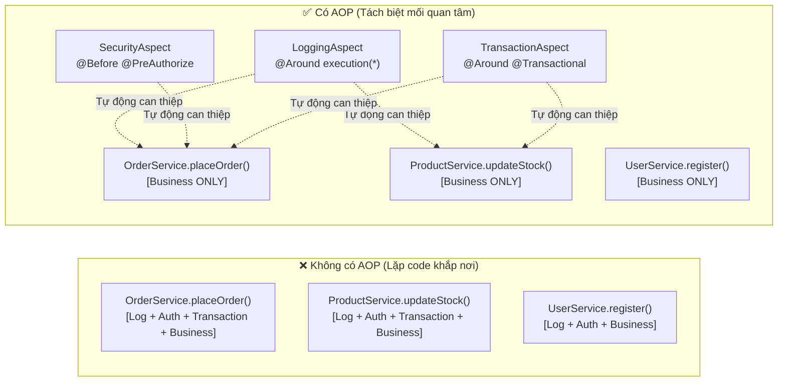
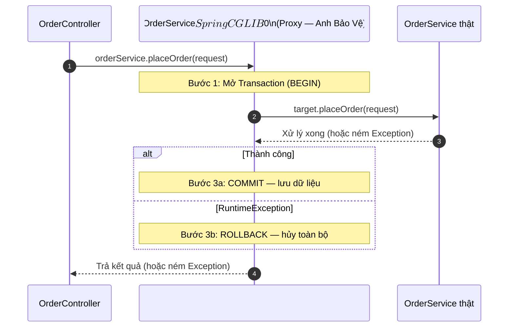
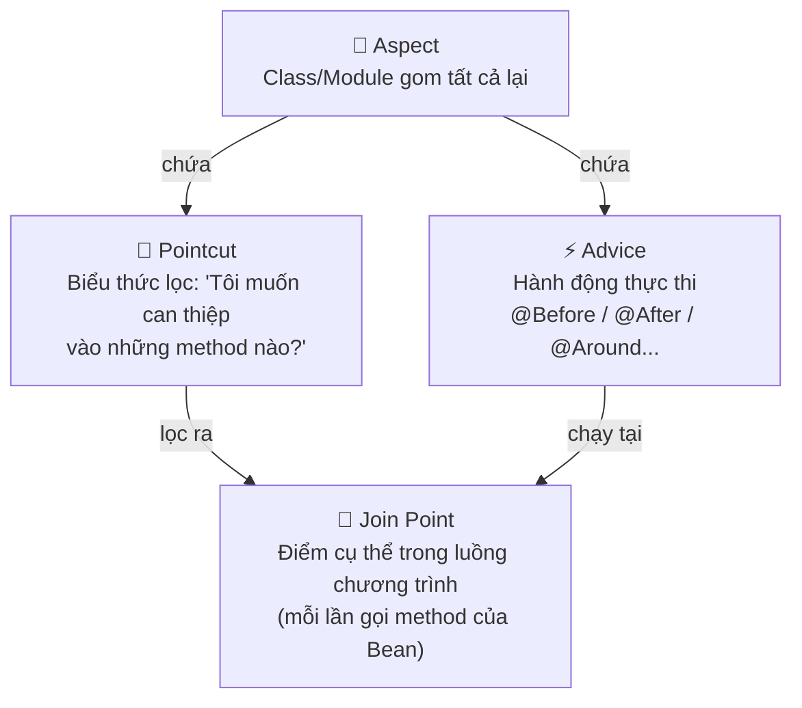
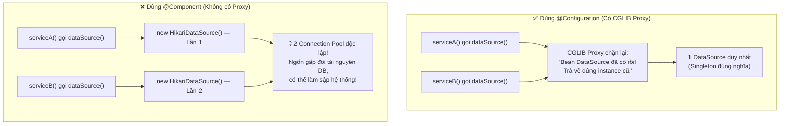
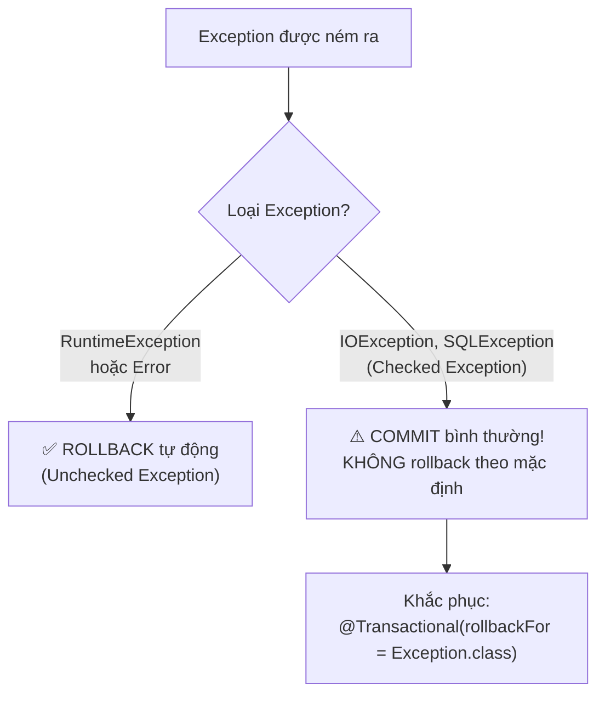
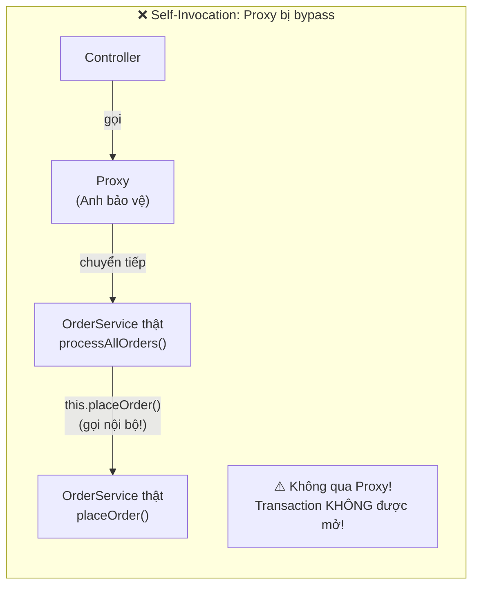
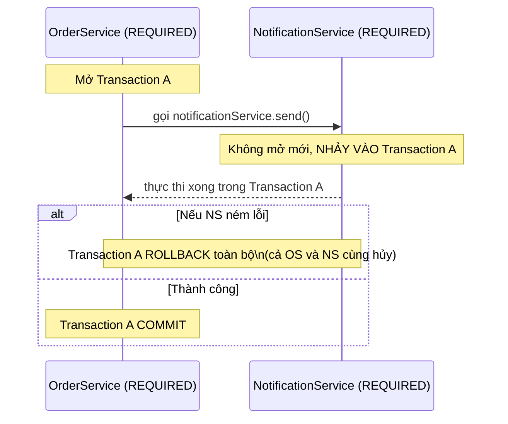
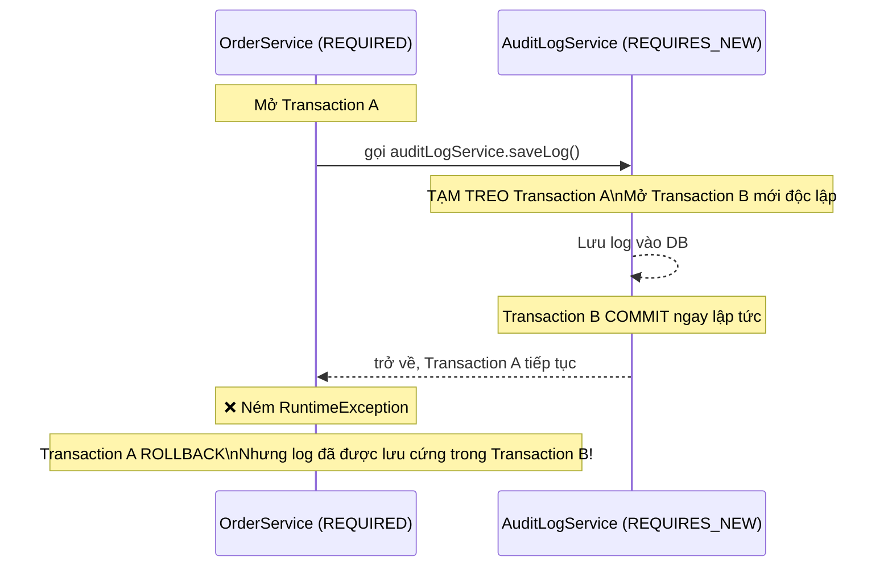

Bạn đã bao giờ gặp tình huống đặt `@Transactional` lên một hàm mà dữ liệu vẫn không rollback khi có lỗi? Hoặc tự hỏi tại sao `@Transactional` đặt trên method `private` lại vô nghĩa? Câu trả lời nằm ở một cơ chế mà Spring dùng để hiện thực hóa **hầu hết các tính năng mạnh nhất của nó** — cơ chế **Runtime Proxy**.

Khi hiểu được Proxy, bạn sẽ hiểu tại sao `@Transactional`, `@Async`, `@Cacheable`, `@PreAuthorize` hoạt động — và quan trọng hơn, khi nào chúng **không** hoạt động.

---

## 1. Spring AOP: Giải Mã Bản Chất Proxy

### 1.1 Bài Toán Cross-Cutting Concerns

Hình dung bạn có 20 hàm nghiệp vụ trong ứng dụng. Mỗi hàm đều cần: (1) ghi log khi bắt đầu/kết thúc, (2) mở/đóng transaction, (3) kiểm tra quyền hạn. Không dùng AOP, bạn phải copy-paste logic phụ trợ này vào cả 20 hàm — **boilerplate code cực kỳ nguy hiểm và khó bảo trì**.

**AOP (Aspect-Oriented Programming)** giải quyết bài toán này bằng cách **tách các mối quan tâm cắt ngang (Cross-cutting Concerns)** ra khỏi logic nghiệp vụ chính, rồi tự động "dệt" chúng vào đúng chỗ lúc runtime.



### 1.2 Cơ Chế Runtime Proxy: "Anh Bảo Vệ Đứng Trước Cửa"

Spring AOP không sửa bytecode — nó hoạt động bằng cách tạo ra một **đối tượng Proxy** bọc bên ngoài Bean thật. Mọi lời gọi từ bên ngoài đều phải đi qua Proxy trước khi chạm vào code nghiệp vụ.



> [!NOTE]
> **Controller không bao giờ nói chuyện trực tiếp với Bean thật** khi Service đó có dùng `@Transactional`, `@Async`, `@Cacheable` hoặc `@PreAuthorize`. Thứ Controller nắm giữ là lớp vỏ Proxy.

**Kiểm tra nhanh trong code:**
```java
// Trong Controller: kiểm tra xem mình đang nói chuyện với ai
System.out.println(orderService.getClass().getName());
// Output: com.example.OrderService$$SpringCGLIB$$0
// Thấy "$$SpringCGLIB$$0" -> đang nói chuyện với Proxy!
```

### 1.3 Khi Nào Dùng CGLIB, Khi Nào Dùng JDK Dynamic Proxy?

| | **JDK Dynamic Proxy** | **CGLIB Proxy** |
| :--- | :--- | :--- |
| **Yêu cầu** | Class phải implement ít nhất 1 Interface | Class không cần Interface |
| **Cơ chế** | Tạo Proxy dựa trên Interface | Tạo class **con kế thừa** class gốc (`extends`) |
| **Hạn chế** | Chỉ proxy được method trong Interface | Không proxy method `final` và `private` |
| **Mặc định Spring Boot** | Không còn là mặc định | ✅ **Mặc định từ Spring Boot 2.x** |

> [!IMPORTANT]
> **Tại sao `final` và `private` thì Proxy không can thiệp được?**
> CGLIB tạo Proxy bằng cách `extends` (kế thừa) class thật và override method. Trong Java:
> - Method `final` → **không thể override** → CGLIB không thể chặn được.
> - Method `private` → **class con không nhìn thấy** → không override được.
>
> Đây là lý do `@Transactional` đặt trên method `private` hoàn toàn vô nghĩa.

---

## 2. Bộ Tứ Khái Niệm AOP



| Khái niệm | Định nghĩa | Ví dụ |
| :--- | :--- | :--- |
| **Join Point** | Điểm trong chương trình **có thể** chèn logic (trong Spring AOP là mỗi lần gọi method của Bean) | Gọi `orderService.placeOrder()` |
| **Pointcut** | Biểu thức điều kiện để **lọc** ra những Join Point nào sẽ được áp dụng | `execution(* com.example.service.*.*(..))` |
| **Advice** | Đoạn code được thực hiện tại Join Point đã lọc ra | Ghi log, mở transaction, kiểm tra quyền |
| **Aspect** | **Class/Module** gom chung các Pointcut và Advice liên quan lại với nhau | `LoggingAspect`, `SecurityAspect` |

### 2.1 Các Loại Advice

```java
@Aspect
@Component
public class LoggingAspect {

    // Pointcut: nhắm vào mọi method trong package service
    @Pointcut("execution(* com.example.service.*.*(..))")
    public void serviceLayer() {}

    // @Before: Chạy TRƯỚC khi method thật thực thi
    @Before("serviceLayer()")
    public void logBefore(JoinPoint jp) {
        log.info("▶ Gọi: {}.{}()", jp.getTarget().getClass().getSimpleName(), jp.getSignature().getName());
    }

    // @AfterReturning: Chạy SAU khi method trả về thành công
    @AfterReturning(pointcut = "serviceLayer()", returning = "result")
    public void logAfterSuccess(JoinPoint jp, Object result) {
        log.info("✅ Thành công: {} -> {}", jp.getSignature().getName(), result);
    }

    // @AfterThrowing: Chạy SAU khi method ném Exception
    @AfterThrowing(pointcut = "serviceLayer()", throwing = "ex")
    public void logAfterError(JoinPoint jp, Exception ex) {
        log.error("❌ Lỗi: {} -> {}", jp.getSignature().getName(), ex.getMessage());
    }

    // @Around: Bao bọc toàn bộ — mạnh nhất, linh hoạt nhất
    @Around("serviceLayer()")
    public Object measureTime(ProceedingJoinPoint jp) throws Throwable {
        long start = System.currentTimeMillis();
        try {
            Object result = jp.proceed(); // Gọi method thật
            log.info("⏱ {} hoàn thành trong {}ms", jp.getSignature().getName(), System.currentTimeMillis() - start);
            return result;
        } catch (Throwable ex) {
            log.error("⏱ {} thất bại sau {}ms", jp.getSignature().getName(), System.currentTimeMillis() - start);
            throw ex;
        }
    }
}
```

---

## 3. CGLIB Proxy Trong `@Configuration`: Bảo Vệ Singleton Khi Bean Gọi Nhau

### 3.1 Vấn Đề: Gọi Chéo Giữa Các `@Bean` Method

```java
@Configuration // Quan trọng: phải là @Configuration, không phải @Component!
public class DatabaseConfig {

    @Bean
    public DataSource dataSource() {
        return new HikariDataSource(); // Connection Pool kết nối DB
    }

    @Bean
    public ServiceA serviceA() {
        return new ServiceA(dataSource()); // Gọi dataSource() lần 1
    }

    @Bean
    public ServiceB serviceB() {
        return new ServiceB(dataSource()); // Gọi dataSource() lần 2
    }
}
```

### 3.2 `@Configuration` vs `@Component`: Sự Khác Biệt Sống Còn



> [!CAUTION]
> Khi bạn thay `@Configuration` bằng `@Component` (mode `proxyBeanMethods = false`), Spring KHÔNG tạo CGLIB Proxy cho class đó. Các lời gọi hàm `@Bean` trong cùng class trở thành lời gọi Java bình thường — mỗi lần gọi tạo ra một instance mới, phá vỡ hoàn toàn đặc tính Singleton.

---

## 4. `@Transactional`: Cơ Chế, Quy Tắc Rollback & Những Cạm Bẫy Chết Người

### 4.1 Cơ Chế Hoạt Động

`@Transactional` không phải ma thuật — nó chỉ là AOP Proxy làm việc tự động:

```java
@Service
public class OrderService {

    @Transactional // Proxy bọc bên ngoài hàm này
    public void placeOrder(OrderRequest request) {
        // --- PROXY ĐÃ LÀM TRƯỚC KHI VÀO ĐÂY ---
        // 1. Lấy Connection từ Pool
        // 2. connection.setAutoCommit(false)
        // 3. Bắt đầu Transaction (BEGIN)
        // ----------------------------------------

        orderRepository.save(new Order(request));    // INSERT vào DB (chưa commit)
        inventoryService.deductStock(request.items()); // UPDATE tồn kho (chưa commit)
        paymentService.charge(request.getAmount());    // Trừ tiền (chưa commit)

        // --- PROXY LÀM SAU KHI RA KHỎI ĐÂY ---
        // Nếu không có Exception: COMMIT — lưu cả 3 thao tác cùng lúc
        // Nếu có RuntimeException: ROLLBACK — hủy cả 3 thao tác
        // ----------------------------------------
    }
}
```

### 4.2 Quy Tắc Rollback Mặc Định — Điểm Hay Nhầm Nhất



```java
@Transactional // Mặc định: chỉ rollback với RuntimeException và Error
public void processPayment(Payment payment) throws IOException {
    paymentRepo.save(payment);

    // IOException là Checked Exception -> Spring VẪN COMMIT dù ném lỗi!
    externalService.sendReceipt(payment); // Throws IOException

    // Nếu muốn rollback với mọi loại Exception:
    // @Transactional(rollbackFor = Exception.class)
}

@Transactional
public void processOrder(Order order) {
    orderRepo.save(order);

    try {
        // ❌ NGUY HIỂM: Nuốt mất Exception -> Proxy không biết có lỗi -> COMMIT!
        inventoryService.deductStock(order);
    } catch (Exception e) {
        log.error("Lỗi kho: {}", e.getMessage());
        // Không re-throw -> Transaction vẫn commit như bình thường
    }
}
```

> [!WARNING]
> **3 cạm bẫy cần tránh với `@Transactional`:**
> 1. **Nuốt Exception trong try-catch** mà không re-throw → Proxy không nhận ra lỗi → COMMIT dù data sai.
> 2. **Gắn lên method `private`** → AOP Proxy không thể override method private → Transaction không hoạt động.
> 3. **Gọi API bên ngoài / gửi email trong Transaction** → giữ Connection Pool lâu → nghẽn hệ thống.

---

## 5. Cạm Bẫy Self-Invocation: Kẻ Thù Số 1 Của `@Transactional`

### 5.1 Vấn Đề Là Gì?

```java
@Service
public class OrderService {

    // ❌ Hàm này KHÔNG có @Transactional
    public void processAllOrders(List<Order> orders) {
        for (Order order : orders) {
            // Gọi nội bộ: this.placeOrder() đi thẳng vào Object thật
            // KHÔNG đi qua lớp vỏ Proxy!
            this.placeOrder(order);
        }
    }

    @Transactional // ❌ Vô nghĩa khi được gọi nội bộ qua "this"!
    public void placeOrder(Order order) {
        orderRepo.save(order);
        // Nếu ném RuntimeException ở đây -> KHÔNG rollback!
        // Vì Transaction không bao giờ được mở (Proxy bị bypass)
    }
}
```



### 5.2 Giải Pháp Chuẩn: Tách Sang Service Bean Riêng

```java
// ✅ Giải pháp tốt nhất: tách sang Service riêng
@Service
public class OrderBatchService {
    private final OrderService orderService; // Inject Proxy của OrderService

    @Autowired
    public OrderBatchService(OrderService orderService) {
        this.orderService = orderService;
    }

    public void processAllOrders(List<Order> orders) {
        for (Order order : orders) {
            // Lời gọi đi qua Proxy -> @Transactional hoạt động đúng!
            orderService.placeOrder(order);
        }
    }
}

@Service
public class OrderService {
    @Transactional // Hoạt động bình thường khi được gọi qua Proxy
    public void placeOrder(Order order) { ... }
}
```

> [!TIP]
> **Self-Invocation** là nguyên nhân thầm lặng đằng sau hầu hết các bug "tại sao `@Transactional` không rollback?". Khi debugging, hãy luôn kiểm tra xem lời gọi có đi qua Proxy không bằng cách in `getClass().getName()` và tìm chữ `$$SpringCGLIB$$`.

---

## 6. Transaction Propagation: Quy Tắc "Lan Truyền Giao Dịch"

### 6.1 Hai Giá Trị Quan Trọng Nhất

**`REQUIRED` (Mặc định) — "Cùng Chung Một Thuyền"**



**`REQUIRES_NEW` — "Tự Ra Khơi Riêng"**



### 6.2 Bài Toán Thực Tế: Audit Log Phải Sống Sót Kể Cả Khi Order Thất Bại

```java
@Service
public class AuditLogService {

    @Autowired private AuditLogRepository logRepository;

    // REQUIRES_NEW: Luôn mở Transaction độc lập, không dính đến cha
    @Transactional(propagation = Propagation.REQUIRES_NEW)
    public void saveLog(String message) {
        logRepository.save(new AuditLog(message, LocalDateTime.now()));
        // Transaction này COMMIT ngay khi hàm kết thúc
        // Kể cả khi Transaction cha bị rollback, log vẫn tồn tại trong DB
    }
}

@Service
public class OrderService {

    @Autowired private OrderRepository orderRepository;
    @Autowired private AuditLogService auditLogService; // Inject Bean riêng (tránh Self-Invocation)

    @Transactional(propagation = Propagation.REQUIRED) // Mặc định
    public void placeOrder(Order order) {
        // Bước 1: Lưu log audit (chạy trong Transaction B độc lập)
        auditLogService.saveLog("Bắt đầu đặt hàng: " + order.getId());
        // -> Transaction B COMMIT ngay, log được lưu cứng

        // Bước 2: Lưu đơn hàng (trong Transaction A)
        orderRepository.save(order);

        // Bước 3: Giả sử lỗi xảy ra
        if (order.getQuantity() > availableStock) {
            throw new RuntimeException("Kho không đủ hàng!");
        }
        // -> Transaction A ROLLBACK: đơn hàng bị hủy
        // -> Nhưng Audit Log ở Transaction B vẫn còn nguyên trong DB!
    }
}
```

### 6.3 Tổng Hợp Các Giá Trị Propagation

| Giá trị | Hành vi | Khi nào dùng |
| :--- | :--- | :--- |
| **`REQUIRED`** *(mặc định)* | Dùng chung transaction hiện có; tạo mới nếu chưa có | 99% trường hợp thông thường |
| **`REQUIRES_NEW`** | Tạm treo transaction cha; mở transaction mới độc lập | Audit Log, ghi nhận sự kiện luôn phải lưu |
| **`SUPPORTS`** | Tham gia nếu có transaction; chạy bình thường nếu không | Hàm đọc, linh hoạt |
| **`NOT_SUPPORTED`** | Tạm treo transaction cha; chạy ngoài transaction | Tác vụ không cần transaction |
| **`MANDATORY`** | Bắt buộc phải có transaction cha; ném lỗi nếu không có | Hàm chỉ hợp lệ trong transaction |
| **`NEVER`** | Ném lỗi nếu đang có transaction | Hàm cấm chạy trong transaction |

---

## 7. Chuyên Mục Phỏng Vấn: Câu 14 – 21

> [!TIP]
> **Tip ghi điểm:** Với các câu hỏi về AOP và Transaction, người phỏng vấn sẽ ngay lập tức ấn tượng nếu bạn **tự chủ động đề cập đến Self-Invocation và cạm bẫy method `private`/`final`** trước khi bị hỏi. Đây là dấu hiệu cho thấy bạn đã làm dự án thật.

---

**Câu 14 — `@Configuration` và `@Bean` khác nhau thế nào? Khi nào bắt buộc phải dùng `@Bean`?**

> *"`@Configuration` đặt ở cấp độ class để khai báo 'Xưởng sản xuất Bean'. `@Bean` đặt trên method (factory method) để đăng ký đối tượng trả về vào Container. `@Bean` bắt buộc khi (1) muốn đăng ký class từ thư viện bên thứ ba như `RestTemplate`, `ObjectMapper` — những class ta không thể sửa code để gắn `@Component` — hoặc (2) cần logic khởi tạo phức tạp. Đặc biệt, `@Configuration` dùng CGLIB Proxy đảm bảo khi các `@Bean` method gọi chéo nhau vẫn trả về đúng một instance Singleton."*

---

**Câu 15 — Externalized Configuration là gì? Thứ tự ưu tiên các nguồn cấu hình?**

> *"Externalized Configuration là cơ chế tách các thông số phụ thuộc môi trường ra khỏi mã nguồn, cho phép dùng chung một bản build `.jar` trên nhiều môi trường. Thứ tự ưu tiên từ cao đến thấp: **CLI Arguments** > **Environment Variables** > **`application.yml`** (cấu hình file). Có thể đọc giá trị đơn lẻ bằng `@Value` hoặc gom nhóm type-safe bằng `@ConfigurationProperties`. Tuyệt đối không commit secrets (mật khẩu DB, JWT key) lên Git."*

---

**Câu 16 — Spring Profiles là gì? Kích hoạt Bean hoặc cấu hình riêng cho từng môi trường thế nào?**

> *"Spring Profiles cho phép phân nhóm và kích hoạt Bean (`@Profile('dev')`) hoặc file cấu hình riêng biệt (`application-dev.yml`, `application-prod.yml`) tương ứng với từng môi trường qua `spring.profiles.active`. Kích hoạt qua CLI: `--spring.profiles.active=prod`, qua env var: `SPRING_PROFILES_ACTIVE=prod`, hoặc qua `@ActiveProfiles('test')` trong test class. Lưu ý quan trọng: Profile chỉ để phân tách cấu hình theo môi trường, không phải kho lưu secrets — mật khẩu Production phải truyền qua biến môi trường hoặc Vault."*

---

**Câu 17 — Spring AOP là gì? Hoạt động dựa trên cơ chế nào?**

> *"Spring AOP giải quyết bài toán tách các Cross-cutting Concerns (logging, bảo mật, transaction, caching) ra khỏi logic nghiệp vụ chính. Hoạt động dựa trên **Runtime Proxy**: lời gọi hàm đi qua Proxy để thực thi logic phụ trợ trước/sau rồi mới chuyển vào Bean thật. Spring dùng **CGLIB** (mặc định từ Spring Boot 2.x — tạo class con kế thừa) hoặc JDK Dynamic Proxy (khi class implement Interface). Do dùng Proxy nên AOP không can thiệp được vào method `private`, `final` và lời gọi nội bộ trong cùng class (Self-Invocation)."*

---

**Câu 18 — Phân biệt Aspect, Advice, Pointcut và Join Point?**

> *"**Join Point** là điểm cụ thể trong luồng thực thi mà AOP có thể can thiệp vào — trong Spring AOP đó là mỗi lần gọi method của Bean. **Pointcut** là biểu thức điều kiện để lọc ra những Join Point nào sẽ được áp dụng. **Advice** là đoạn code thực thi tại Join Point đã chọn (`@Before`, `@After`, `@AfterReturning`, `@AfterThrowing`, `@Around`). **Aspect** là class/module gom chung Pointcut và Advice liên quan lại với nhau."*

---

**Câu 19 — `@Transactional` hoạt động thế nào? Quy tắc rollback mặc định là gì?**

> *"`@Transactional` dùng AOP Proxy thiết lập ranh giới giao dịch: tự động mở transaction trước khi vào hàm, `COMMIT` khi hàm chạy xong xuôi và `ROLLBACK` khi có ngoại lệ văng ra. Quy tắc rollback mặc định: **chỉ rollback với Unchecked Exception (`RuntimeException` và `Error`)** — với Checked Exception (như `IOException`) Spring vẫn COMMIT trừ khi khai báo `rollbackFor = Exception.class`. Cần tránh: nuốt exception trong try-catch, gắn lên method `private`, và giữ connection Pool lâu bằng cách gọi API ngoài trong transaction."*

---

**Câu 20 — Vấn đề Self-Invocation với `@Transactional` là gì? Cách khắc phục?**

> *"Khi một method không có `@Transactional` gọi trực tiếp method khác có `@Transactional` trong **cùng một class** (qua `this`), lời gọi nội bộ này đi thẳng vào object thật mà không đi qua lớp vỏ Proxy — khiến `@Transactional` hoàn toàn mất tác dụng. **Cách khắc phục chuẩn:** tách method cần transaction sang một Service Bean khác rồi inject vào, để lời gọi đi qua Proxy. Hoặc dùng `TransactionTemplate` để quản lý transaction theo kiểu lập trình."*

---

**Câu 21 — Transaction Propagation là gì? `REQUIRED` và `REQUIRES_NEW` khác nhau thế nào?**

> *"Transaction Propagation quy định cách một hàm xử lý giao dịch khi được gọi từ ngữ cảnh đã có transaction. **`REQUIRED` (mặc định):** 'Cùng chung một thuyền' — nếu đã có transaction thì tham gia vào, chưa có thì tạo mới. Nếu hàm con lỗi thì cả hàm cha cùng rollback. **`REQUIRES_NEW`:** 'Tự ra khơi riêng' — tạm treo transaction cha, mở transaction mới độc lập, chạy xong commit ngay. Cha có rollback thì con vẫn bình an. Ứng dụng cổ điển: Audit Log phải được lưu cứng vào DB kể cả khi transaction chính thất bại."*

---

> [!TIP]
> 📚 **Bài tiếp theo trong series:** [Spring MVC, RESTful API & Validation](./spring-mvc-rest-api) — Giải mã luồng DispatcherServlet, HTTP Methods & Idempotency, chuẩn hóa phản hồi với `ResponseEntity` và xử lý lỗi tập trung.
