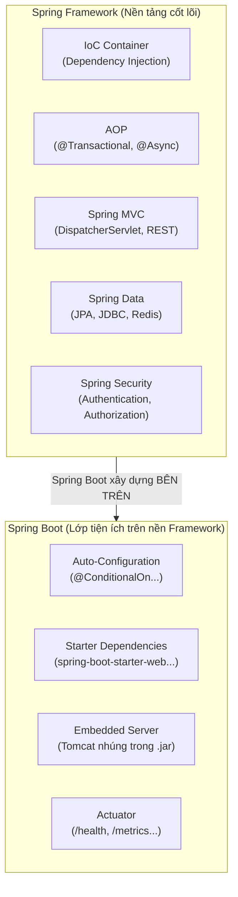
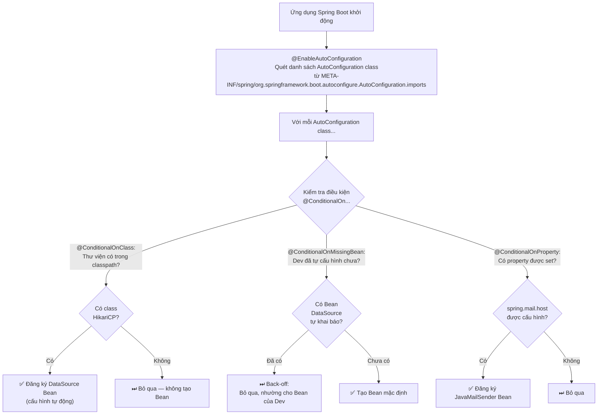
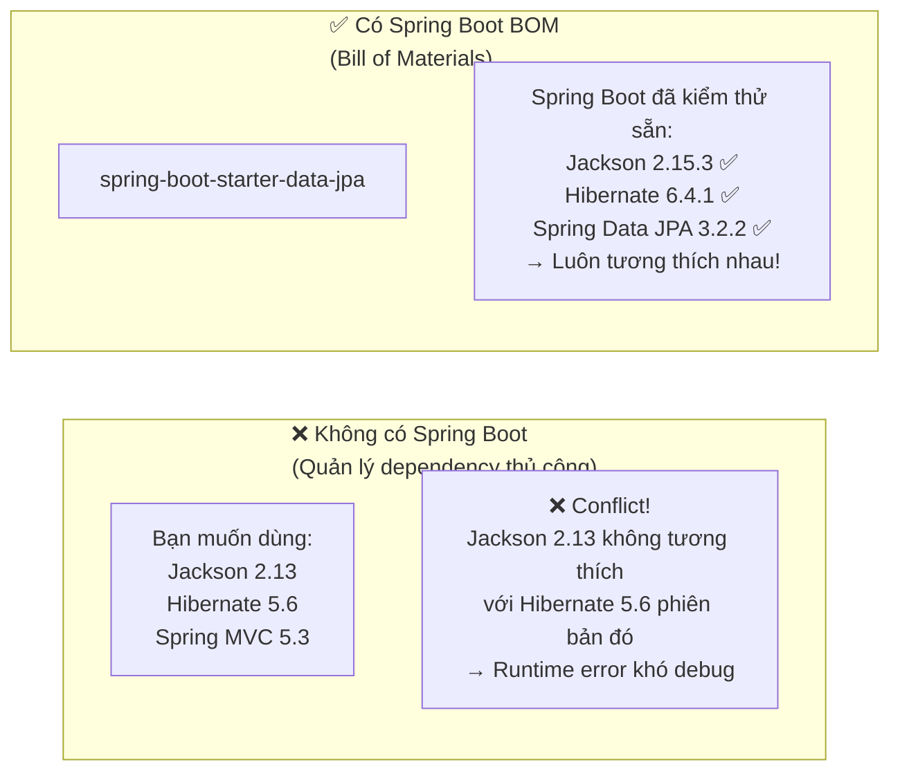
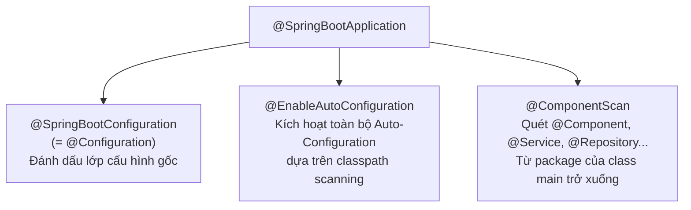
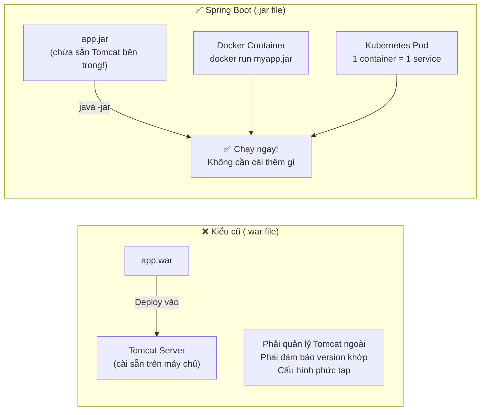
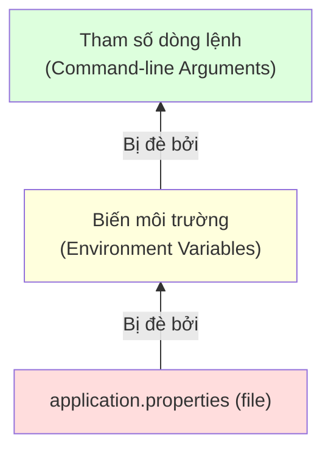

*"Spring Boot thần kỳ ở điểm nào? Tôi chỉ thêm một dependency là mọi thứ tự chạy?"* — Đây là câu hỏi của hầu hết lập trình viên khi mới bắt đầu. Câu trả lời nằm ở **Auto-Configuration** — một trong những cơ chế thông minh nhất trong hệ sinh thái Java.

Hiểu được cơ chế này sẽ giúp bạn: gỡ lỗi hiệu quả khi cấu hình bị xung đột, tuỳ chỉnh Spring Boot đúng cách mà không phá vỡ tính năng tự động, và tự tin trả lời bất kỳ câu phỏng vấn nào về Spring Boot Internals.

---

## 1. Spring Framework vs Spring Boot: Ranh Giới Rõ Ràng



> [!NOTE]
> **Spring Boot không thay thế Spring Framework** — nó là lớp tiện ích xây dựng *trên nền* Spring Framework, giải quyết bài toán "Convention over Configuration": giảm thiểu tối đa công sức cấu hình thủ công để developer tập trung vào nghiệp vụ.

---

## 2. Auto-Configuration: Cơ Chế Tự Động Kỳ Diệu

### 2.1 Hoạt Động Bên Trong

Auto-Configuration là cơ chế **tự động đăng ký các Bean cấu hình sẵn** dựa trên các điều kiện kiểm tra lúc khởi động ứng dụng.



### 2.2 Tính Năng "Back-off" — Điểm Đắt Giá Nhất

**Back-off** (tự lùi lại) là cơ chế Spring Boot tôn trọng quyết định của developer:

```java
// BÊN TRONG Spring Boot Auto-Configuration (code framework, bạn không thấy):
@Configuration
@ConditionalOnClass(DataSource.class) // Chỉ chạy nếu có thư viện JDBC trong classpath
public class DataSourceAutoConfiguration {

    @Bean
    @ConditionalOnMissingBean // Magic! Chỉ tạo nếu dev CHƯA khai báo DataSource riêng
    public DataSource dataSource() {
        // Tạo DataSource mặc định từ application.properties
        return DataSourceBuilder.create()
                .url(properties.getUrl())
                .username(properties.getUsername())
                .build();
    }
}
```

```java
// Trong code CỦA BẠN — khai báo DataSource tùy chỉnh:
@Configuration
public class DatabaseConfig {

    @Bean // Khai báo Bean DataSource riêng
    public DataSource dataSource() {
        HikariDataSource ds = new HikariDataSource();
        ds.setJdbcUrl("jdbc:postgresql://prod-db:5432/myapp");
        ds.setMaximumPoolSize(50);     // Tùy chỉnh Connection Pool
        ds.setConnectionTimeout(3000); // Timeout 3 giây
        ds.setConnectionTestQuery("SELECT 1");
        return ds;
    }
}
// -> Spring Boot thấy DataSource Bean đã có -> @ConditionalOnMissingBean = false
// -> DataSourceAutoConfiguration tự động BACK-OFF, không tạo Bean mặc định nữa
// -> DataSource của bạn được dùng!
```

> [!TIP]
> **Back-off** là lý do Spring Boot vừa "magical" (zero-config) vừa linh hoạt tùy chỉnh. Bạn không cần tắt Auto-Configuration để override — chỉ cần khai báo Bean của riêng mình, Spring Boot tự nhận ra và lùi lại.

### 2.3 Debug Auto-Configuration

```properties
# Thêm vào application.properties để xem Auto-Configuration nào đang được bật/tắt
debug=true
# Hoặc:
logging.level.org.springframework.boot.autoconfigure=DEBUG
```

Hoặc gọi Actuator endpoint:
```
GET /actuator/conditions
```
→ Trả về danh sách đầy đủ các điều kiện Auto-Configuration đã pass hay fail.

---

## 3. Starter Dependencies: Hết Mãi Vấn Đề Version Conflict

### 3.1 Starter Là Gì?

Starter **không chứa code nghiệp vụ** — chúng chỉ là file cấu hình Maven/Gradle kéo theo các thư viện phụ thuộc được tuyển chọn và kiểm thử sẵn:

```xml
<!-- Bạn chỉ cần khai báo 1 dòng: -->
<dependency>
    <groupId>org.springframework.boot</groupId>
    <artifactId>spring-boot-starter-web</artifactId>
    <!-- KHÔNG cần version — Spring Boot BOM quản lý! -->
</dependency>

<!-- Spring Boot tự động kéo theo toàn bộ: -->
<!-- spring-webmvc 6.x.x      -->
<!-- tomcat-embed-core 10.x.x  -->
<!-- jackson-databind 2.x.x   -->
<!-- spring-boot-autoconfigure -->
<!-- slf4j-api + logback       -->
<!-- hibernate-validator       -->
<!-- ... và nhiều thư viện khác -->
```

### 3.2 Giải Quyết Triệt Để Version Conflict



### 3.3 Các Starter Thông Dụng

| Starter | Bao gồm | Khi nào dùng |
| :--- | :--- | :--- |
| `starter-web` | Spring MVC, Tomcat, Jackson | REST API / Web app |
| `starter-data-jpa` | Hibernate, Spring Data JPA, HikariCP | Truy cập Database |
| `starter-security` | Spring Security | Authentication & Authorization |
| `starter-validation` | Hibernate Validator, Jakarta Validation | Validate DTO |
| `starter-test` | JUnit 5, Mockito, AssertJ, MockMvc | Unit & Integration Test |
| `starter-actuator` | Health checks, Metrics, Monitoring | Giám sát Production |
| `starter-mail` | JavaMail, MIME Message | Gửi Email |
| `starter-data-redis` | Lettuce, Spring Data Redis | Cache, Session với Redis |

---

## 4. Giải Phẫu `@SpringBootApplication`

```java
// @SpringBootApplication là tổ hợp của 3 annotation:
@SpringBootConfiguration   // = @Configuration: Lớp cấu hình gốc của ứng dụng
@EnableAutoConfiguration   // Kích hoạt cơ chế tự động cấu hình
@ComponentScan             // Quét Bean từ package hiện tại trở xuống
public class MyApplication {
    public static void main(String[] args) {
        SpringApplication.run(MyApplication.class, args);
    }
}
```



> [!WARNING]
> **Đặt class `main` sai package** là lỗi phổ biến với người mới: nếu `MainApp.java` nằm ở `com.example.web` thay vì `com.example`, các Bean ở `com.example.service` và `com.example.repository` sẽ **không được quét** và `NoSuchBeanDefinitionException` sẽ xuất hiện. Luôn đặt class `main` ở **root package** của dự án.

---

## 5. Embedded Server: Triển Khai Đơn Giản Hóa Tối Đa

### 5.1 Kiến Trúc `.jar` Tự Khởi Động



### 5.2 Lợi Ích Với Microservices

```yaml
# docker-compose.yml — Mỗi service chạy độc lập, tự chứa Tomcat riêng
services:
  order-service:
    image: myapp/order-service:1.0.0
    ports:
      - "8081:8080"

  payment-service:
    image: myapp/payment-service:1.0.0
    ports:
      - "8082:8080"

  user-service:
    image: myapp/user-service:1.0.0
    ports:
      - "8083:8080"
# Mỗi service là 1 .jar độc lập với Tomcat nhúng riêng — không can thiệp lẫn nhau!
```

---

## 6. Spring Profiles & Externalized Configuration

### 6.1 Bài Toán Thực Tế

```
Cùng 1 file app.jar duy nhất phải chạy được trên:
- Máy Dev: DB ở localhost, log DEBUG, gửi email giả
- Staging:  DB ở staging server, log INFO, gửi email test
- Production: DB ở cloud, log WARN, gửi email thật
→ Không sửa code, không build lại!
```

### 6.2 Cách Tổ Chức File Cấu Hình

```
src/main/resources/
├── application.yml              # Cấu hình chung — áp dụng cho MỌI môi trường
├── application-dev.yml          # Ghi đè cho môi trường DEV
├── application-staging.yml      # Ghi đè cho môi trường STAGING
└── application-prod.yml         # Ghi đè cho môi trường PRODUCTION
```

```yaml
# application.yml — Cấu hình chung
spring:
  application:
    name: my-ecommerce-app
  jpa:
    show-sql: false

server:
  port: 8080

app:
  pagination:
    default-size: 20
```

```yaml
# application-dev.yml — Ghi đè cho Dev
spring:
  datasource:
    url: jdbc:postgresql://localhost:5432/shop_dev
    username: dev_user
    password: dev_pass  # ⚠️ OK trên Dev nhưng KHÔNG bao giờ commit prod secret!
  jpa:
    show-sql: true  # Hiển thị SQL để debug

logging:
  level:
    root: DEBUG
    com.example: TRACE
```

```yaml
# application-prod.yml — Ghi đè cho Production
spring:
  datasource:
    url: ${DB_URL}           # ✅ Đọc từ Environment Variable, không hardcode!
    username: ${DB_USERNAME}
    password: ${DB_PASSWORD}
  jpa:
    show-sql: false

logging:
  level:
    root: WARN
```

### 6.3 Sử Dụng `@Profile` Cho Bean

```java
// Interface dùng chung
public interface EmailService {
    void send(String to, String subject, String body);
}

// Chỉ được tạo Bean khi profile "dev" hoặc "test" bật
@Service
@Profile({"dev", "test"})
public class FakeEmailService implements EmailService {
    @Override
    public void send(String to, String subject, String body) {
        // Chỉ in ra console — không gửi email thật
        log.info("[FAKE EMAIL] To: {} | Subject: {} | Body: {}", to, subject, body);
    }
}

// Chỉ được tạo Bean khi profile "prod" bật
@Service
@Profile("prod")
public class SmtpEmailService implements EmailService {
    @Override
    public void send(String to, String subject, String body) {
        // Kết nối SMTP thật và gửi email
    }
}

// Chạy ở mọi môi trường TRỪ prod (toán tử phủ định !)
@Component
@Profile("!prod")
public class DatabaseSeeder {
    @PostConstruct
    public void seed() {
        // Chỉ seed dữ liệu mẫu ở Dev và Staging
    }
}
```

### 6.4 Thứ Tự Ưu Tiên Externalized Configuration



```bash
# Thứ tự ưu tiên từ thấp đến cao:

# 1. Thấp nhất: application.yml / application.properties
server.port=8080

# 2. Biến môi trường (overrides file)
export SERVER_PORT=9090

# 3. Cao nhất: Tham số dòng lệnh (overrides mọi thứ)
java -jar app.jar --server.port=9999 --spring.profiles.active=prod
```

### 6.5 Đọc Cấu Hình Trong Code

```java
// Cách 1: @Value — đọc từng giá trị đơn lẻ
@Service
public class PaymentService {
    @Value("${app.payment.timeout:5000}") // 5000 là giá trị mặc định
    private int paymentTimeout;

    @Value("${app.payment.provider}")
    private String paymentProvider;
}

// Cách 2: @ConfigurationProperties — gom nhóm, type-safe (khuyến nghị)
@Component
@ConfigurationProperties(prefix = "app.payment")
public class PaymentProperties {
    private int timeout = 5000;        // Giá trị mặc định
    private String provider;
    private boolean enableRetry;
    private RetryConfig retry;         // Object lồng nhau
    // Getters & Setters...
}

// application.yml:
// app:
//   payment:
//     timeout: 3000
//     provider: VNPAY
//     enable-retry: true
//     retry:
//       max-attempts: 3
//       delay-ms: 1000
```

> [!CAUTION]
> **Cạm bẫy bảo mật nghiêm trọng:** Spring Profiles chỉ dùng để phân tách cấu hình theo môi trường, **KHÔNG PHẢI** nơi lưu trữ secrets. Tuyệt đối không commit `application-prod.yml` chứa mật khẩu DB thật hay JWT secret key lên Git — kể cả repo private. Hacker scan toàn bộ commit history, kể cả đã xóa. Secrets phải được truyền qua:
> - **OS Environment Variables** trên server
> - **Kubernetes Secret** trong K8s cluster  
> - **HashiCorp Vault** hoặc **AWS Secrets Manager** cho hệ thống lớn

---

## 7. Spring Boot Actuator: Giám Sát Production

### 7.1 Kích Hoạt Và Các Endpoint Hữu Ích

```xml
<dependency>
    <groupId>org.springframework.boot</groupId>
    <artifactId>spring-boot-starter-actuator</artifactId>
</dependency>
```

```yaml
# application.yml
management:
  endpoints:
    web:
      exposure:
        include: health, info, metrics  # Chỉ mở endpoint thực sự cần!
        # KHÔNG bao giờ: include: "*" trên Production!
  endpoint:
    health:
      show-details: when-authorized     # Chi tiết chỉ cho user đã xác thực
  server:
    port: 8081  # Tách Actuator sang port riêng (không public ra Internet)
```

| Endpoint | Mô tả | Dùng để |
| :--- | :--- | :--- |
| `/actuator/health` | Trạng thái sức khoẻ ứng dụng | Kubernetes Liveness/Readiness Probe |
| `/actuator/info` | Thông tin ứng dụng (version, build time) | Tracking deployment |
| `/actuator/metrics` | JVM, HTTP metrics, Connection Pool | Tích hợp Prometheus/Grafana |
| `/actuator/loggers` | Xem & thay đổi log level runtime | Debug Production không cần restart |
| `/actuator/conditions` | Kết quả Auto-Configuration | Debug Bean không được tạo |
| ⚠️ `/actuator/env` | **NGUY HIỂM!** Toàn bộ environment | **Lộ password, secret keys!** |
| ⚠️ `/actuator/heapdump` | **NGUY HIỂM!** Dump JVM Heap | **Lộ dữ liệu nhạy cảm trong RAM!** |

### 7.2 Tích Hợp Với Kubernetes

```yaml
# deployment.yaml — Kubernetes Probe dùng Actuator
livenessProbe:
  httpGet:
    path: /actuator/health/liveness
    port: 8081  # Actuator port riêng biệt
  initialDelaySeconds: 30
  periodSeconds: 10

readinessProbe:
  httpGet:
    path: /actuator/health/readiness
    port: 8081
  initialDelaySeconds: 15
  periodSeconds: 5
```

### 7.3 Custom Health Indicator

```java
// Tạo custom health check riêng cho ứng dụng
@Component
public class PaymentGatewayHealthIndicator implements HealthIndicator {

    private final PaymentGatewayClient client;

    @Override
    public Health health() {
        try {
            boolean isReachable = client.ping();
            if (isReachable) {
                return Health.up()
                        .withDetail("gateway", "VNPAY")
                        .withDetail("latency", "12ms")
                        .build();
            }
            return Health.down()
                    .withDetail("reason", "Payment gateway không phản hồi")
                    .build();
        } catch (Exception e) {
            return Health.down(e).build();
        }
    }
}
// GET /actuator/health sẽ bao gồm kết quả của custom check này
```

---

## 8. Chuyên Mục Phỏng Vấn: Câu 31 – 36

---

**Câu 31 — Spring Framework và Spring Boot khác nhau ở đâu?**

> *"Spring Boot **không thay thế** mà được xây dựng **trên nền tảng của** Spring Framework. Spring Framework cung cấp các cơ chế cốt lõi (IoC, DI, AOP, MVC, Transaction), còn Spring Boot là lớp tiện ích giúp khởi tạo và vận hành dự án nhanh nhờ 4 trụ cột: **Starter Dependencies** (quản lý version), **Auto-Configuration** (zero-config), **Embedded Server** (Tomcat nhúng trong .jar) và **Actuator** (giám sát Production)."*

---

**Câu 32 — Cơ chế Auto-Configuration là gì? Làm sao nó biết khi nào tạo Bean?**

> *"Là cơ chế tự động đăng ký các Bean cấu hình sẵn dựa trên điều kiện kiểm tra lúc khởi động qua bộ annotation `@Conditional` như `@ConditionalOnClass` (thư viện có trong classpath không?), `@ConditionalOnProperty` (property có được set không?). Điểm đắt giá nhất là cơ chế **Back-off**: nhờ `@ConditionalOnMissingBean`, nếu developer tự khai báo Bean riêng thì Spring Boot tự nhận ra và không tạo Bean mặc định nữa — vừa tự động vừa linh hoạt tùy chỉnh."*

---

**Câu 33 — Starter Dependency là gì? Giải quyết vấn đề gì?**

> *"Là gói quản lý phụ thuộc được tuyển chọn sẵn theo từng tính năng (ví dụ `spring-boot-starter-web`, `spring-boot-starter-data-jpa`). Bản thân Starter không chứa code nghiệp vụ mà là file cấu hình Maven/Gradle kéo theo toàn bộ thư viện liên quan. Giải quyết triệt để vấn đề **Version Conflict** vì Spring Boot đã kiểm thử và khóa sẵn các phiên bản tương thích nhau thông qua BOM (Bill of Materials)."*

---

**Câu 34 — `@SpringBootApplication` gồm những annotation nào?**

> *"Là annotation tổng hợp gộp 3 annotation: (1) **`@SpringBootConfiguration`** (bản chất là `@Configuration` — đánh dấu lớp cấu hình gốc); (2) **`@EnableAutoConfiguration`** (kích hoạt cơ chế tự động cấu hình); (3) **`@ComponentScan`** (quét Bean từ package của class `main` trở xuống). Vì vậy class `main` phải đặt ở **root package** để `@ComponentScan` quét đủ toàn bộ dự án."*

---

**Câu 35 — Tại sao Embedded Server lại hữu ích?**

> *"Thay vì phải cài Tomcat riêng rồi deploy file `.war`, Embedded Server được nhúng thẳng vào file `.jar`. Lợi ích: (1) chạy ngay bằng `java -jar` — không cần cài thêm gì; (2) đảm bảo **đồng nhất phiên bản** server giữa Dev và Production — không có lỗi 'trên máy mình chạy được'; (3) đóng gói vào **Docker container** cực đơn giản — mỗi microservice là 1 container độc lập với server riêng."*

---

**Câu 36 — Spring Boot Actuator là gì? Cần lưu ý gì về bảo mật?**

> *"Module cung cấp các endpoint giám sát và vận hành hệ thống trên Production: `/actuator/health` cho Kubernetes Probe, `/actuator/metrics` tích hợp Prometheus/Grafana, `/actuator/loggers` thay đổi log level runtime không cần restart. **Bảo mật quan trọng:** endpoint như `/env` lộ toàn bộ environment variables (gồm password, secret keys) và `/heapdump` dump cả RAM — phải chỉ mở những endpoint thực sự cần, bảo vệ bằng Spring Security và tốt nhất là tách sang port nội bộ riêng không public ra Internet."*

---

> [!TIP]
> 📚 **Bài tiếp theo trong series:** [Spring Data JPA & Hibernate Mastery](./spring-data-jpa-mastery) — Giải mã vấn đề N+1 Query, tại sao đổi sang EAGER là anti-pattern nghiêm trọng, và các kỹ thuật tối ưu chuẩn (JOIN FETCH, @EntityGraph).
