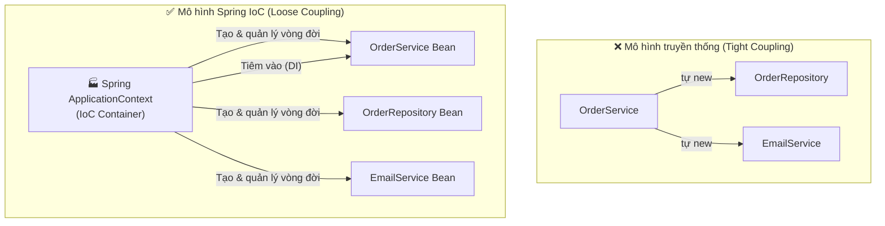
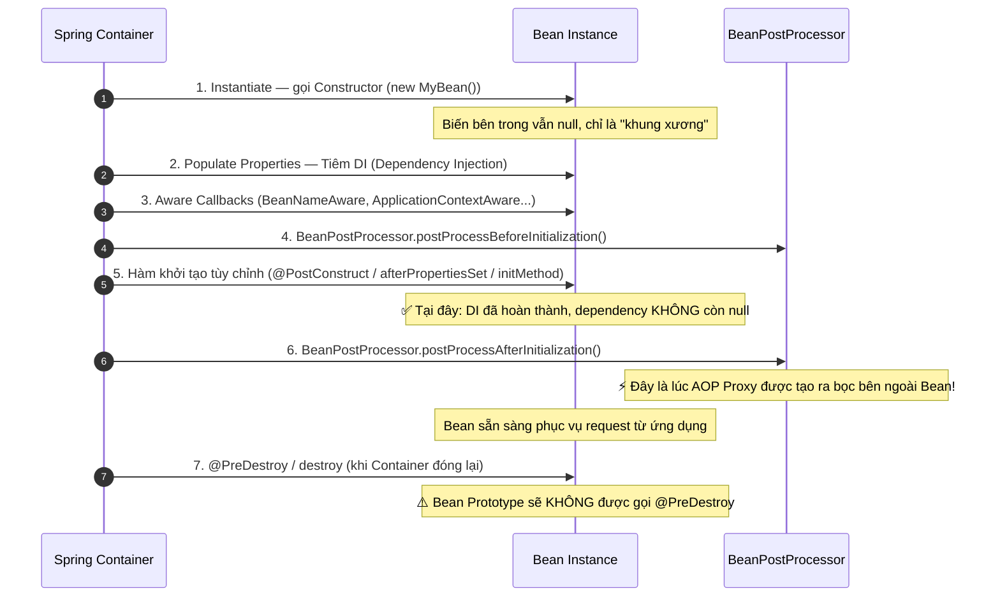
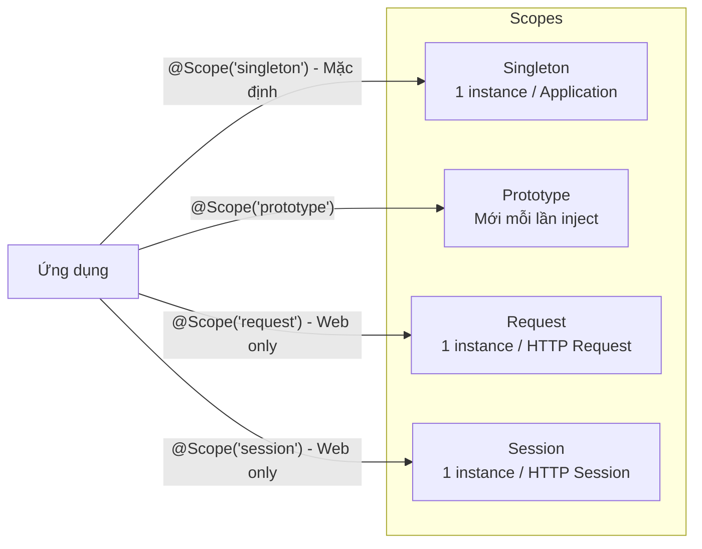
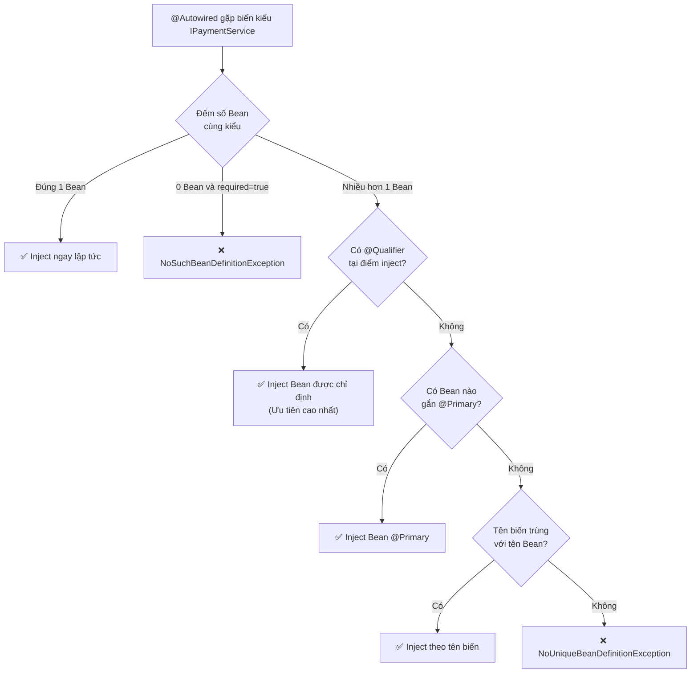

Nhiều lập trình viên dùng Spring hàng ngày nhưng khi phỏng vấn gặp câu *"Tại sao Constructor Injection lại tốt hơn Field Injection?"* hay *"Singleton Bean có an toàn đa luồng không?"* thì lại loay hoay. Nguyên nhân không phải vì lười học — mà vì chưa từng hiểu đúng **bản chất IoC Container** đang làm gì phía sau lưng code của mình.

Bài viết này sẽ giải mã từng lớp: từ triết lý đến cơ chế thực thi, từ lý thuyết đến các cạm bẫy thực tế trên Production.

---

## 1. IoC & DI: Nguyên Lý và Kỹ Thuật Hiện Thực Hóa

### 1.1 Inversion of Control (IoC) — Đảo Ngược Quyền Kiểm Soát

Trong phát triển phần mềm truyền thống, một class tự khởi tạo các phụ thuộc của nó:

```java
// Cách cũ: Tight Coupling — OrderService tự "new" phụ thuộc
public class OrderService {
    // Cứng nhắc: muốn đổi sang MockRepository để test phải sửa cả class này
    private OrderRepository repo = new OrderRepository();
    private EmailService email = new EmailService("smtp.gmail.com", 587);
}
```

**IoC** đảo ngược quyền kiểm soát này: thay vì class tự tạo phụ thuộc, một thực thể bên ngoài — **Spring IoC Container** — sẽ đảm nhận việc tạo lập, cấu hình và gắn kết toàn bộ đối tượng.



> [!NOTE]
> **IoC** là **Design Principle** (nguyên lý thiết kế) — nó chỉ mô tả *ai nên kiểm soát việc tạo đối tượng*.  
> **Dependency Injection (DI)** là **Design Pattern / Kỹ thuật cụ thể** mà Spring dùng để **hiện thực hóa** nguyên lý IoC đó.

### 1.2 BeanFactory vs ApplicationContext

| Tiêu chí | `BeanFactory` | `ApplicationContext` |
| :--- | :--- | :--- |
| **Khởi tạo Bean** | **Lazy** — chỉ tạo khi được yêu cầu | **Eager** — tạo sẵn các Singleton Bean khi khởi động |
| **Phát hiện lỗi** | Muộn — chỉ lỗi khi gọi Bean | **Sớm** — báo lỗi cấu hình ngay khi start |
| **Event Publishing** | Không | Có (`ApplicationEventPublisher`) |
| **MessageSource** | Không | Có (đa ngôn ngữ i18n) |
| **AOP tích hợp** | Hạn chế | Đầy đủ |
| **Dùng trong thực tế** | Rất hiếm | **100% dự án Spring Boot** |

> [!TIP]
> **Câu trả lời phỏng vấn 15 giây:** *"`ApplicationContext` kế thừa `BeanFactory` và bổ sung các tính năng cấp doanh nghiệp như Event Publishing, MessageSource và khởi tạo sẵn toàn bộ Singleton Bean ngay khi ứng dụng start để phát hiện lỗi cấu hình sớm. Trong thực tế 100% dự án Spring Boot đều dùng `ApplicationContext`."*

---

## 2. Ba Cách Dependency Injection: So Sánh Triệt Để

Spring hỗ trợ 3 cách "đưa" phụ thuộc vào Bean — sự khác biệt nằm ở **cửa nào** Container dùng để đưa chúng vào.

### 2.1 Constructor Injection ✅ (Best Practice)

```java
@Service
public class OrderService {
    // ✅ final: đảm bảo bất biến sau khi khởi tạo
    private final OrderRepository orderRepository;
    private final PaymentService paymentService;

    // Spring 4.3+: chỉ có 1 constructor -> không cần @Autowired
    // Lombok: @RequiredArgsConstructor tự generate constructor này
    public OrderService(OrderRepository orderRepository, PaymentService paymentService) {
        this.orderRepository = orderRepository;
        this.paymentService = paymentService;
    }
}
```

**Tại sao Constructor Injection là best practice?** Có 4 lý do cốt lõi:

1. **Bất biến (Immutability):** Từ khóa `final` đảm bảo không ai có thể vô tình gán `null` sau khi đối tượng được tạo. Field Injection và Setter Injection đều không cho phép dùng `final`.

2. **An toàn tuyệt đối NullPointerException:** Đối tượng chỉ được tạo ra khi **đã có đủ tất cả phụ thuộc**. Không có trạng thái "nửa vời" nguy hiểm.

3. **Viết Unit Test cực dễ — không cần Spring:**
   ```java
   // Khi test: chỉ cần new + truyền mock vào, chạy trong mili-giây
   OrderRepository mockRepo = Mockito.mock(OrderRepository.class);
   PaymentService mockPayment = Mockito.mock(PaymentService.class);
   
   OrderService service = new OrderService(mockRepo, mockPayment); // Xong!
   ```

4. **Phát hiện Code Smell:** Nếu constructor có 7-8 tham số, nhìn vào là nhận ra ngay class đang vi phạm **Single Responsibility Principle** và cần tách nhỏ.

### 2.2 Setter Injection — Chỉ Cho Phụ Thuộc Tùy Chọn

```java
@Service
public class OrderService {
    // Không có final -> có thể bị gán null bất cứ lúc nào
    private NotificationService notificationService;

    // Chỉ dùng cho dependency tùy chọn (Optional Dependency)
    @Autowired(required = false)
    public void setNotificationService(NotificationService notificationService) {
        this.notificationService = notificationService;
    }

    public void processOrder(Order order) {
        // Phải kiểm tra null thủ công vì nó là tùy chọn
        if (notificationService != null) {
            notificationService.send(order.getCustomerEmail());
        }
    }
}
```

> [!WARNING]
> Setter Injection không dùng được `final`. Bất kỳ đoạn code nào cũng có thể gọi `service.setNotificationService(null)` và gây ra NPE rất khó tìm nguyên nhân.

### 2.3 Field Injection ❌ (Không Khuyến Khích)

```java
@Service
public class OrderService {
    @Autowired // Spring dùng Java Reflection để "bẻ khóa" private và nhét vào
    private OrderRepository orderRepository; // Không thể final

    @Autowired
    private PaymentService paymentService;
}
```

**Tại sao bị khuyên tránh?**

- **Rất khó test:** `new OrderService()` → cả hai biến đều `null`. Muốn gán Mock phải dùng `ReflectionTestUtils` hoặc khởi động cả Spring Context.
- **Che giấu sự phức tạp:** Copy-paste thêm 10 dòng `@Autowired` quá dễ, class phình to lúc nào không hay.
- **Phụ thuộc chặt vào Spring Container:** Code không còn là Java thuần, không thể chạy độc lập.

### 2.4 Bảng So Sánh Tổng Hợp

| Tiêu chí | Constructor Injection | Setter Injection | Field Injection |
| :--- | :---: | :---: | :---: |
| **Dùng được `final`** | ✅ Có | ❌ Không | ❌ Không |
| **An toàn NPE** | ✅ Luôn an toàn | ⚠️ Phải kiểm tra null | ❌ Nguy hiểm |
| **Viết Unit Test** | ✅ Rất dễ (`new`) | 🟡 Dễ (gọi `set`) | ❌ Khó (Reflection) |
| **Loại phụ thuộc** | Bắt buộc | Tùy chọn | — |
| **Khuyến nghị Spring** | ✅ **Best Practice** | 🟡 Dùng có chọn lọc | ❌ **Không dùng** |

---

## 3. Vòng Đời 8 Bước Của Một Spring Bean



### Điểm quan trọng nhất: `@PostConstruct` vs Constructor

```java
@Service
public class CacheService {
    @Autowired
    private DataRepository dataRepository; // Field Injection (chỉ để minh họa)

    // ❌ SAI: dataRepository vẫn NULL tại thời điểm này!
    // Constructor chạy ở Bước 1, trước khi DI xảy ra ở Bước 2
    public CacheService() {
        // dataRepository.loadAll() -> NullPointerException!
    }

    // ✅ ĐÚNG: Bước 5 - mọi dependency đã được tiêm đầy đủ
    @PostConstruct
    public void initCache() {
        // An toàn để dùng dataRepository ở đây
        List<Data> all = dataRepository.loadAll();
        cache.putAll(all);
    }
}
```

> [!NOTE]
> Khi dùng **Constructor Injection**, tất cả phụ thuộc đã có sẵn ngay trong constructor vì chúng được truyền vào như tham số — không cần `@PostConstruct`. Đây là thêm một lý do để ưu tiên Constructor Injection.

---

## 4. Bean Scope: Quản Lý Số Lượng và Vòng Đời Instance

### 4.1 Các Scope Phổ Biến



| Scope | Số lượng instance | Thời gian sống | Dùng khi |
| :--- | :--- | :--- | :--- |
| **Singleton** (mặc định) | 1 trên toàn ứng dụng | Suốt vòng đời ứng dụng | Service, Repository (stateless) |
| **Prototype** | Mới mỗi lần `getBean()` / inject | Đến khi GC dọn | Đối tượng có trạng thái riêng |
| **Request** | 1 / HTTP Request | Đến hết request | Web: dữ liệu riêng theo từng request |
| **Session** | 1 / HTTP Session | Đến hết session | Web: dữ liệu riêng theo từng user |

### 4.2 Cạm Bẫy Thread-Safety Với Singleton Bean

> [!CAUTION]
> **Singleton không có nghĩa là Thread-Safe!** Đây là một trong những nguồn gốc lỗi nghiêm trọng nhất trên Production.

```java
@Service // Mặc định SINGLETON — chỉ có 1 object duy nhất trên toàn ứng dụng!
public class OrderService {

    // 💀 SAI LẦM CHẾT NGƯỜI: Biến instance lưu dữ liệu của từng request
    private String currentCustomerEmail;

    public void processOrder(String email) {
        this.currentCustomerEmail = email; // Ghi lên "bảng chung" duy nhất

        // Giả sử đang kiểm tra kho mất 2 giây...

        sendEmail(this.currentCustomerEmail); // Đọc từ "bảng chung"
    }
}
```

**Kịch bản thảm họa khi 2 khách đặt hàng cùng lúc:**
- **Giây 1:** Khách A (`a@gmail.com`) đặt hàng → `currentCustomerEmail = "a@gmail.com"`.
- **Giây 2:** Khách B (`b@gmail.com`) đặt hàng → ghi đè thành `"b@gmail.com"`.
- **Giây 3:** Luồng của Khách A chạy tiếp → đọc `"b@gmail.com"` → **gửi xác nhận đơn hàng của Khách A sang email của Khách B!**

```java
// ✅ CÁCH ĐÚNG: Stateless Singleton — an toàn đa luồng
@Service
public class OrderService {
    // Chỉ giữ dependency cố định (final), KHÔNG lưu state của request
    private final OrderRepository orderRepository;

    public void processOrder(String email) {
        // ✅ Biến cục bộ nằm trong hàm -> mỗi thread có Stack riêng, an toàn tuyệt đối
        String customerEmail = email;
        sendEmail(customerEmail);
    }
}
```

### 4.3 Tiêm Prototype Vào Singleton — Cạm Bẫy Ẩn

```java
@Service // Singleton
public class ReportService {

    // ❌ Cạm bẫy: Prototype chỉ được tạo 1 lần khi Singleton được khởi tạo!
    // Mọi lần gọi đều dùng đúng 1 instance cũ — mất hoàn toàn ý nghĩa Prototype
    @Autowired
    private ReportContext reportContext; // @Scope("prototype")
}
```

**Giải pháp:** Dùng `ObjectProvider` để lấy instance mới mỗi lần cần:

```java
@Service
public class ReportService {
    private final ObjectProvider<ReportContext> contextProvider;

    public ReportService(ObjectProvider<ReportContext> contextProvider) {
        this.contextProvider = contextProvider;
    }

    public void generateReport() {
        // ✅ Tạo instance Prototype mới mỗi lần gọi
        ReportContext context = contextProvider.getObject();
        context.process();
    }
}
```

---

## 5. Cơ Chế Autowiring: Thứ Tự Ưu Tiên Khi Spring Chọn Bean

Khi `@Autowired` được dùng, Spring tìm kiếm và chọn Bean theo thứ tự ưu tiên sau:



### 5.1 `@Primary` và `@Qualifier` — Ví Dụ Thực Tế

```java
// Interface — hoàn toàn sạch, không annotation
public interface IPaymentService {
    void processPayment(double amount);
}

// Bean mặc định toàn cục
@Service
@Primary
public class VnPayService implements IPaymentService { ... }

// Bean tùy chọn với tên cụ thể
@Service("momoService")
public class MoMoService implements IPaymentService { ... }

// --- Phía tiêu thụ ---

@Service
public class OrderService {
    // Không nói gì -> Spring chọn @Primary -> VnPayService
    public OrderService(IPaymentService paymentService) { ... }
}

@Service
public class RefundService {
    // @Qualifier chỉ đích danh -> bỏ qua @Primary -> MoMoService
    public RefundService(@Qualifier("momoService") IPaymentService paymentService) { ... }
}
```

> [!IMPORTANT]
> **`@Qualifier` luôn thắng `@Primary`.** `@Primary` chỉ là phương án dự phòng khi không có chỉ định nào khác. `@Qualifier` là mệnh lệnh trực tiếp và cụ thể tại điểm sử dụng nên luôn được ưu tiên cao nhất.

---

## 6. Stereotype Annotations: Ngữ Nghĩa Tầng & Hành Vi Đặc Biệt

Cả 4 annotation đều là **Stereotype Annotations** (bên trong đều chứa `@Component`) — giúp **Component Scanning** tự động nhận diện và đăng ký Bean.

| Annotation | Tầng kiến trúc | Hành vi đặc biệt | Mục đích chính |
| :--- | :--- | :--- | :--- |
| **`@Component`** | Dùng chung | Không | Cho Bean không thuộc 3 tầng chuẩn |
| **`@Service`** | Business Logic | Không (chủ yếu ngữ nghĩa) | Logic nghiệp vụ, nơi đặt `@Transactional` |
| **`@Repository`** | Persistence | **Exception Translation** ⭐ | Truy cập DB, tự động dịch lỗi thành `DataAccessException` |
| **`@Controller`** | Web / API | **MVC Routing & JSON** | Đón HTTP Request, trả View hoặc JSON |

> [!NOTE]
> **Exception Translation** của `@Repository` là điểm phân biệt quan trọng: Spring tự động chuyển đổi các lỗi hệ quản trị CSDL đặc thù (SQL Server Exception, Hibernate Exception...) thành hệ thống lỗi thống nhất `DataAccessException` của Spring, giúp code tầng Service không bị phụ thuộc vào từng loại DB cụ thể.

---

## 7. Chuyên Mục Phỏng Vấn: Câu 1 – 13 Spring Core

> [!TIP]
> **Công thức trả lời ăn điểm (45 giây):** Định nghĩa cốt lõi → Bản chất công nghệ bên dưới → Cạm bẫy / Best Practice thực tế.

---

**Câu 1 — Spring Framework là gì?**

> *"Spring là Java framework mã nguồn mở thiết kế theo dạng module, với thành phần cốt lõi là **IoC Container** chuyên tạo lập, quản lý vòng đời và kết nối các phụ thuộc giữa các đối tượng. Xung quanh đó là các module chuyên biệt: Spring MVC (web), Spring Data (dữ liệu), Spring Security (bảo mật), giúp giảm coupling và dễ kiểm thử hơn rất nhiều."*

---

**Câu 2 — Spring giải quyết vấn đề cốt lõi nào?**

> *"Hai bài toán lớn nhất: **Boilerplate Code** (code lặp nhàm như mở/đóng kết nối JDBC, commit/rollback thủ công) và **Tight Coupling** (các class tự khởi tạo cứng phụ thuộc bên trong). Nhờ DI, `@Transactional` khai báo và lớp trừu tượng thống nhất, lập trình viên chỉ cần tập trung vào logic nghiệp vụ."*

---

**Câu 3 — IoC là gì? Quyền nào bị đảo ngược?**

> *"IoC là nguyên lý thiết kế trong đó quyền **khởi tạo và gắn kết các đối tượng** được chuyển từ code ứng dụng sang Spring Container. Class chỉ cần khai báo những gì nó cần, Container sẽ quyết định thời điểm tạo và tiêm phụ thuộc phù hợp. Lưu ý: IoC là nguyên lý, DI là kỹ thuật Spring dùng để hiện thực hóa nguyên lý đó."*

---

**Câu 4 — DI là gì? Có mấy cách? Cái nào khuyên dùng nhất?**

> *"DI là kỹ thuật Container cung cấp dependency cho đối tượng thay vì để đối tượng tự khởi tạo. Có 3 cách: Constructor, Setter và Field Injection. **Constructor Injection được khuyến nghị nhất** vì: cho phép dùng `final` đảm bảo bất biến, phát hiện sớm class vi phạm SRP khi có quá nhiều tham số, và viết Unit Test dễ dàng không cần Spring Context."*

---

**Câu 5 — Spring Bean là gì? `new ArrayList()` có phải Bean không?**

> *"Bean là đối tượng được **tạo ra, cấu hình và quản lý hoàn toàn bởi Spring IoC Container** (khai báo qua `@Component`, `@Bean`...). `new ArrayList()` tự khởi tạo bằng từ khóa `new` **không phải Bean** — Spring không quản lý nó và không tự động inject phụ thuộc cho nó."*

---

**Câu 6 — `BeanFactory` vs `ApplicationContext` khác nhau thế nào?**

> *"`BeanFactory` là container cơ bản nhất, khởi tạo Bean theo cơ chế Lazy. `ApplicationContext` kế thừa và mở rộng với Event Publishing, MessageSource, quản lý Profile, và mặc định khởi tạo sẵn toàn bộ Singleton Bean ngay khi ứng dụng start — giúp phát hiện lỗi cấu hình sớm. Thực tế 100% dự án Spring Boot đều dùng `ApplicationContext`."*

---

**Câu 7 — Bean Scope phổ biến là gì? Singleton có Thread-Safe không?**

> *"Các scope chính: **Singleton** (1 instance/ApplicationContext), **Prototype** (tạo mới mỗi lần), và trong Web có thêm `request`, `session`. Singleton **KHÔNG tự động thread-safe** — vì nhiều thread dùng chung 1 object, nếu lưu state của request vào biến instance thì các thread sẽ ghi đè lên nhau. Bean Singleton phải được thiết kế **stateless** — chỉ giữ dependency cố định, không lưu dữ liệu tạm theo từng request."*

---

**Câu 8 — Vòng đời Bean theo thứ tự nào? Tại sao dùng `@PostConstruct` thay vì Constructor với Field Injection?**

> *"8 bước: Constructor → DI → Aware Callbacks → BPP pre-init → `@PostConstruct` → BPP post-init (AOP Proxy) → Ready → `@PreDestroy`. Khi dùng Field Injection, lúc Constructor chạy (Bước 1) thì các field DI vẫn là `null` (Bước 2 chưa xảy ra) → gọi dependency trong constructor sẽ NPE. `@PostConstruct` chạy ở Bước 5 sau khi DI hoàn tất nên mới an toàn."*

---

**Câu 9 — `@Component`, `@Service`, `@Repository`, `@Controller` khác nhau ở đâu?**

> *"Cả 4 đều là Stereotype Annotations (bên trong đều chứa `@Component`) giúp Component Scanning nhận diện. Sự khác biệt: `@Service` mang ngữ nghĩa tầng Business Logic; `@Repository` bật cơ chế **Exception Translation** chuyển lỗi SQL/Hibernate về `DataAccessException` chuẩn của Spring; `@Controller` giúp Spring MVC ánh xạ HTTP request. `@Component` dùng cho Bean không thuộc 3 tầng kia."*

---

**Câu 10 — Component Scanning hoạt động ra sao?**

> *"Spring tự động quét các package được chỉ định để tìm class gắn Stereotype Annotation và đăng ký thành Bean. Trong Spring Boot, `@SpringBootApplication` mặc định quét từ package chứa class `main` và toàn bộ package con bên dưới — vì vậy phải đặt class `main` ở **root package** để không bỏ sót Bean, hoặc cấu hình tường minh qua `scanBasePackages`."*

---

**Câu 11 — Tại sao Constructor Injection tốt hơn Field Injection?**

> *"3 lý do chính: (1) Cho phép dùng `final` — đối tượng bất biến sau khi tạo, tránh gán null vô tình. (2) Unit Test cực dễ — chỉ `new Service(mockA, mockB)` bằng Java thuần, không cần Spring Context. (3) Phát hiện Code Smell — constructor có 8+ tham số báo hiệu class vi phạm SRP, cần tách nhỏ."*

---

**Câu 12 — `@Autowired` tìm kiếm Bean theo thứ tự nào?**

> *"Ưu tiên tìm theo **kiểu dữ liệu (Type)** trước: đúng 1 Bean → inject ngay; không có Bean nào → `NoSuchBeanDefinitionException`. Nếu có nhiều Bean cùng kiểu → kiểm tra `@Qualifier` (ưu tiên cao nhất) → nếu không có thì xem `@Primary` → nếu không thì khớp tên biến với tên Bean → không khớp thì `NoUniqueBeanDefinitionException`."*

---

**Câu 13 — `@Primary` và `@Qualifier` dùng để làm gì? Ai ưu tiên hơn?**

> *"`@Primary` đặt ở phía **cung cấp (định nghĩa Bean)** — đánh dấu lựa chọn mặc định toàn cục. `@Qualifier` đặt ở phía **tiêu thụ (điểm inject)** — chỉ đích danh Bean muốn sử dụng. Khi cả hai cùng xuất hiện, **`@Qualifier` luôn thắng** vì nó là mệnh lệnh cụ thể và trực tiếp tại điểm sử dụng."*

---

> [!TIP]
> 📚 **Bài tiếp theo trong series:** [Spring AOP & Quản Lý Giao Dịch](./spring-aop-transactions) — Giải mã bản chất Proxy, cơ chế CGLIB, cạm bẫy Self-Invocation và Transaction Propagation thực chiến.
