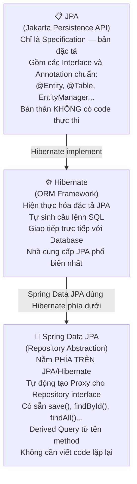
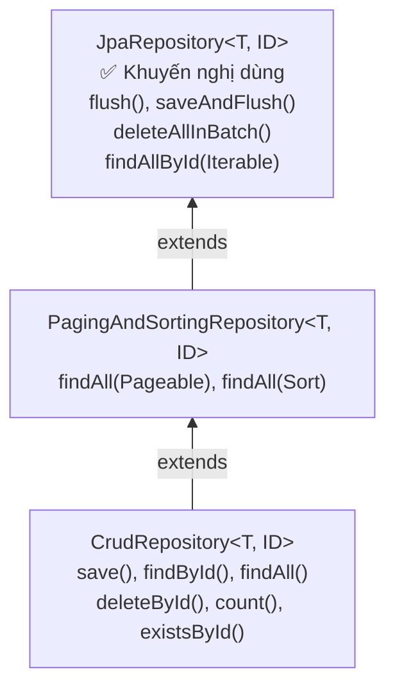
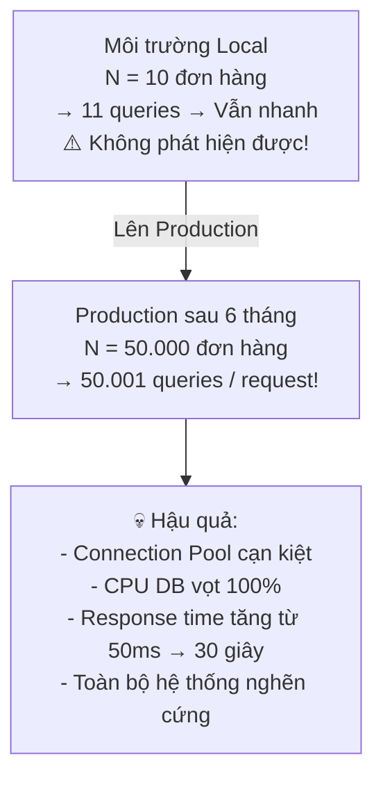

*"Ứng dụng chạy mượt trên máy local với 10 bản ghi nhưng lên Production với 10.000 bản ghi thì nghẽn cứng."* — Đây là triệu chứng điển hình của **N+1 Query Problem**, lỗi hiệu năng phổ biến nhất và nguy hiểm nhất khi làm việc với JPA/Hibernate.

Hiểu đúng lỗi này — và quan trọng hơn, biết cách tránh các "cách fix sai" — sẽ là điểm phân biệt giữa Junior và Mid-level Engineer trong mắt người phỏng vấn.

---

## 1. Phân Biệt Tam Giác: JPA — Hibernate — Spring Data JPA



> [!NOTE]
> **Cách nhớ nhanh:** JPA = *Hợp đồng* (ai muốn là ORM phải tuân theo), Hibernate = *Nhà thầu thực thi* hợp đồng đó, Spring Data JPA = *Kiến trúc sư* giúp bạn dùng Hibernate dễ dàng hơn mà không cần viết SQL lặp lại.

---

## 2. Phân Cấp Repository: Dùng Cái Nào?



```java
// Trong 99% dự án thực tế, dùng JpaRepository
@Repository
public interface OrderRepository extends JpaRepository<Order, Long> {

    // Spring Data tự động tạo câu SQL:
    // SELECT * FROM orders WHERE customer_email = ?
    Optional<Order> findByCustomerEmail(String email);

    // SELECT * FROM orders WHERE status = ? AND created_at >= ?
    // ORDER BY created_at DESC
    List<Order> findByStatusAndCreatedAtAfterOrderByCreatedAtDesc(
            OrderStatus status, LocalDateTime since);

    // Khi tên method quá dài và phức tạp -> dùng @Query
    @Query("SELECT o FROM Order o WHERE o.totalAmount >= :minAmount " +
           "AND o.customer.city = :city")
    List<Order> findHighValueOrdersByCity(
            @Param("minAmount") BigDecimal minAmount,
            @Param("city") String city);
}
```

### Khi nào không nên dùng Derived Query Method?

```java
// ❌ Quá dài, khó đọc, dễ nhầm:
List<Order> findByCustomerFirstNameIgnoreCaseAndCustomerLastNameIgnoreCaseAndStatusInAndCreatedAtBetweenAndTotalAmountGreaterThanEqual(
    String firstName, String lastName, List<OrderStatus> statuses,
    LocalDateTime from, LocalDateTime to, BigDecimal minAmount);

// ✅ Dùng @Query hoặc Specification:
@Query("""
    SELECT o FROM Order o
    WHERE LOWER(o.customer.firstName) = LOWER(:firstName)
      AND LOWER(o.customer.lastName) = LOWER(:lastName)
      AND o.status IN :statuses
      AND o.createdAt BETWEEN :from AND :to
      AND o.totalAmount >= :minAmount
    """)
List<Order> searchOrders(
    @Param("firstName") String firstName,
    @Param("lastName") String lastName,
    @Param("statuses") List<OrderStatus> statuses,
    @Param("from") LocalDateTime from,
    @Param("to") LocalDateTime to,
    @Param("minAmount") BigDecimal minAmount);
```

> [!TIP]
> **Ưu điểm lớn của Derived Query:** Spring Data **kiểm tra tính đúng đắn ngay lúc khởi động ứng dụng** — nếu tên thuộc tính sai (`findByEmaail` thay vì `findByEmail`), ứng dụng sẽ báo lỗi ngay khi start, không phải đến khi chạy mới biết.

---

## 3. Lazy vs Eager Fetching: Nền Tảng Để Hiểu N+1

### 3.1 Cơ Chế Hoạt Động

```java
@Entity
public class Order {
    @Id
    private Long id;

    // @ManyToOne mặc định là EAGER trong JPA
    @ManyToOne(fetch = FetchType.LAZY) // ✅ Best practice: ghi đè thành LAZY
    @JoinColumn(name = "customer_id")
    private Customer customer;

    // @OneToMany mặc định là LAZY
    @OneToMany(mappedBy = "order", fetch = FetchType.LAZY)
    private List<OrderItem> items = new ArrayList<>();
}
```

```java
// Với LAZY: Hibernate không tải dữ liệu ngay
Order order = orderRepository.findById(1L).get();
// -> SQL: SELECT * FROM orders WHERE id = 1
// -> customer và items CHƯA được load — chỉ là Proxy rỗng

String customerName = order.getCustomer().getName(); // Trigger lazy load
// -> SQL: SELECT * FROM customers WHERE id = ? (chạy thêm 1 query!)

int itemCount = order.getItems().size(); // Trigger lazy load
// -> SQL: SELECT * FROM order_items WHERE order_id = ? (chạy thêm 1 query!)
```

```java
// Với EAGER: Hibernate tải dữ liệu ngay
Order order = orderRepository.findById(1L).get();
// -> SQL: SELECT o.*, c.* FROM orders o JOIN customers c ON o.customer_id = c.id WHERE o.id = 1
// -> customer đã được tải cùng lúc (1 câu JOIN) — tiện nhưng đặt cứng cho MỌI trường hợp
```

### 3.2 Mặc Định JPA & Lý Do Thiết Kế

| Annotation | Mặc định JPA | Số lượng liên kết | Rủi ro | Lý do thiết kế |
| :--- | :---: | :--- | :--- | :--- |
| **`@ManyToOne`** | **EAGER** | 0 hoặc 1 | Thấp | FK nằm ngay bảng hiện tại, dữ liệu nhỏ, thường cần dùng |
| **`@OneToOne`** | **EAGER** | 0 hoặc 1 | Thấp | Quan hệ 1-1, dữ liệu nhỏ, thường cần dùng |
| **`@OneToMany`** | **LAZY** | 0 đến N (vô hạn) | **Rất cao** | N không giới hạn — có thể hàng triệu bản ghi! |
| **`@ManyToMany`** | **LAZY** | 0 đến N (vô hạn) | **Cực cao** | Bảng trung gian — dữ liệu tổ hợp khổng lồ |

> [!WARNING]
> Dù JPA chọn EAGER cho `@ManyToOne` với "ý định tốt", đây bị đa số chuyên gia coi là **Historic Design Flaw** (quyết định mặc định sai lầm lịch sử). Chính EAGER mặc định này là nguyên nhân gây ra N+1 Query phổ biến nhất!

---

## 4. N+1 Query Problem: Kẻ Phá Hoại Hiệu Năng Thầm Lặng

### 4.1 Tái Hiện Vấn Đề

```java
@Entity
public class Order {
    @Id private Long id;

    @OneToMany(fetch = FetchType.LAZY) // Mặc định LAZY
    private List<OrderItem> items;
}
```

```java
// ❌ Code trông vô hại nhưng gây thảm họa:
List<Order> orders = orderRepository.findAll(); // Bước 1: 1 câu query
for (Order order : orders) {
    System.out.println(order.getItems().size()); // Bước 2: N câu query!
}
```

**Điều gì xảy ra ở tầng Database:**

```sql
-- 1 câu query đầu: lấy N đơn hàng
SELECT * FROM orders;
-- → Trả về 1000 đơn hàng (N = 1000)

-- N câu query tiếp theo: mỗi đơn hàng 1 câu
SELECT * FROM order_items WHERE order_id = 1;
SELECT * FROM order_items WHERE order_id = 2;
SELECT * FROM order_items WHERE order_id = 3;
-- ... 997 câu nữa ...
SELECT * FROM order_items WHERE order_id = 1000;

-- TỔNG CỘNG: 1001 câu query thay vì 1!
```

### 4.2 Vì Sao Nguy Hiểm?



---

## 5. Tại Sao Đổi Sang EAGER Là Anti-Pattern? (3 Lý Do Cốt Lõi)

Đây là câu trả lời SAI phổ biến nhất khi được hỏi *"Bạn fix N+1 Query như thế nào?"*:

> ❌ *"Tôi đổi `FetchType.LAZY` thành `FetchType.EAGER` là xong!"*

### Lý Do 1: EAGER Với `findAll()` JPQL Vẫn Gây N+1!

```java
// Nhiều người nhầm: EAGER = Hibernate tự JOIN khi findAll()
// Sự thật: JPQL luôn được ưu tiên chạy trước

List<Order> orders = orderRepository.findAll();
// Bước 1: Hibernate chạy JPQL -> SELECT * FROM orders (không có JOIN)
// Bước 2: Thấy items là EAGER -> PHẢI load ngay
// Vì không có JOIN trong query ban đầu -> bắn N câu query riêng lẻ!
// Kết quả: vẫn N+1, chỉ là bắn ngay lập tức thay vì lazy
```

### Lý Do 2: Over-Fetching Gây Tràn RAM (OOM)

```java
// Giả sử cấu trúc entity:
// User --(EAGER)--> Order[] --(EAGER)--> OrderItem[] --(EAGER)--> Product

// Chỉ cần: đếm số lượng user đang hoạt động
long activeUsers = userRepository.countByStatus(UserStatus.ACTIVE);
// Nhưng Hibernate bị ép phải load: tất cả Order của mọi User, tất cả
// OrderItem của mọi Order, tất cả Product của mọi OrderItem...
// → OutOfMemoryError với DB có vài chục nghìn bản ghi!
```

### Lý Do 3: Mất Tính Linh Hoạt Theo Từng API

```java
// API A: Chỉ cần hiển thị danh sách đơn hàng (mã, ngày, tổng tiền)
// → Không cần items

// API B: Xem chi tiết đơn hàng
// → Cần cả items

// Với EAGER: API A buộc phải chịu chi phí của API B — luôn luôn!
// Không có cách nào "tắt" EAGER cho từng trường hợp
```

---

## 6. Quy Tắc Vàng & Giải Pháp Tối Ưu Chuẩn

### Quy Tắc Bất Di Bất Dịch

> **Mặc định LAZY cho TẤT CẢ quan hệ** (kể cả `@ManyToOne` và `@OneToOne` — ghi đè JPA default).  
> Khi nào cần dữ liệu con, chủ động nạp đúng nhu cầu bằng `JOIN FETCH` hoặc `@EntityGraph`.

### Giải Pháp 1: `JOIN FETCH` Trong JPQL

```java
@Repository
public interface OrderRepository extends JpaRepository<Order, Long> {

    // Màn hình danh sách: chỉ cần Order, không cần items -> dùng findAll() bình thường
    // SQL: SELECT * FROM orders (nhanh, nhẹ)

    // Màn hình chi tiết: cần cả items -> dùng query riêng với JOIN FETCH
    @Query("SELECT DISTINCT o FROM Order o JOIN FETCH o.items WHERE o.id = :id")
    Optional<Order> findByIdWithItems(@Param("id") Long id);
    // SQL: SELECT DISTINCT o.*, i.* FROM orders o
    //      INNER JOIN order_items i ON i.order_id = o.id
    //      WHERE o.id = ?
    // → CHỈ 1 câu query, không có N+1!

    // Lấy nhiều orders kèm items (batch):
    @Query("SELECT DISTINCT o FROM Order o JOIN FETCH o.items WHERE o.id IN :ids")
    List<Order> findAllWithItemsByIds(@Param("ids") List<Long> ids);
}
```

### Giải Pháp 2: `@EntityGraph` (Khai Báo Hơn)

```java
@Repository
public interface OrderRepository extends JpaRepository<Order, Long> {

    // Định nghĩa EntityGraph trên Entity
    // (hoặc inline như dưới đây)
    @EntityGraph(attributePaths = {"items", "items.product", "customer"})
    @Query("SELECT o FROM Order o WHERE o.status = :status")
    List<Order> findByStatusWithDetails(@Param("status") OrderStatus status);
    // SQL: SELECT o.*, i.*, p.*, c.* FROM orders o
    //      LEFT JOIN order_items i ON i.order_id = o.id
    //      LEFT JOIN products p ON i.product_id = p.id
    //      LEFT JOIN customers c ON o.customer_id = c.id
    //      WHERE o.status = ?
    // → 1 câu query duy nhất, lấy tất cả dữ liệu cần thiết
}
```

### Giải Pháp 3: DTO Projection (Tối Ưu Nhất Khi Chỉ Cần Một Phần Dữ Liệu)

```java
// Khi chỉ cần một vài field — không cần load toàn bộ Entity
public interface OrderSummary {
    Long getId();
    String getCustomerEmail();
    BigDecimal getTotalAmount();
    OrderStatus getStatus();
}

@Repository
public interface OrderRepository extends JpaRepository<Order, Long> {
    // Spring Data tự động map vào interface Projection
    List<OrderSummary> findByStatus(OrderStatus status);
    // SQL: SELECT o.id, o.customer_email, o.total_amount, o.status
    //      FROM orders o WHERE o.status = ?
    // → Không load toàn bộ Entity, không load quan hệ, nhanh nhất!
}
```

### So Sánh Các Giải Pháp

| Giải pháp | Số lượng Query | Linh hoạt | Khi nào dùng |
| :--- | :---: | :--- | :--- |
| **`JOIN FETCH`** | 1 | Trung bình | Cần Entity đầy đủ kèm quan hệ |
| **`@EntityGraph`** | 1 | Cao (khai báo rõ ràng) | Cần linh hoạt chọn quan hệ theo từng method |
| **DTO Projection** | 1 | Cao nhất | Chỉ cần một số field cụ thể — API danh sách |
| **`@BatchSize`** | N/batch | Trung bình | Khi không thể dùng JOIN (phân trang phức tạp) |

### Phát Hiện N+1 Trên Môi Trường Dev

```yaml
# application-dev.yml — Bật log SQL để phát hiện N+1
spring:
  jpa:
    show-sql: true
    properties:
      hibernate:
        format_sql: true

logging:
  level:
    org.hibernate.SQL: DEBUG
    org.hibernate.type.descriptor.sql.BasicBinder: TRACE

# Hoặc dùng datasource-proxy để đếm số lượng query:
# Thư viện: com.github.gavlyukovskiy:datasource-proxy-spring-boot-starter
```

> [!TIP]
> **Quy trình kiểm tra N+1:** Bật `show-sql: true` → Gọi API → Đếm số câu `SELECT` trong log. Nếu thấy nhiều câu `SELECT ... WHERE id = ?` liên tiếp cho cùng một bảng — đó chính là N+1 Query đang xảy ra.

---

## 7. Chuyên Mục Phỏng Vấn: Câu 37 – 41

---

**Câu 37 — JPA, Hibernate và Spring Data JPA khác nhau thế nào?**

> *"**JPA** chỉ là bản đặc tả (Specification) gồm các interface và annotation chuẩn (`@Entity`, `EntityManager`), bản thân không có code thực thi. **Hibernate** là ORM Framework hiện thực hóa đặc tả JPA, tự sinh SQL và giao tiếp với DB. **Spring Data JPA** là tầng trừu tượng nằm phía trên JPA/Hibernate, tự động tạo Proxy cho Repository interface giúp lập trình viên có sẵn các hàm CRUD, phân trang mà không cần viết code lặp lại."*

---

**Câu 38 — `CrudRepository`, `PagingAndSortingRepository` và `JpaRepository` khác nhau thế nào?**

> *"`CrudRepository` cung cấp các hàm CRUD cơ bản (`save`, `findById`, `deleteById`, `count`). `PagingAndSortingRepository` bổ sung phân trang (`Pageable`) và sắp xếp (`Sort`). `JpaRepository` bao gồm toàn bộ tính năng cả hai trên, thêm các thao tác đặc thù JPA như `flush`, `saveAndFlush`, `deleteAllInBatch`. Trong thực tế, **`JpaRepository` được dùng phổ biến nhất** vì tính đầy đủ nhất."*

---

**Câu 39 — Derived Query Method hoạt động ra sao? Khi nào không nên dùng?**

> *"Ngay khi ứng dụng khởi động, Spring Data phân tích cú pháp tên hàm (cắt tiền tố `findBy`, `countBy`, tách tên thuộc tính và toán tử `And`, `GreaterThan`...) rồi đối chiếu với Entity để sinh JPQL. Ưu điểm: phát hiện lỗi tên field ngay khi startup. Không nên dùng khi điều kiện lọc quá phức tạp — tên hàm trở nên dài khó đọc và khó bảo trì; lúc đó dùng `@Query` (JPQL/Native SQL) hoặc `Specification` / QueryDSL."*

---

**Câu 40 — N+1 Query là gì? Nguyên nhân và cách khắc phục?**

> *"Xảy ra khi thực hiện 1 query lấy N bản ghi cha, sau đó trong vòng lặp truy cập quan hệ con khiến Hibernate bắn thêm N query riêng lẻ — tổng cộng N+1 query. Với N = 10.000 thì là 10.001 query/request, làm cạn Connection Pool và sập DB. Cách khắc phục chuẩn: dùng **`JOIN FETCH`** trong JPQL hoặc **`@EntityGraph`** để gom về 1 query duy nhất, hoặc dùng **DTO Projection** khi chỉ cần một số field. Tuyệt đối không đổi sang EAGER — EAGER với `findAll()` JPQL vẫn gây N+1!"*

---

**Câu 41 — Lazy vs Eager Fetching? Cấu hình mặc định của các quan hệ JPA?**

> *"**Lazy:** Chưa tải dữ liệu quan hệ ngay — chỉ gán Proxy rỗng; query thực sự chạy khi gọi getter (nếu gọi sau khi Transaction đóng → `LazyInitializationException`). **Eager:** Tải luôn dữ liệu quan hệ khi lấy entity cha. Mặc định JPA: `@ManyToOne` và `@OneToOne` là **Eager**, `@OneToMany` và `@ManyToMany` là **Lazy**. **Best Practice:** Mặc định LAZY cho tất cả (kể cả `@ManyToOne` — ghi đè JPA default), sau đó chủ động dùng `JOIN FETCH` hoặc `@EntityGraph` theo nhu cầu từng API."*

---

> [!TIP]
> 📚 **Bài tiếp theo trong series:** [Spring Security, Testing & Clean Architecture](./spring-security-testing) — Cơ chế SecurityFilterChain, BCrypt chống Timing Attack, 5 Red Flags nguy hiểm, MockMvc và kiến trúc phân tầng sạch.
