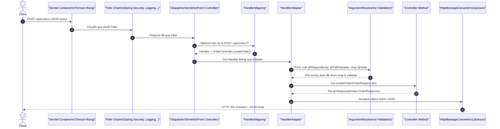
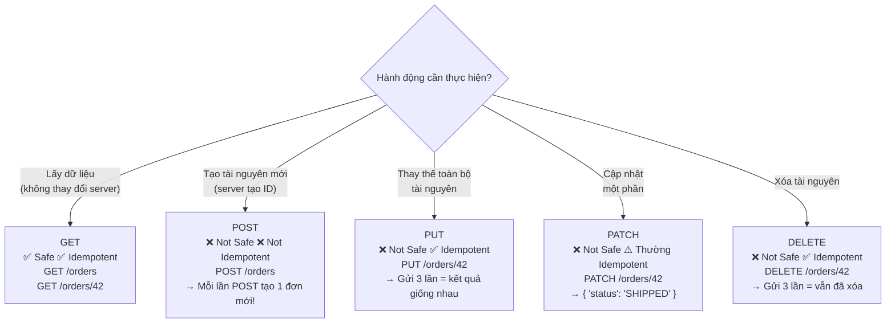
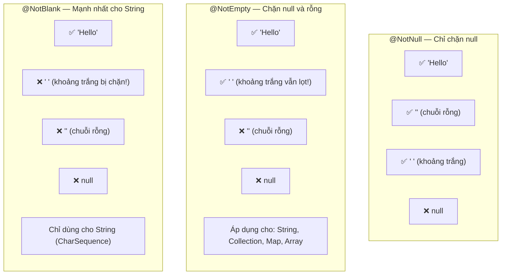
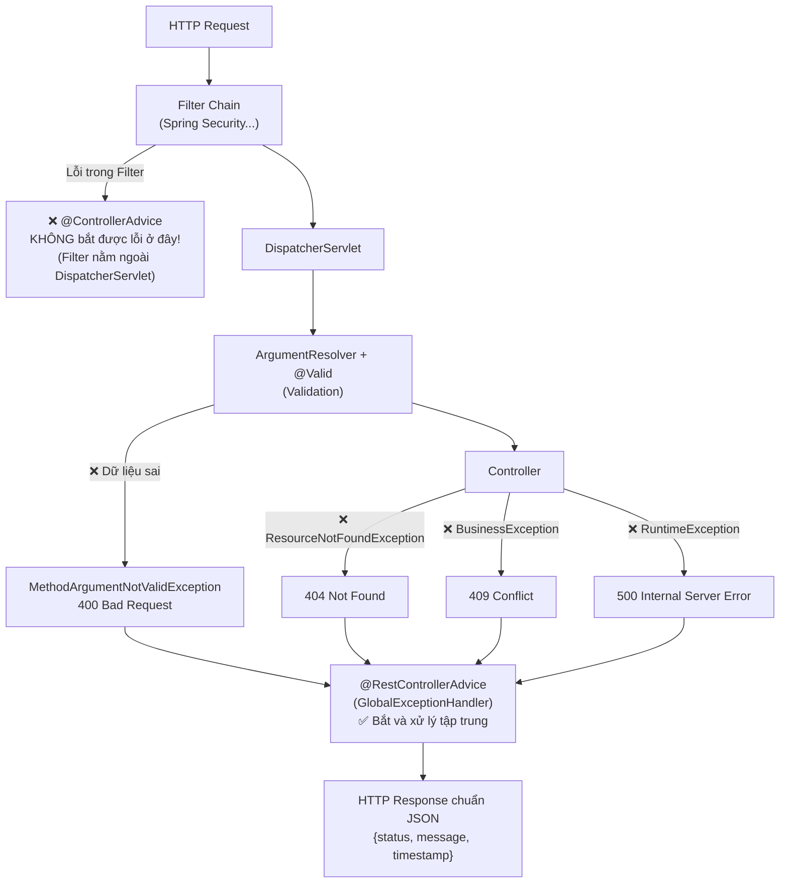

Một trong những câu hỏi phỏng vấn ưa thích nhất của các Senior Engineer là: *"Khi tôi gõ `POST /api/orders` và nhấn Enter, điều gì thực sự xảy ra bên trong Spring Boot?"* Câu trả lời chính xác đòi hỏi phải hiểu toàn bộ luồng xử lý — từ Tomcat đến Controller, qua từng thành phần trung gian.

Bài viết này đi từ cơ chế bên trong ra ngoài: Luồng request → Xây dựng REST API đúng chuẩn → Validation → Xử lý lỗi tập trung.

---

## 1. Luồng Xử Lý HTTP Request Trong Spring MVC

### 1.1 Sơ Đồ Tổng Thể



### 1.2 Vai Trò Từng Thành Phần

| Thành phần | Vai trò | Khi nào bạn gặp |
| :--- | :--- | :--- |
| **Filter** | Xử lý request/response **trước** DispatcherServlet | Spring Security (JWT filter), CORS, Logging |
| **DispatcherServlet** | Cổng tiếp nhận duy nhất — điều phối toàn bộ | Cấu hình tự động trong Spring Boot |
| **HandlerMapping** | Tìm method Controller phù hợp với URL + HTTP Method | Khi thêm `@GetMapping`, `@PostMapping`... |
| **HandlerAdapter** | Gọi Controller method (bridge pattern) | Tự động — ít khi can thiệp trực tiếp |
| **ArgumentResolver** | Map `@RequestBody`, `@PathVariable`, `@RequestParam`, chạy `@Valid` | Khi debug lỗi 400 Bad Request |
| **HttpMessageConverter** | Serialize/Deserialize JSON ↔ Java object (Jackson) | Khi config `ObjectMapper` custom |
| **ViewResolver** | Tìm template HTML (Thymeleaf, FreeMarker) | Chỉ với MVC truyền thống, không REST |
| **HandlerExceptionResolver** | Chuyển exception thành HTTP response lỗi | `@ControllerAdvice` dùng thành phần này |

> [!NOTE]
> **Filter vs Interceptor:** Filter thuộc tầng Servlet Container (chạy **trước** DispatcherServlet), còn `HandlerInterceptor` thuộc tầng Spring MVC (chạy **sau** DispatcherServlet nhưng **trước** Controller). Lỗi ném trong Filter sẽ **không** được `@ControllerAdvice` bắt.

### 1.3 DispatcherServlet: Front Controller Pattern

```java
// Spring Boot tự cấu hình DispatcherServlet — không cần khai báo thủ công
// Nó được đăng ký để xử lý mọi request đến: "/*"
// @SpringBootApplication -> @EnableAutoConfiguration -> DispatcherServletAutoConfiguration
```

DispatcherServlet không xử lý nghiệp vụ — nó chỉ điều phối:

1. Định tuyến đến đúng Controller
2. Kích hoạt Validation
3. Delegate xử lý lỗi cho `HandlerExceptionResolver` / `@ControllerAdvice`
4. Đóng gói kết quả trả về

---

## 2. Xây Dựng REST API Đúng Chuẩn

### 2.1 `@Controller` vs `@RestController`

```java
// @Controller: Dùng cho Web truyền thống (MVC với View template)
@Controller
@RequestMapping("/web/orders")
public class OrderWebController {

    @GetMapping("/{id}")
    public String getOrderPage(@PathVariable Long id, Model model) {
        model.addAttribute("order", orderService.findById(id));
        return "orders/detail"; // ViewResolver tìm template "orders/detail.html"
    }

    @PostMapping("/{id}/items")
    @ResponseBody // Cần @ResponseBody để trả JSON thay vì View
    public OrderItem addItem(@PathVariable Long id, @RequestBody ItemRequest req) {
        return orderService.addItem(id, req);
    }
}

// @RestController = @Controller + @ResponseBody trên tất cả methods
// Dùng cho REST API: mọi return value tự động serialize thành JSON/XML
@RestController
@RequestMapping("/api/v1/orders")
public class OrderApiController {

    private final OrderService orderService;

    public OrderApiController(OrderService orderService) {
        this.orderService = orderService;
    }

    @GetMapping("/{id}")
    public ResponseEntity<OrderResponse> getOrder(@PathVariable Long id) {
        return ResponseEntity.ok(orderService.findById(id));
        // Jackson tự động serialize OrderResponse thành JSON
    }
}
```

### 2.2 Bộ Ba Nhận Dữ Liệu Đầu Vào

```java
@RestController
@RequestMapping("/api/v1/products")
public class ProductController {

    // @PathVariable: Lấy từ đường dẫn URI — dùng để định danh tài nguyên cụ thể
    // GET /api/v1/products/42
    @GetMapping("/{id}")
    public ResponseEntity<ProductResponse> getById(@PathVariable Long id) {
        return ResponseEntity.ok(productService.findById(id));
    }

    // @RequestParam: Lấy từ Query String — dùng để lọc, tìm kiếm, phân trang
    // GET /api/v1/products?category=electronics&minPrice=100&page=0&size=20
    @GetMapping
    public ResponseEntity<Page<ProductResponse>> search(
            @RequestParam(required = false) String category,
            @RequestParam(defaultValue = "0") double minPrice,
            @RequestParam(defaultValue = "0") int page,
            @RequestParam(defaultValue = "20") int size) {
        return ResponseEntity.ok(productService.search(category, minPrice, PageRequest.of(page, size)));
    }

    // @RequestBody: Lấy từ body của request — dùng khi tạo mới / cập nhật dữ liệu phức tạp
    // POST /api/v1/products  (Body: { "name": "...", "price": 99.99, "category": "electronics" })
    @PostMapping
    public ResponseEntity<ProductResponse> create(@Valid @RequestBody CreateProductRequest request) {
        ProductResponse created = productService.create(request);
        return ResponseEntity.status(HttpStatus.CREATED).body(created);
    }
}
```

| Annotation | Nguồn dữ liệu | Ví dụ URL | Dùng khi |
| :--- | :--- | :--- | :--- |
| **`@PathVariable`** | Đường dẫn URI | `/orders/{id}` | Định danh tài nguyên cụ thể |
| **`@RequestParam`** | Query String | `?page=0&size=10` | Lọc, tìm kiếm, phân trang |
| **`@RequestBody`** | Body (JSON/XML) | `{ "name": "..." }` | Tạo mới, cập nhật dữ liệu phức tạp |

---

## 3. HTTP Methods, RESTful Design & Tính Idempotent

### 3.1 Chọn HTTP Method Đúng



### 3.2 Tính Idempotent — Khái Niệm Quan Trọng

**Idempotent** nghĩa là: gọi API **1 lần hay nhiều lần** với cùng đầu vào thì **trạng thái server vẫn giữ nguyên như nhau** sau tất cả các lần gọi.

```java
// ✅ DELETE là Idempotent:
// Lần 1: DELETE /orders/42 -> Xóa order 42 -> 204 No Content
// Lần 2: DELETE /orders/42 -> Order 42 đã không còn -> 404 Not Found
// Kết quả: order 42 đã bị xóa (trạng thái cuối cùng giống nhau)

// ❌ POST KHÔNG Idempotent:
// Lần 1: POST /orders -> Tạo order #100 -> 201 Created
// Lần 2: POST /orders -> Tạo order #101 -> 201 Created (khác nhau!)
// Giải pháp: Dùng Idempotency-Key header cho thanh toán quan trọng
```

> [!IMPORTANT]
> **Trong thanh toán và đặt hàng quan trọng:** POST có thể gây tạo trùng đơn nếu client gửi lại request do network timeout. Giải pháp chuẩn là dùng **`Idempotency-Key`** header — client tạo UUID duy nhất cho mỗi lần thử, server kiểm tra key này để tránh xử lý trùng.

---

## 4. `ResponseEntity` — Kiểm Soát Hoàn Toàn HTTP Response

### 4.1 Tại Sao Cần `ResponseEntity`?

```java
// ❌ Không dùng ResponseEntity: Luôn trả về HTTP 200 OK dù trường hợp nào
@GetMapping("/{id}")
public OrderResponse getOrder(@PathVariable Long id) {
    return orderService.findById(id); // HTTP 200 dù có tìm thấy hay không
}

// ✅ Dùng ResponseEntity: Kiểm soát chính xác Status Code, Headers và Body
@GetMapping("/{id}")
public ResponseEntity<OrderResponse> getOrder(@PathVariable Long id) {
    return orderService.findByIdOptional(id)
            .map(order -> ResponseEntity.ok(order))                // 200 OK khi tìm thấy
            .orElse(ResponseEntity.notFound().build());             // 404 Not Found khi không có
}
```

### 4.2 Bảng Các Trường Hợp Phổ Biến

```java
@RestController
@RequestMapping("/api/v1/orders")
public class OrderController {

    // 201 Created + Location header (chuẩn REST khi tạo tài nguyên)
    @PostMapping
    public ResponseEntity<OrderResponse> create(@Valid @RequestBody CreateOrderRequest req) {
        OrderResponse created = orderService.create(req);
        URI location = URI.create("/api/v1/orders/" + created.getId());
        return ResponseEntity.created(location).body(created); // 201 + Location header
    }

    // 200 OK với dữ liệu
    @GetMapping("/{id}")
    public ResponseEntity<OrderResponse> getById(@PathVariable Long id) {
        return ResponseEntity.ok(orderService.findById(id)); // 200 OK
    }

    // 204 No Content khi xóa thành công (không có body)
    @DeleteMapping("/{id}")
    public ResponseEntity<Void> delete(@PathVariable Long id) {
        orderService.delete(id);
        return ResponseEntity.noContent().build(); // 204 No Content
    }

    // Custom headers
    @GetMapping("/export")
    public ResponseEntity<byte[]> exportCsv() {
        byte[] csv = orderService.exportToCsv();
        return ResponseEntity.ok()
                .header(HttpHeaders.CONTENT_DISPOSITION, "attachment; filename=\"orders.csv\"")
                .contentType(MediaType.TEXT_CSV)
                .body(csv);
    }
}
```

| HTTP Status | Nghĩa | Khi dùng |
| :---: | :--- | :--- |
| **200 OK** | Thành công | GET, PUT, PATCH thành công |
| **201 Created** | Đã tạo | POST tạo mới thành công (kèm `Location` header) |
| **204 No Content** | Thành công, không có body | DELETE thành công |
| **400 Bad Request** | Dữ liệu đầu vào sai | Validation thất bại |
| **401 Unauthorized** | Chưa xác thực | Chưa đăng nhập / Token hết hạn |
| **403 Forbidden** | Không có quyền | Đã đăng nhập nhưng thiếu quyền |
| **404 Not Found** | Không tìm thấy | Resource không tồn tại |
| **409 Conflict** | Xung đột dữ liệu | Email đã tồn tại, username trùng |
| **500 Internal Server Error** | Lỗi server | Exception không được xử lý |

---

## 5. Request Validation: 3 Bước Triển Khai & Bẫy `@NotBlank`

### 5.1 Quy Trình 3 Bước

**Bước 1:** Thêm dependency vào `pom.xml`:
```xml
<dependency>
    <groupId>org.springframework.boot</groupId>
    <artifactId>spring-boot-starter-validation</artifactId>
</dependency>
```

**Bước 2:** Gắn annotation ràng buộc lên DTO:
```java
public record CreateOrderRequest(

    @NotBlank(message = "Tên khách hàng không được trống")
    String customerName,

    @Email(message = "Email không đúng định dạng")
    @NotBlank(message = "Email không được trống")
    String customerEmail,

    @NotEmpty(message = "Phải có ít nhất 1 sản phẩm")
    List<@Valid OrderItemRequest> items, // @Valid để validate cả object lồng bên trong!

    @NotNull(message = "Địa chỉ giao hàng là bắt buộc")
    @Valid
    ShippingAddressRequest shippingAddress

) {}

public record OrderItemRequest(
    @NotNull Long productId,
    @Min(value = 1, message = "Số lượng phải ít nhất là 1") int quantity
) {}
```

**Bước 3:** Kích hoạt Validation tại Controller:
```java
@PostMapping
public ResponseEntity<OrderResponse> create(
        @Valid @RequestBody CreateOrderRequest request) { // @Valid kích hoạt validation
    // Nếu validation thất bại -> MethodArgumentNotValidException được ném
    // trước khi vào đây -> Code nghiệp vụ luôn nhận dữ liệu sạch
    return ResponseEntity.status(HttpStatus.CREATED)
            .body(orderService.create(request));
}
```

### 5.2 Phân Biệt Tam Giác Validation



| Annotation | Chặn `null` | Chặn `""` | Chặn `"   "` | Áp dụng cho |
| :--- | :---: | :---: | :---: | :--- |
| **`@NotNull`** | ✅ | ❌ | ❌ | Mọi kiểu đối tượng |
| **`@NotEmpty`** | ✅ | ✅ | ❌ | `String`, `Collection`, `Map`, Array |
| **`@NotBlank`** | ✅ | ✅ | ✅ | Chỉ `String` / `CharSequence` |

> [!TIP]
> **Quy tắc thực tế:** Với các trường text input từ người dùng (tên, email, địa chỉ...), **luôn dùng `@NotBlank`** để chặn cả 3 trường hợp. `@NotNull` và `@NotEmpty` thường dành cho các kiểu dữ liệu phi-String (số, collection...).

---

## 6. Xử Lý Lỗi Tập Trung: `@RestControllerAdvice` & `@ExceptionHandler`

### 6.1 Cấu Trúc Global Exception Handler

```java
// Đây là class xử lý lỗi tập trung cho TOÀN BỘ Controller trong ứng dụng
@RestControllerAdvice
public class GlobalExceptionHandler {

    // Xử lý lỗi Validation (400 Bad Request)
    @ExceptionHandler(MethodArgumentNotValidException.class)
    public ResponseEntity<ApiErrorResponse> handleValidationErrors(MethodArgumentNotValidException ex) {
        Map<String, String> fieldErrors = new LinkedHashMap<>();
        ex.getBindingResult().getFieldErrors().forEach(err ->
            fieldErrors.put(err.getField(), err.getDefaultMessage())
        );

        ApiErrorResponse response = ApiErrorResponse.builder()
                .status(HttpStatus.BAD_REQUEST.value())
                .message("Dữ liệu đầu vào không hợp lệ")
                .errors(fieldErrors)
                .timestamp(LocalDateTime.now())
                .build();

        return ResponseEntity.badRequest().body(response);
    }

    // Xử lý lỗi không tìm thấy tài nguyên (404 Not Found)
    @ExceptionHandler(ResourceNotFoundException.class)
    public ResponseEntity<ApiErrorResponse> handleNotFound(ResourceNotFoundException ex) {
        ApiErrorResponse response = ApiErrorResponse.builder()
                .status(HttpStatus.NOT_FOUND.value())
                .message(ex.getMessage())
                .timestamp(LocalDateTime.now())
                .build();

        return ResponseEntity.status(HttpStatus.NOT_FOUND).body(response);
    }

    // Xử lý lỗi nghiệp vụ (409 Conflict)
    @ExceptionHandler(BusinessException.class)
    public ResponseEntity<ApiErrorResponse> handleBusiness(BusinessException ex) {
        ApiErrorResponse response = ApiErrorResponse.builder()
                .status(HttpStatus.CONFLICT.value())
                .message(ex.getMessage())
                .timestamp(LocalDateTime.now())
                .build();

        return ResponseEntity.status(HttpStatus.CONFLICT).body(response);
    }

    // Bắt tất cả exception còn lại (500 Internal Server Error)
    // LƯU Ý: KHÔNG trả stack trace ra ngoài — lộ thông tin bảo mật!
    @ExceptionHandler(Exception.class)
    public ResponseEntity<ApiErrorResponse> handleGeneric(Exception ex) {
        log.error("Unexpected error: ", ex); // Chỉ log ở server

        ApiErrorResponse response = ApiErrorResponse.builder()
                .status(HttpStatus.INTERNAL_SERVER_ERROR.value())
                .message("Hệ thống đang gặp sự cố, vui lòng thử lại sau")
                .timestamp(LocalDateTime.now())
                .build();

        return ResponseEntity.internalServerError().body(response);
    }
}

// Format lỗi chuẩn trả về cho Frontend
@Builder
public record ApiErrorResponse(
    int status,
    String message,
    Map<String, String> errors, // Chi tiết lỗi theo field (cho Validation)
    LocalDateTime timestamp
) {}
```

### 6.2 Luồng Xử Lý Lỗi Tổng Thể



> [!WARNING]
> **Hai hạn chế quan trọng của `@ControllerAdvice`:**
> 1. **Không bắt được lỗi trong Filter** (như JWT parsing error) vì Filter chạy trước `DispatcherServlet`. Phải xử lý trong Filter hoặc dùng `AuthenticationEntryPoint` của Spring Security.
> 2. **Tuyệt đối không trả Stack Trace ra response** — lộ thông tin nội bộ (package names, class names, line numbers) giúp attacker hiểu kiến trúc hệ thống.

---

## 7. Chuyên Mục Phỏng Vấn: Câu 22 – 30

---

**Câu 22 — Luồng xử lý HTTP Request trong Spring MVC diễn ra qua những thành phần nào?**

> *"Request vào Servlet Container (Tomcat), qua **Filter Chain** rồi đến **DispatcherServlet** (cổng tiếp nhận duy nhất theo Front Controller Pattern). DispatcherServlet hỏi **HandlerMapping** để tìm Controller phù hợp, sau đó nhờ **HandlerAdapter** gọi hàm xử lý — lúc này **ArgumentResolver** tự động trích xuất tham số, map JSON body và chạy Validation. Kết quả từ Controller được **HttpMessageConverter** (Jackson) serialize thành JSON hoặc **ViewResolver** tìm template HTML trả về cho Client."*

---

**Câu 23 — `DispatcherServlet` là gì và đóng vai trò gì?**

> *"Là thành phần hiện thực hóa mẫu **Front Controller Pattern** trong Spring MVC — đóng vai trò cổng tiếp nhận duy nhất cho mọi HTTP request. Nó không xử lý nghiệp vụ mà làm nhiệm vụ điều phối: định tuyến đến đúng Controller, kích hoạt Validation, chuyển lỗi cho `@ControllerAdvice` và đóng gói kết quả trả về. Trong Spring Boot, nó được cấu hình tự động hoàn toàn qua Auto-Configuration."*

---

**Câu 24 — `@Controller` và `@RestController` khác nhau thế nào?**

> *"`@Controller` dùng cho Web truyền thống: giá trị String trả về được hiểu là tên View template; muốn trả JSON phải gắn thêm `@ResponseBody`. `@RestController` là tổng hợp của `@Controller` + `@ResponseBody` — mọi return value tự động serialize thành JSON/XML đưa vào body của HTTP Response. Dùng `@RestController` cho REST API, `@Controller` khi cần render View (Thymeleaf, Freemarker)."*

---

**Câu 25 — Phân biệt `@RequestParam`, `@PathVariable` và `@RequestBody`?**

> *"**`@PathVariable`:** Trích xuất từ đường dẫn URI như `/orders/{id}`, dùng để định danh tài nguyên cụ thể. **`@RequestParam`:** Lấy từ Query String như `?page=0&size=10`, phù hợp cho lọc, tìm kiếm, phân trang. **`@RequestBody`:** Dùng `HttpMessageConverter` (Jackson) map toàn bộ JSON body thành đối tượng Java — dùng khi tạo mới hoặc cập nhật dữ liệu phức tạp."*

---

**Câu 26 — Chọn HTTP Method như thế nào? Idempotent là gì?**

> *"GET đọc dữ liệu (safe + idempotent), POST tạo mới (không idempotent — mỗi lần gửi tạo ra bản ghi mới), PUT thay thế toàn bộ tài nguyên (idempotent), PATCH cập nhật một phần (thường idempotent), DELETE xóa (idempotent). **Idempotent** nghĩa là gọi 1 lần hay nhiều lần với cùng đầu vào thì trạng thái server cuối cùng vẫn giống nhau. POST không idempotent nên khi cần tránh tạo trùng trong thanh toán, phải dùng thêm `Idempotency-Key` header."*

---

**Câu 27 — `ResponseEntity` dùng để làm gì? Khi nào nên sử dụng?**

> *"Là lớp bao bọc đại diện cho toàn bộ HTTP Response, cho phép tùy chỉnh đầy đủ cả 3 thành phần: **HTTP Status Code**, **Headers** và **Body**. Nên dùng khi cần trả mã khác ngoài 200 OK: `201 Created` kèm `Location` header khi tạo tài nguyên, `204 No Content` khi xóa thành công, `404 Not Found` khi không tìm thấy. Giúp API trả đúng ngữ nghĩa HTTP thay vì mặc định 200 cho mọi trường hợp."*

---

**Câu 28 — Validation trong Spring Boot triển khai theo mấy bước?**

> *"3 bước: (1) Thêm `spring-boot-starter-validation` dependency; (2) Gắn annotation ràng buộc (`@NotBlank`, `@Email`, `@Min`, `@Size`...) lên các trường của DTO — nhớ gắn `@Valid` cho object lồng bên trong; (3) Đặt `@Valid` trước tham số nhận dữ liệu tại Controller. Khi dữ liệu không hợp lệ, Spring tự ném `MethodArgumentNotValidException` trước khi vào hàm, giúp code nghiệp vụ luôn nhận dữ liệu sạch."*

---

**Câu 29 — Phân biệt `@NotNull`, `@NotEmpty` và `@NotBlank`?**

> *"**`@NotNull`:** Chỉ chặn `null`, chuỗi rỗng `''` và chuỗi toàn khoảng trắng `'   '` vẫn lọt qua. **`@NotEmpty`:** Chặn thêm chuỗi rỗng `''`, áp dụng cho cả `Collection`/`Map`/Array, nhưng `'   '` vẫn lọt qua. **`@NotBlank`:** Mạnh nhất — chặn cả 3 trường hợp (null, rỗng, toàn khoảng trắng sau khi trim), nhưng chỉ áp dụng cho kiểu `String`/`CharSequence`. Với trường nhập văn bản từ người dùng, luôn dùng `@NotBlank`."*

---

**Câu 30 — `@ControllerAdvice` và `@ExceptionHandler` phối hợp thế nào?**

> *"`@ExceptionHandler` định nghĩa hàm bắt loại Exception cụ thể và chuyển thành HTTP Response chuẩn. Khi kết hợp với `@ControllerAdvice` (hoặc `@RestControllerAdvice`), phạm vi bắt lỗi này mở rộng ra **toàn cục cho tất cả Controller**. Giúp chuẩn hóa format lỗi JSON và loại bỏ try-catch lặp lại. Lưu ý: nó chỉ bắt lỗi trong phạm vi DispatcherServlet — lỗi từ Filter chạy trước DispatcherServlet sẽ không vào đây, và không nên trả Stack Trace ra ngoài để tránh lộ thông tin bảo mật."*

---

> [!TIP]
> 📚 **Bài tiếp theo trong series:** [Spring Boot Internals: Auto-Configuration, Starters & Actuator](./spring-boot-internals) — Giải mã cơ chế Auto-Configuration và Back-off, Externalized Configuration, Spring Profiles và giám sát Production với Actuator.
