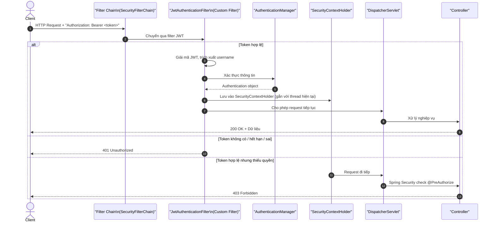
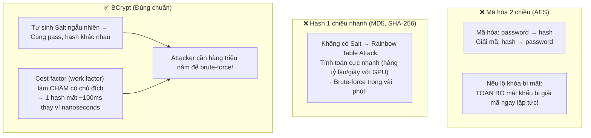
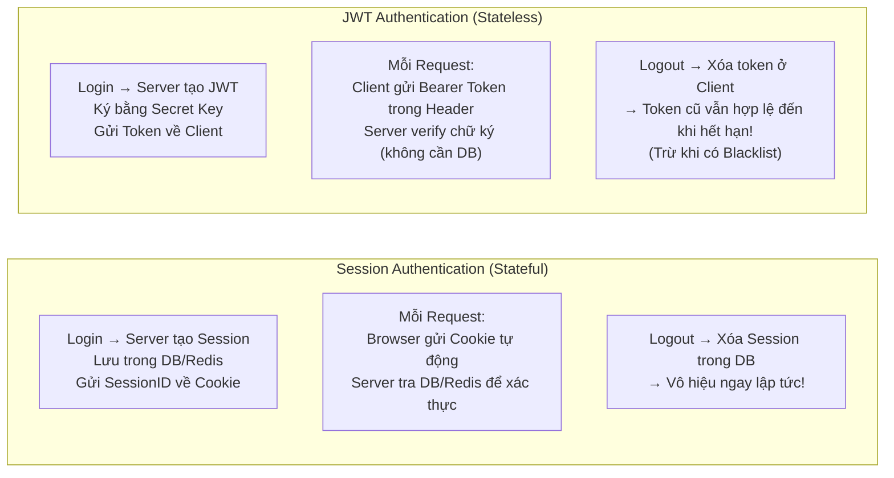
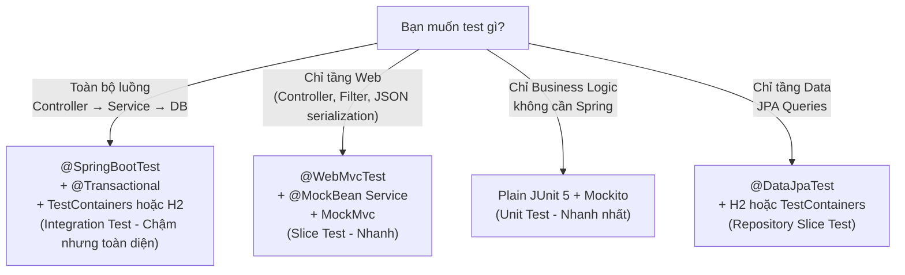
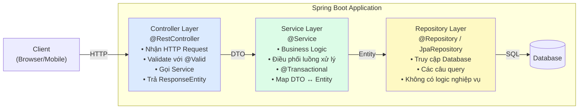

Đây là bài học mà nhiều developer bỏ qua vì nghĩ *"Security thì chỉ cần copy config là chạy"* — và đó chính xác là lý do tại sao bảo mật ứng dụng thường có lỗ hổng nghiêm trọng. Bài viết này không chỉ giải thích **cơ chế hoạt động** của Spring Security mà còn chỉ ra **5 sai lầm chết người** khi cấu hình.

---

## 1. Luồng Bảo Vệ Request Của Spring Security

### 1.1 SecurityFilterChain: Tuyến Phòng Thủ Trước DispatcherServlet



> [!NOTE]
> **Filter vs DispatcherServlet:** Spring Security hoạt động ở tầng **Servlet Filter** — chặn request **TRƯỚC** khi nó chạm tới DispatcherServlet. Đây là lý do lỗi 401/403 từ Security **không** đi qua `@ControllerAdvice` (chỉ bắt lỗi trong phạm vi DispatcherServlet).

### 1.2 Authentication vs Authorization: Không Được Nhầm

| | **Authentication (Xác thực)** | **Authorization (Phân quyền)** |
| :--- | :--- | :--- |
| **Câu hỏi trả lời** | *"Bạn là ai?"* | *"Bạn được phép làm gì?"* |
| **Kiểm tra** | Username/Password, Token hợp lệ | Role, Permission, Ownership |
| **HTTP Status khi thất bại** | **401 Unauthorized** | **403 Forbidden** |
| **Xảy ra khi** | Chưa đăng nhập, Token hết hạn, sai mật khẩu | Đã đăng nhập nhưng không có quyền truy cập |
| **Ví dụ** | Nhân viên chưa quẹt thẻ vào công ty | Nhân viên quẹt thẻ nhưng không vào được phòng server |

```java
// Cấu hình SecurityFilterChain hiện đại (Spring Security 6+)
// KHÔNG dùng WebSecurityConfigurerAdapter nữa!
@Configuration
@EnableMethodSecurity // Cho phép @PreAuthorize, @PostAuthorize trên method
public class SecurityConfig {

    @Bean
    public SecurityFilterChain filterChain(HttpSecurity http) throws Exception {
        return http
            .csrf(csrf -> csrf.disable()) // Chỉ disable với Stateless JWT API
            .sessionManagement(sm -> sm.sessionCreationPolicy(SessionCreationPolicy.STATELESS))
            .authorizeHttpRequests(auth -> auth
                // ✅ Whitelist công khai (mặc định chặn tất cả)
                .requestMatchers("/api/auth/**", "/api/public/**").permitAll()
                .requestMatchers("/api/admin/**").hasRole("ADMIN")
                .requestMatchers("/api/orders/**").hasAnyRole("USER", "ADMIN")
                // ✅ Mặc định: chặn tất cả endpoint chưa được khai báo
                .anyRequest().authenticated()
            )
            .addFilterBefore(jwtAuthFilter, UsernamePasswordAuthenticationFilter.class)
            .exceptionHandling(ex -> ex
                .authenticationEntryPoint(customEntryPoint) // Xử lý 401
                .accessDeniedHandler(customAccessDenied)   // Xử lý 403
            )
            .build();
    }
}
```

---

## 2. UserDetailsService: Ranh Giới Trách Nhiệm Rõ Ràng

### 2.1 Trách Nhiệm Duy Nhất: Nạp User, Không Kiểm Tra Password

```java
// ✅ ĐÚNG: UserDetailsService chỉ làm 1 việc — truy vấn DB theo username
@Service
public class CustomUserDetailsService implements UserDetailsService {

    private final UserRepository userRepository;

    @Override
    public UserDetails loadUserByUsername(String username) throws UsernameNotFoundException {
        // Tìm user trong DB
        User user = userRepository.findByEmail(username)
                .orElseThrow(() -> new UsernameNotFoundException(
                    // Thông báo lỗi chung — không phân biệt "user không tồn tại" hay "sai password"!
                    "Tên đăng nhập hoặc mật khẩu không chính xác"
                ));

        return org.springframework.security.core.userdetails.User.builder()
                .username(user.getEmail())
                .password(user.getPasswordHash()) // Trả về hash — KHÔNG giải mã!
                .roles(user.getRole().name())
                .accountExpired(!user.isActive())
                .build();
    }
}
// DaoAuthenticationProvider sẽ nhận UserDetails này, lấy passwordHash
// và tự gọi passwordEncoder.matches(rawPassword, passwordHash) để so sánh
```

### 2.2 Tại Sao Không Thể Dùng `.equals()` Để So Sánh Mật Khẩu?

```java
// ❌ SAI hoàn toàn — 3 lý do:
public UserDetails loadUserByUsername(String username) {
    User user = userRepository.findByEmail(username).orElseThrow(...);

    // Lý do 1: BCrypt tự sinh Salt ngẫu nhiên mỗi lần hash
    // Cùng mật khẩu "123456":
    // Hash lần 1: "$2a$10$vI8aWBnW3fID.ZQ4/zo1G.q1lR..."
    // Hash lần 2: "$2a$10$92IXUNpkjO0rOQ5byMi.Ye4oK..."
    // → Hai chuỗi khác nhau! .equals() luôn trả về false

    // Lý do 2: Timing Attack
    // String.equals() ngắt sớm khi gặp ký tự khác → Attacker đo thời gian
    // BCrypt.matches() duyệt toàn bộ chuỗi (Constant-time comparison)

    // Lý do 3: Vi phạm Single Responsibility
    // UserDetailsService chỉ là Data Fetcher, không phải Authentication Verifier
}
```

---

## 3. BCrypt: Tại Sao Không Dùng MD5/SHA-256 Hay AES?



```java
// Cấu hình BCrypt đúng cách
@Configuration
public class SecurityConfig {

    @Bean
    public PasswordEncoder passwordEncoder() {
        // Cost factor 12 = 2^12 = 4096 lần lặp
        // Điều chỉnh để mỗi lần hash mất ~100-300ms (đủ chậm để chống brute-force)
        return new BCryptPasswordEncoder(12);
    }
}

// Đăng ký user:
String rawPassword = "user_plain_text_password";
String hashed = passwordEncoder.encode(rawPassword);
// Lưu hashed vào DB — không bao giờ lưu rawPassword!

// Đăng nhập (DaoAuthenticationProvider tự làm):
boolean valid = passwordEncoder.matches(rawPassword, hashedFromDB);
// BCrypt trích xuất Salt từ trong chuỗi hash, hash lại rawPassword với đúng Salt đó
// rồi so sánh — Constant-time comparison!
```

### Chống User Enumeration & Timing Attack

```java
// Trong DaoAuthenticationProvider — Spring Security tự xử lý ngầm:
// Nếu user KHÔNG tồn tại: trả "bad credentials" ngay → ~2ms
// Nếu user TỒN TẠI nhưng sai password: BCrypt check (~100ms) → trả "bad credentials"
// Attacker có thể đo thời gian phản hồi để biết user có tồn tại hay không!

// Spring Security 5.x+ giải quyết bằng "mitigateTimingAttack":
// Nếu user KHÔNG tồn tại → vẫn âm thầm chạy BCrypt với dummy password
// → Thời gian phản hồi cả 2 trường hợp đều ~100ms → Attacker không phân biệt được!
```

---

## 4. Session vs JWT: Đánh Đổi Thực Tế



| Tiêu chí | **Session (Stateful)** | **JWT (Stateless)** |
| :--- | :--- | :--- |
| **Lưu trữ** | Server (DB/Redis) | Client (localStorage / Memory) |
| **Thu hồi tức thì** | ✅ Xóa session là hết hiệu lực | ❌ Không thể thu hồi trước khi hết hạn |
| **Hỗ trợ Scale** | ❌ Cần shared session store (Redis) | ✅ Mỗi server tự verify — scale dễ |
| **Microservices** | ❌ Cần sync session giữa services | ✅ Mỗi service tự verify JWT |
| **Bảo mật khi lộ token** | ✅ Đổi session ID ngay | ❌ Token bị lộ dùng được đến hết hạn |

> [!IMPORTANT]
> **JWT không mặc định an toàn hơn Session!** Mỗi approach có tradeoff riêng:
> - **Session:** Thu hồi tức thì nhưng cần shared store khi scale.
> - **JWT:** Scale dễ nhưng không thu hồi được → phải đặt Access Token ngắn (5-15 phút) + Refresh Token dài hạn hoặc dùng JWT Blacklist.

---

## 5. Năm Red Flags Trong Spring Security

### Red Flag #1: Tắt CSRF Bừa Bãi

```java
// ❌ Red Flag — Thấy immeditely trong code:
http.csrf(csrf -> csrf.disable());

// CSRF chỉ an toàn để disable khi:
// ✅ REST API thuần Stateless dùng JWT gửi qua Header (browser không tự gửi Authorization header)
// ❌ NGUY HIỂM nếu dùng Cookie/Session — browser tự gửi cookie kèm mọi request
// → Attacker tạo trang web độc hại chứa form tự POST đến server của bạn
```

**Kịch bản tấn công CSRF:**
```html
<!-- Trang web của kẻ tấn công: evil.com -->
<form action="https://yourbank.com/api/transfer" method="POST">
    <input type="hidden" name="to" value="attacker_account">
    <input type="hidden" name="amount" value="10000000">
</form>
<script>document.forms[0].submit();</script>
<!-- Nạn nhân vào trang này trong khi đang đăng nhập yourbank.com
     → Browser tự gửi Cookie → Server chấp nhận → Tiền bị chuyển! -->
```

---

### Red Flag #2: `permitAll()` Toàn Bộ

```java
// ❌ Red Flag — Junior thường làm để tắt 401 "cho dễ test"
http.authorizeHttpRequests(auth -> auth
    .anyRequest().permitAll() // Mở toàn bộ — NGUY HIỂM!
);

// ✅ Đúng: Mặc định chặn tất cả, chỉ mở endpoint công khai cụ thể
http.authorizeHttpRequests(auth -> auth
    .requestMatchers("/api/auth/login", "/api/auth/register").permitAll()
    .requestMatchers("/api/public/**").permitAll()
    .anyRequest().authenticated() // Mặc định: phải xác thực!
);
```

---

### Red Flag #3: `NoOpPasswordEncoder` Và Hardcode Secrets

```java
// ❌ Red Flag — Mật khẩu lưu dạng plain text:
@Bean
public PasswordEncoder passwordEncoder() {
    return NoOpPasswordEncoder.getInstance(); // Lưu "123456" thành "123456"!
}

// ❌ Red Flag — JWT secret hardcode trong code:
private String jwtSecret = "my-secret-key-do-not-share";
// → Bất kỳ ai có access repo Git đều lấy được!
// → Với secret này, attacker tự tạo Token có quyền Admin!

// ✅ Đúng:
@Bean
public PasswordEncoder passwordEncoder() {
    return new BCryptPasswordEncoder(12);
}

// application.yml:
// app:
//   jwt:
//     secret: ${JWT_SECRET}  # Đọc từ Environment Variable!
```

---

### Red Flag #4: `WebSecurityConfigurerAdapter` — Deprecated & Removed

```java
// ❌ Red Flag — Cách viết cũ đã bị xóa từ Spring Security 6:
@Configuration
public class SecurityConfig extends WebSecurityConfigurerAdapter {
    @Override
    protected void configure(HttpSecurity http) throws Exception { ... }
}
// → Không compile được với Spring Boot 3 / Spring Security 6!
// → Báo hiệu copy code từ bài viết cũ trước 2022

// ✅ Đúng — Component-based với Lambda DSL:
@Configuration
@EnableMethodSecurity
public class SecurityConfig {
    @Bean
    public SecurityFilterChain filterChain(HttpSecurity http) throws Exception { ... }
}
```

---

### Red Flag #5: Secrets Trong Git

```yaml
# ❌ NGUY HIỂM — Commit lên Git:
# application-prod.yml
spring:
  datasource:
    url: jdbc:postgresql://prod-db.company.com:5432/shop
    username: prod_admin
    password: Super$ecretPassword2024!  # Bất kỳ ai vào repo đều thấy!

# ✅ Đúng — Dùng Environment Variable:
spring:
  datasource:
    url: ${DB_URL}
    username: ${DB_USERNAME}
    password: ${DB_PASSWORD}
```

> [!CAUTION]
> Git **nhớ toàn bộ lịch sử commit**. Kể cả bạn xóa file secret và commit lại, attacker vẫn có thể dùng `git log` hoặc các công cụ scan như `truffleHog`, `git-secrets` để tìm lại. Nếu lỡ commit secret: phải xoay vòng (rotate) key ngay lập tức, không có cách "xóa sạch" khỏi Git history đã public.

---

## 6. Testing: `@SpringBootTest` vs `@WebMvcTest` + `MockMvc`

### 6.1 Chọn Strategy Test Phù Hợp



### 6.2 `@WebMvcTest` + `MockMvc` — Kiểm Thử Controller Hiệu Quả

```java
// Chỉ load tầng Web (Controller, Filter, Jackson, @ControllerAdvice)
// KHÔNG load Service, Repository, Database
@WebMvcTest(OrderController.class)
class OrderControllerTest {

    @Autowired
    private MockMvc mockMvc; // Gửi request giả trực tiếp vào DispatcherServlet

    @MockBean // Giả lập Service — không load Spring IoC của Service thật
    private OrderService orderService;

    @Autowired
    private ObjectMapper objectMapper; // Jackson để serialize/deserialize

    @Test
    @DisplayName("POST /api/orders - Tạo đơn hàng thành công trả về 201")
    void createOrder_whenValidRequest_shouldReturn201() throws Exception {
        // Arrange
        CreateOrderRequest request = new CreateOrderRequest(
                "Nguyễn Văn A", "nguyenvana@gmail.com",
                List.of(new OrderItemRequest(1L, 2))
        );
        OrderResponse mockResponse = new OrderResponse(100L, "PENDING", BigDecimal.valueOf(299.98));

        when(orderService.create(any(CreateOrderRequest.class))).thenReturn(mockResponse);

        // Act & Assert
        mockMvc.perform(post("/api/v1/orders")
                .contentType(MediaType.APPLICATION_JSON)
                .content(objectMapper.writeValueAsString(request)))
            .andExpect(status().isCreated())                          // 201 Created
            .andExpect(jsonPath("$.id").value(100))                   // Check body
            .andExpect(jsonPath("$.status").value("PENDING"))
            .andExpect(header().exists("Location"));                  // Check Location header
    }

    @Test
    @DisplayName("POST /api/orders - Email không hợp lệ trả về 400")
    void createOrder_whenInvalidEmail_shouldReturn400() throws Exception {
        CreateOrderRequest badRequest = new CreateOrderRequest(
                "Nguyễn Văn A", "invalid-email", // Email sai định dạng
                List.of(new OrderItemRequest(1L, 2))
        );

        mockMvc.perform(post("/api/v1/orders")
                .contentType(MediaType.APPLICATION_JSON)
                .content(objectMapper.writeValueAsString(badRequest)))
            .andExpect(status().isBadRequest())                       // 400 Bad Request
            .andExpect(jsonPath("$.errors.customerEmail").exists());  // Có lỗi field email
    }
}
```

> [!TIP]
> **MockMvc không khởi động HTTP Server thật (Tomcat)** — request đi thẳng vào DispatcherServlet trong bộ nhớ. Điều này giúp test chạy nhanh hơn nhiều so với `@SpringBootTest(webEnvironment = RANDOM_PORT)` nhưng vẫn kiểm tra đầy đủ URL mapping, serialization JSON, Validation và xử lý lỗi.

---

## 7. Clean Layered Architecture: Kiến Trúc Phân Tầng Sạch

### 7.1 Nguyên Tắc Chiều Phụ Thuộc Một Chiều



### 7.2 Tách Biệt DTO Khỏi Entity — Bắt Buộc

```java
// Entity: Mô hình ánh xạ bảng DB — KHÔNG dùng làm response/request API
@Entity
@Table(name = "users")
public class User {
    @Id
    private Long id;
    private String firstName;
    private String lastName;
    private String email;

    // ⚠️ Nếu trả Entity thẳng ra API:
    // 1. Lộ thông tin nhạy cảm (passwordHash, salt, internalFlag...)
    // 2. Jackson trigger lazy load → LazyInitializationException!
    // 3. Thay đổi DB schema ảnh hưởng ngay đến API contract
    @Column(name = "password_hash")
    private String passwordHash; // KHÔNG bao giờ expose ra ngoài!

    @OneToMany(fetch = FetchType.LAZY)
    private List<Order> orders; // Trigger lazy load khi serialize JSON!
}

// Request DTO: Hợp đồng giao tiếp dữ liệu đầu vào — validation ở đây
public record CreateUserRequest(
    @NotBlank String firstName,
    @NotBlank String lastName,
    @Email @NotBlank String email,
    @Size(min = 8, max = 100) String password // Plain text nhận từ client
) {}

// Response DTO: Hợp đồng giao tiếp dữ liệu đầu ra — chỉ expose field cần thiết
public record UserResponse(
    Long id,
    String firstName,
    String lastName,
    String email
    // Không có passwordHash, không có orders (tránh lazy load!)
) {}
```

### 7.3 Ví Dụ Service Layer Điển Hình

```java
@Service
@RequiredArgsConstructor // Lombok tạo Constructor Injection
public class UserService {

    private final UserRepository userRepository;
    private final PasswordEncoder passwordEncoder;
    private final UserMapper userMapper; // MapStruct hoặc tự viết

    @Transactional
    public UserResponse createUser(CreateUserRequest request) {
        // 1. Business validation
        if (userRepository.existsByEmail(request.email())) {
            throw new BusinessException("Email đã được sử dụng: " + request.email());
        }

        // 2. Map DTO -> Entity và xử lý nghiệp vụ
        User user = User.builder()
                .firstName(request.firstName())
                .lastName(request.lastName())
                .email(request.email().toLowerCase())
                .passwordHash(passwordEncoder.encode(request.password())) // Hash!
                .role(Role.USER)
                .createdAt(LocalDateTime.now())
                .build();

        // 3. Lưu Entity
        User saved = userRepository.save(user);

        // 4. Map Entity -> Response DTO và trả về
        return userMapper.toResponse(saved);
    }

    @Transactional(readOnly = true) // Optimization: readonly transaction cho query
    public UserResponse getUserById(Long id) {
        User user = userRepository.findById(id)
                .orElseThrow(() -> new ResourceNotFoundException("User not found: " + id));
        return userMapper.toResponse(user);
    }
}
```

---

## 8. Chuyên Mục Phỏng Vấn: Câu 42 – 50

---

**Câu 42 — Khi nào dùng `@SpringBootTest` và khi nào dùng `@WebMvcTest`?**

> *"**`@SpringBootTest`** khởi tạo gần như toàn bộ `ApplicationContext` (Controller, Service, Repository, DB) — phù hợp cho **Integration Test** toàn diện nhưng chạy chậm. **`@WebMvcTest`** là Test Slice chỉ nạp tầng Web MVC (Controller, `@ControllerAdvice`, Filter, Jackson) — giúp kiểm thử tầng Controller cực nhanh và phải dùng `@MockBean` để giả lập Service tầng dưới. Chiến lược lý tưởng: nhiều `@WebMvcTest` + `@DataJpaTest` cho từng tầng, một số `@SpringBootTest` cho critical integration flow."*

---

**Câu 43 — `MockMvc` là gì? Server thật có khởi động không?**

> *"MockMvc giúp kiểm thử tầng Spring MVC **không cần khởi động HTTP Server thật** và không mở cổng mạng. Nó gửi request giả lập trực tiếp vào `DispatcherServlet` trong bộ nhớ — chạy rất nhanh nhưng vẫn kiểm tra toàn bộ: URL mapping, `@PathVariable`/`@RequestParam`, Validation `@Valid`, JSON serialization và xử lý lỗi `@ControllerAdvice`."*

---

**Câu 44 — Authentication và Authorization khác nhau? Khi nào 401, khi nào 403?**

> *"**Authentication** trả lời 'Bạn là ai?' — kiểm tra thông tin đăng nhập. Thất bại → **401 Unauthorized** (chưa đăng nhập, Token hết hạn, sai mật khẩu). **Authorization** diễn ra sau khi đã xác thực, trả lời 'Bạn được phép làm gì?' — kiểm tra Role/Permission. Đã đăng nhập nhưng cố truy cập tài nguyên vượt quyền → **403 Forbidden**. Dễ nhớ: 401 = 'Chưa biết bạn là ai', 403 = 'Biết bạn là ai nhưng không cho vào'."*

---

**Câu 45 — Spring Security bảo vệ request thông qua cơ chế nào?**

> *"Hoạt động dựa trên cơ chế **Servlet Filter** (chuỗi `SecurityFilterChain`) chặn và kiểm tra request **trước cả khi chạm tới `DispatcherServlet`**. Luồng: Filter trích xuất thông tin xác thực → chuyển cho `AuthenticationManager` → nếu hợp lệ thì lưu `Authentication` vào `SecurityContextHolder` (gắn với thread hiện tại) → cuối cùng Filter phân quyền kiểm tra và chặn bằng 401/403 nếu vi phạm. Vì Filter nằm trước DispatcherServlet nên lỗi 401/403 sẽ không được `@ControllerAdvice` bắt."*

---

**Câu 46 — `UserDetailsService` là gì? Trách nhiệm giới hạn ở đâu?**

> *"Là interface với 1 method duy nhất `loadUserByUsername(String username)`, nhiệm vụ độc nhất là **truy vấn DB theo username và trả về `UserDetails`** (username, password hash, danh sách quyền). `UserDetailsService` **KHÔNG so sánh mật khẩu** — trách nhiệm đó thuộc về `DaoAuthenticationProvider` thông qua `passwordEncoder.matches(rawPassword, encodedPassword)`. Không thể dùng `.equals()` vì BCrypt dùng Salt ngẫu nhiên nên cùng mật khẩu ra 2 hash khác nhau."*

---

**Câu 47 — Tại sao dùng BCrypt thay vì MD5/SHA-256 hay AES?**

> *"AES là mã hóa 2 chiều — nếu lộ khóa bí mật thì mọi mật khẩu bị giải mã ngay. MD5/SHA-256 là hash 1 chiều nhưng tính toán quá nhanh (hàng tỷ lần/giây với GPU) → dễ bị brute-force và Rainbow Table. BCrypt giải quyết cả 2 vấn đề: tự sinh Salt ngẫu nhiên (cùng mật khẩu ra hash khác nhau → vô hiệu Rainbow Table) và có Cost Factor làm chậm cố ý (~100ms/hash) → Brute-force cần hàng triệu năm. Ngoài ra BCrypt.matches() dùng Constant-time comparison chống Timing Attack."*

---

**Câu 48 — Session và JWT khác nhau? JWT có an toàn hơn Session không?**

> *"**Session (Stateful):** Server lưu session trong DB/Redis, gửi SessionID về Cookie — có thể thu hồi ngay tức thì bằng xóa session. **JWT (Stateless):** Thông tin đóng gói trong Token ký số, server không lưu gì — mọi server tự verify, phù hợp Microservices. **JWT không mặc định an toàn hơn Session** — vì không trạng thái nên rất khó thu hồi Token trước khi hết hạn. Giải pháp: Access Token ngắn (5-15 phút) + Refresh Token hoặc JWT Blacklist."*

---

**Câu 49 — Các Red Flags phổ biến trong Spring Security là gì?**

> *"5 Red Flags: (1) **Tắt CSRF** khi ứng dụng dùng Cookie/Session — lỗ hổng CSRF nguy hiểm. (2) **`permitAll()` toàn bộ** thay vì whitelist — mở toang mọi API. (3) **`NoOpPasswordEncoder`** lưu mật khẩu plain text hoặc **hardcode secret key** vào code rồi commit Git. (4) **Kế thừa `WebSecurityConfigurerAdapter`** đã bị xóa từ Spring Security 6. (5) Trả **Stack Trace** chi tiết trong error response — lộ thông tin kiến trúc hệ thống cho attacker."*

---

**Câu 50 — Mô tả kiến trúc phân tầng sạch (Clean Layered Architecture) trong Spring Boot?**

> *"Tách rõ 3 tầng: **Controller** chỉ phụ trách giao thức HTTP (nhận request, kích hoạt `@Valid`, gọi Service, trả `ResponseEntity`). **Service** chứa toàn bộ Business Logic và đặt ranh giới giao dịch (`@Transactional`). **Repository** chỉ đảm nhiệm truy xuất và lưu trữ dữ liệu. Chiều phụ thuộc đi một hướng: Controller → Service → Repository. Bắt buộc tách biệt **DTO** (hợp đồng API) khỏi **Entity** (mô hình DB) để tránh lộ thông tin nhạy cảm (như `passwordHash`) và tránh `LazyInitializationException` khi Jackson serialize Entity."*

---

> [!TIP]
> 📚 **Bài cuối trong series:** [Master Cheat Sheet 50 Câu Hỏi Phỏng Vấn](./spring-interview-50-qa) — Toàn bộ 50 câu hỏi & kịch bản trả lời ghi điểm kèm link timestamp tra cứu nhanh.
