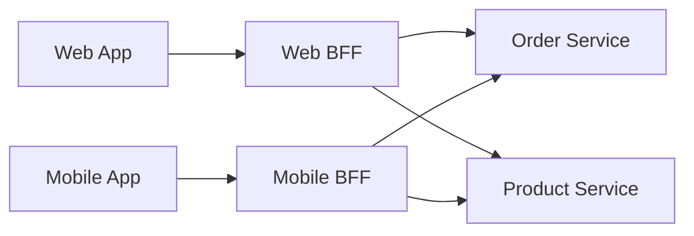

Ở các bài trước, ta đã nói về cách bảo vệ dữ liệu bên trong (Idempotency, Concurrency, Outbox, Cache). Bài này sẽ nhìn ra **tuyến phòng thủ ngoài cùng (Edge / Traffic Layer)** — nơi tiếp nhận request từ người dùng và điều tiết lưu lượng trước khi nó kịp làm quá tải các service phía sau.

---

## 1. API Gateway & BFF (Backend for Frontend)

### 1.1 API Gateway Pattern
Nếu bạn có 20 microservices, việc để Client (Web/Mobile) tự nhớ 20 địa chỉ IP/domain khác nhau và tự xử lý xác thực ở từng nơi là cơn ác mộng.

**API Gateway** đóng vai trò **cổng vào duy nhất (Single Entry Point)** cho toàn bộ hệ thống:
- **Routing:** Điều hướng `/orders/**` vào `Order Service`, `/users/**` vào `User Service`.
- **Cross-Cutting Concerns:** Xác thực JWT/OAuth2, SSL Termination, Logging, Rate Limiting tập trung một chỗ.
- **Protocol Translation:** Bên ngoài nói chuyện bằng REST/HTTPS, bên trong Gateway dịch sang gRPC.

### 1.2 BFF (Backend for Frontend)
Một API Gateway dùng chung cho mọi nền tảng đôi khi bị quá tải logic:
- **Web Desktop** cần màn hình chi tiết đầy đủ 20 trường dữ liệu.
- **Mobile App** màn hình nhỏ, mạng 4G chậm, chỉ cần 5 trường gọn nhẹ.

**BFF Pattern** tách lớp Gateway thành các backend mỏng riêng cho từng loại thiết bị:

Mỗi BFF tự gom dữ liệu (API Aggregation) và định dạng payload tối ưu nhất cho chính giao diện của nó.

---

## 2. Bốn Thuật Toán Rate Limiting Phổ Biến

**Rate Limiting** giới hạn số lượng request một user/IP được phép gọi trong một khoảng thời gian (ví dụ: `100 requests / phút`), trả về HTTP `429 Too Many Requests` nếu vượt ngưỡng.

### 2.1 Fixed Window Counter (Cửa Sổ Cố Định)
Chia thời gian thành các khung cố định (vd `10:00–10:01`, `10:01–10:02`), mỗi khung có 1 bộ đếm.
- **Nhược điểm (Boundary Burst):** Nếu giới hạn là 100 req/phút, user gửi 100 req ở giây `10:00:59` và 100 req nữa ở giây `10:01:01` $\rightarrow$ thực tế trong vòng 2 giây hệ thống phải hứng **200 req** (gấp đôi giới hạn)!

### 2.2 Sliding Window (Cửa Sổ Trượt)
Khắc phục lỗi biên của Fixed Window bằng cách tính tổng số request trong khoảng `[now - 1 phút, now]` trượt liên tục theo thời gian thực (thường dùng Redis Sorted Set `ZSET` lưu timestamp, hoặc Sliding Window Counter kết hợp trọng số).
- **Ưu điểm:** Chính xác, không bị lách luật ở ranh giới phút.
- **Nhược điểm:** Tốn bộ nhớ hơn Fixed Window một chút.

### 2.3 Token Bucket (Xô Chứa Token) — Rất Phổ Biến (AWS, Stripe)
- Có một chiếc xô chứa tối đa $C$ token.
- Cứ mỗi giây, hệ thống nạp thêm $R$ token vào xô (nếu đầy thì bỏ).
- Mỗi request đến phải **lấy 1 token** mới được đi qua; hết token thì bị từ chối (`429`).
- **Ưu điểm:** **Cho phép lưu lượng tăng đột biến ngắn hạn (burst)** nếu trong xô vẫn còn token tích lũy, rất tự nhiên với hành vi người dùng thật.

### 2.4 Leaky Bucket (Xô Rò Rỉ)
- Request đến được xếp vào một hàng đợi (xô) có kích thước cố định; đầy xô thì từ chối.
- Đáy xô rò rỉ ra ngoài với **tốc độ hằng số cố định** (ví dụ đúng 10 req/giây), bất kể đầu vào dồn dập thế nào.
- **Ưu điểm:** Làm mượt lưu lượng đầu ra tuyệt đối, bảo vệ cực tốt các service phía sau vốn không chịu được burst.

| Thuật toán | Cho phép Burst? | Độ chính xác | Phù hợp khi nào? |
| :--- | :---: | :---: | :--- |
| **Fixed Window** | ⚠️ Bị burst ở biên | Trung bình | Cần cài đặt cực đơn giản bằng `INCR` + `EXPIRE` |
| **Sliding Window** | ❌ Kiểm soát chặt | Cao | Chống spam API, login brute-force |
| **Token Bucket** | ✅ Có (trong giới hạn xô) | Cao | Public API cho phép người dùng bấm nhanh thoáng qua |
| **Leaky Bucket** | ❌ Đầu ra đều tăm tắp | Cao | Bảo vệ downstream yếu (payment gateway, legacy DB) |

---

## 3. Backpressure (Áp Lực Ngược)

Trong các hệ thống xử lý luồng dữ liệu hoặc Message Queue, **Producer** (bên gửi) có thể đẩy dữ liệu nhanh gấp 10 lần tốc độ **Consumer** (bên xử lý). Nếu Consumer cứ cố nhận hết vào RAM, nó sẽ nổ `OutOfMemoryError`.

**Backpressure** là cơ chế **Consumer báo ngược lại cho Producer biết mình đang quá tải để Producer tự giảm tốc độ gửi**, thay vì nhận bừa rồi crash:
- **Pull-based (Chủ động kéo):** Như Kafka Consumer — chỉ `poll()` đúng số lượng message mà nó xử lý nổi ở mỗi nhịp, không để Broker tự đẩy ồ ạt.
- **Bounded Queue (Hàng đợi có giới hạn):** Đặt kích thước tối đa cho queue; khi đầy thì chặn (block) hoặc từ chối sớm (`Load Shedding` trả `503`).

---

## Tóm Lại

- Dùng **API Gateway** để gom routing/auth/rate-limit tại một điểm; cân nhắc **BFF** khi Web và Mobile có nhu cầu dữ liệu khác biệt lớn.
- Chọn **Token Bucket** khi muốn linh hoạt cho phép burst nhẹ, **Sliding Window** khi cần giới hạn nghiêm ngặt, và **Leaky Bucket** khi cần đầu ra ổn định tuyệt đối.
- Kết hợp **Backpressure** để hệ thống tự điều tiết nhịp độ giữa bên gửi và bên nhận, tránh tràn bộ nhớ khi tải tăng vọt.
