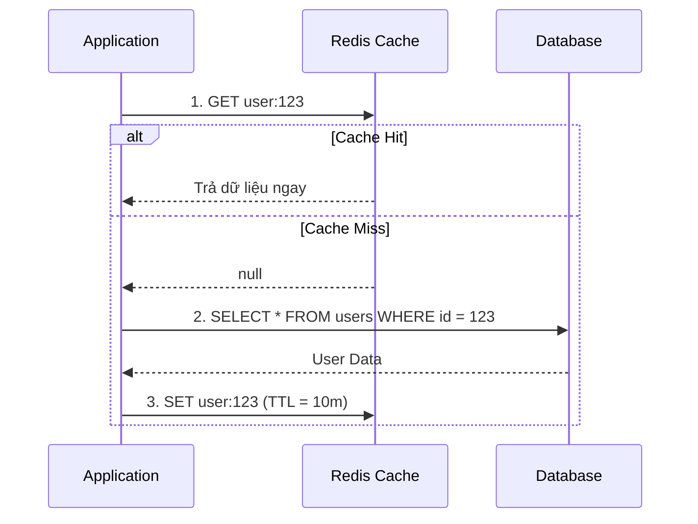

Đặt Redis trước Database là cách nhanh nhất để giảm tải cho DB và tăng tốc độ phản hồi từ vài trăm mili-giây xuống dưới 5ms. Nhưng dùng Cache không chỉ đơn giản là `get/set` — chọn sai chiến lược hoặc không phòng thủ các tình huống cực đoan có thể khiến **Database sập nhanh hơn cả khi không có Cache**.

---

## 1. Bốn Pattern Đọc & Ghi Cache Phổ Biến

### 1.1 Cache-Aside (Lazy Loading) — Phổ Biến Nhất
Ứng dụng (Application) tự quản lý việc giao tiếp với cả Cache và Database.

- **Khi ghi dữ liệu:** Cập nhật DB trước, sau đó **xóa (Invalidate/Delete)** key trong Cache thay vì update cache (giúp tránh race condition khi 2 request ghi đè cache ngược thứ tự).
- **Ưu điểm:** Chỉ cache những dữ liệu thực sự được hỏi; nếu Redis chết, app vẫn đọc từ DB được.
- **Nhược điểm:** Request đầu tiên luôn bị Cache Miss; có khả năng dữ liệu trong cache bị cũ (*stale*) nếu cập nhật DB trực tiếp từ nơi khác.

---

### 1.2 Read-Through & Write-Through
Khác với Cache-Aside, ở đây **Cache đứng ra làm lớp trung gian duy nhất** mà App giao tiếp; chính Cache Provider tự chịu trách nhiệm đọc/ghi xuống DB:

- **Read-Through:** App hỏi Cache. Nếu Miss, **Cache tự query DB**, lưu lại rồi trả cho App.
- **Write-Through:** App ghi vào Cache $\rightarrow$ Cache ghi đồng bộ xuống DB rồi mới báo thành công.
  - **Ưu điểm:** Dữ liệu giữa Cache và DB luôn đồng bộ.
  - **Nhược điểm:** Độ trễ ghi (write latency) tăng vì phải ghi cả 2 nơi đồng bộ.

---

### 1.3 Write-Behind (Write-Back)
App chỉ ghi vào Cache và nhận phản hồi thành công ngay lập tức. Sau đó Cache gom nhiều thay đổi lại và **ghi bất đồng bộ (async batch)** xuống DB.

- **Ưu điểm:** Tốc độ ghi cực nhanh, giảm tải ghi cho DB (rất hợp cho bộ đếm lượt xem, like, bảng xếp hạng).
- **Nhược điểm:** **Rủi ro mất dữ liệu** nếu node Cache bị sập trước khi kịp flush xuống DB.

---

## 2. Ba Thảm Họa Cache Kinh Điển & Cách Phòng Thủ

### 2.1 Cache Penetration (Xuyên Thủng Cache)
**Hiện tượng:** Kẻ xấu (hoặc bug client) gửi hàng loạt request hỏi các ID **không hề tồn tại** trong DB (ví dụ `GET /products/-999`).
- Cache luôn Miss $\rightarrow$ mọi request đều đâm thẳng xuống Database $\rightarrow$ DB quá tải.

**Cách xử lý:**
1. **Cache Null Object:** Nếu DB trả về không có, vẫn lưu `null` (hoặc chuỗi rỗng) vào Redis với **TTL ngắn** (vd 30–60 giây).
2. **Bloom Filter:** Đặt một bộ lọc Bloom Filter ở tầng trước (hoặc RedisBloom) chứa tập tất cả ID hợp lệ. Nếu Bloom Filter báo *"chắc chắn không có"*, từ chối ngay không cần hỏi Cache hay DB.

---

### 2.2 Cache Breakdown / Hot Key Expiration (Sập Điểm Nóng)
**Hiện tượng:** Một key **cực kỳ nóng** (vd: sản phẩm đang Flash Sale có 50.000 req/s) bất ngờ **hết hạn TTL**. Đúng khoảnh khắc đó, cả 50.000 request cùng thấy Cache Miss và đồng loạt chọc thẳng vào DB để query lại đúng 1 dòng dữ liệu đó!

**Cách xử lý:**
1. **Mutex / Distributed Lock:** Khi Cache Miss, chỉ cho **1 thread duy nhất** lấy lock để xuống DB đọc và nạp lại vào Redis; 49.999 thread còn lại chờ vài mili-giây rồi đọc lại từ Redis.
2. **Logical Expiration (Hết hạn logic):** Không đặt TTL vật lý cho hot key trong Redis, mà lưu kèm trường `expireAt` bên trong JSON. Nếu thấy quá hạn, vẫn trả dữ liệu cũ cho user hiện tại và kích hoạt 1 background thread âm thầm đi cập nhật lại.

---

### 2.3 Cache Avalanche (Tuyết Lở Cache)
**Hiện tượng:** Hàng ngàn key được nạp vào Cache cùng một lúc với **cùng một giá trị TTL** (vd: đúng 00:00 đồng loạt hết hạn), hoặc cả cụm Redis bị sập. Toàn bộ lưu lượng đổ ập xuống DB cùng lúc như tuyết lở.

**Cách xử lý:**
1. **Random TTL Jitter:** Khi set TTL, cộng thêm một khoảng ngẫu nhiên: `TTL = 3600 + random(0, 600)` giây để các key hết hạn rải rác.
2. **High Availability cho Redis:** Chạy Redis Sentinel hoặc Redis Cluster để không có điểm chết đơn lẻ.
3. **Circuit Breaker & Rate Limiting:** Nếu Redis chết thật, dùng Circuit Breaker/Rate Limiter bảo vệ DB khỏi bị đánh sập theo.

---

## Tóm Lại

| Tình huống | Giải pháp ưu tiên |
| :--- | :--- |
| Cần pattern đọc/ghi an toàn, phổ thông | **Cache-Aside** (Đọc Cache $\rightarrow$ Miss thì đọc DB; Ghi DB $\rightarrow$ Xóa Cache) |
| Tối ưu tốc độ ghi cực cao (view, like) | **Write-Behind** (chấp nhận rủi ro mất nhẹ nếu cache crash) |
| Bị spam ID không tồn tại (**Penetration**) | **Cache Null (TTL ngắn)** + **Bloom Filter** |
| Hot key hết hạn gây nghẽn DB (**Breakdown**) | **Distributed Lock** hoặc **Logical Expiration** |
| Hàng loạt key hết hạn cùng lúc (**Avalanche**) | **Random TTL Jitter** + **Redis Cluster** |
