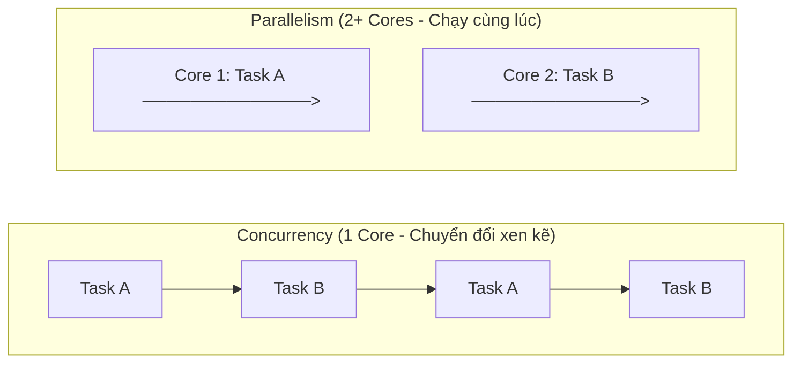
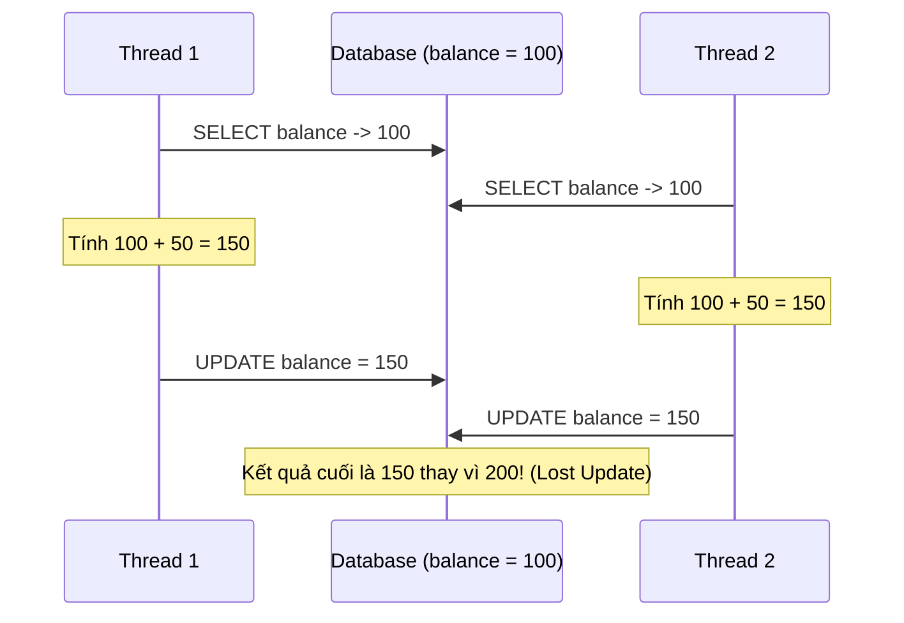

Giả sử kho hàng chỉ còn **đúng 1 chiếc iPhone cuối cùng**. Lúc 12:00:00.001, cả User A và User B cùng bấm nút **"Mua ngay"**. Nếu hệ thống xử lý cả hai request cùng lúc mà không kiểm soát đồng thời, cả hai đều thấy `stock = 1`, cả hai đều tạo đơn thành công, và tồn kho âm `-1`.

Đó là lúc bài toán **Concurrency** (xử lý đồng thời) xuất hiện.

---

## 1. Concurrency Là Gì? Phân Biệt Với Parallelism

Rất nhiều người đánh đồng **Concurrency** và **Parallelism**, nhưng về mặt bản chất chúng khác nhau:

- **Concurrency (Đồng thời):** Là khả năng **cấu trúc chương trình để xử lý nhiều tác vụ tiến triển trong cùng một khoảng thời gian** (có thể trên 1 CPU core bằng cách chuyển đổi ngữ cảnh qua lại — *time-slicing* hoặc *event loop*).
- **Parallelism (Song song):** Là việc **thực thi nhiều tác vụ tại cùng một thời điểm vật lý** (bắt buộc phải có nhiều CPU core hoặc nhiều máy).

> Câu nói nổi tiếng của Rob Pike: *"Concurrency is about dealing with lots of things at once. Parallelism is about doing lots of things at once."*



Trong một hệ thống web/backend (nhiều user gửi request cùng lúc, nhiều worker đọc queue cùng lúc), bạn **luôn phải đối mặt với Concurrency** — dù server chạy 1 core hay 64 core.

---

## 2. Khi Concurrency Gặp Shared State: Những Lỗi Kinh Điển

Concurrency sẽ hoàn toàn vô hại nếu các luồng không dùng chung dữ liệu. Rắc rối chỉ bắt đầu khi **nhiều luồng cùng đọc và ghi vào một tài nguyên chung (Shared Mutable State)**.

### 2.1 Race Condition & Lost Update

**Race Condition** xảy ra khi kết quả đúng hay sai của chương trình phụ thuộc vào **thứ tự hoặc tốc độ chạy may rủi** giữa các luồng.

Ví dụ kinh điển: hai luồng cùng đọc số dư `balance = 100`, mỗi luồng cộng thêm `50`:



Hiện tượng ghi đè làm mất kết quả của luồng trước gọi là **Lost Update** (mất cập nhật).

### 2.2 Deadlock, Livelock và Starvation

Khi dùng khóa (lock) để chống Race Condition, ta lại có thể gặp 3 vấn đề khác:
- **Deadlock (Khóa chết):** Luồng A giữ khóa X và chờ khóa Y; luồng B giữ khóa Y và chờ khóa X. Cả hai đứng chờ nhau vĩnh viễn.
- **Livelock:** Hai luồng liên tục nhường nhau (giống hai người tránh nhau ở hành lang mà bước cùng một hướng) — trạng thái có đổi nhưng công việc không tiến triển.
- **Starvation (Đói tài nguyên):** Một luồng ưu tiên thấp bị các luồng khác chen ngang liên tục và không bao giờ lấy được khóa.

---

## 3. Các Chiến Lược Kiểm Soát Đồng Thời (Concurrency Control)

Để đảm bảo dữ liệu nhất quán khi có nhiều request chạy đồng thời, kỹ sư backend có 4 vũ khí chính:

### 3.1 Pessimistic Locking (Khóa Bi Quan)

**Tư tưởng:** *"Chắc chắn sẽ có người khác tranh sửa dữ liệu này với mình, nên mình khóa chặt nó lại trước khi đọc/sửa."*

Trong SQL, bạn dùng `SELECT ... FOR UPDATE` bên trong một Transaction:

```sql
BEGIN;

-- Khóa dòng sản phẩm id = 10, các transaction khác phải chờ đến khi COMMIT/ROLLBACK
SELECT stock FROM products WHERE id = 10 FOR UPDATE;

-- Kiểm tra stock >= 1 ở tầng app hoặc SQL, rồi mới trừ
UPDATE products SET stock = stock - 1 WHERE id = 10 AND stock >= 1;

COMMIT;
```

- **Ưu điểm:** Đảm bảo an toàn tuyệt đối, không bị xung đột giữa chừng.
- **Nhược điểm:** Giảm thông lượng (throughput) vì các request phải xếp hàng chờ nhau; dễ gây **Deadlock** nếu khóa nhiều bảng theo thứ tự khác nhau; giữ connection DB lâu.
- **Khi nào dùng:** Xung đột xảy ra rất thường xuyên (flash sale, chuyển tiền, trừ ví) và chi phí retry cao.

---

### 3.2 Optimistic Locking (Khóa Lạc Quan)

**Tư tưởng:** *"Chắc ít ai sửa trùng lúc với mình đâu, cứ đọc thoải mái không khóa; lúc ghi xuống mới kiểm tra xem dữ liệu có bị ai sửa lén trong lúc mình đang xử lý không."*

Cơ chế phổ biến nhất là thêm cột **`version`** (hoặc timestamp). Trong JPA/Hibernate, chỉ cần gắn `@Version`:

```java
@Entity
public class Product {
    @Id
    private Long id;
    private Integer stock;

    @Version
    private Long version;
}
```

Khi lưu xuống DB, SQL được sinh ra có dạng:

```sql
UPDATE products
SET stock = 0, version = version + 1
WHERE id = 10 AND version = 5;
```

- Nếu `rows affected == 1`: cập nhật thành công.
- Nếu `rows affected == 0`: chứng tỏ đã có luồng khác nhanh tay tăng `version` lên `6` rồi! Server ném `OptimisticLockException` và có thể retry lại từ đầu hoặc báo lỗi cho user.

- **Ưu điểm:** Không giữ lock trong DB, throughput rất cao khi ít xung đột.
- **Nhược điểm:** Nếu xung đột quá nhiều, tỷ lệ retry thất bại cao gây lãng phí CPU.
- **Khi nào dùng:** Hệ thống **đọc nhiều, ghi ít**, xác suất 2 người sửa cùng 1 bản ghi trong cùng 1 thời điểm thấp.

---

### 3.3 Atomic Operations (Thao Tác Nguyên Tử)

Thay vì đọc ra app tính toán rồi ghi ngược lại (*Read-Modify-Write*), hãy gộp thành **một lệnh nguyên tử duy nhất**:

- **Ở tầng Database:**
  ```sql
  UPDATE products
  SET stock = stock - 1
  WHERE id = 10 AND stock >= 1;
  ```
  Database tự đảm bảo khóa mức dòng (row-level lock) trong tích tắc thực thi lệnh `UPDATE` đó. Nếu trả về `0 rows`, tức là hết hàng — vừa gọn, vừa không lo Lost Update.
- **Ở tầng ngôn ngữ (Java):** Dùng `AtomicInteger`, `AtomicLong` (dựa trên cơ chế **CAS — Compare-And-Swap** ở CPU) thay vì `synchronized` cho các biến đếm đơn giản.

---

### 3.4 Distributed Lock (Khóa Phân Tán)

Nếu ứng dụng của bạn chạy trên **nhiều server/container** (ví dụ 5 pods Kubernetes), thì `synchronized` hay `ReentrantLock` trong Java **vô tác dụng** — vì mỗi JVM chỉ khóa được các thread bên trong chính nó.

Lúc này bạn cần một nơi lưu trữ tập trung bên ngoài làm trọng tài, phổ biến nhất là **Redis**:

```text
SET lock:order:123 "worker-uuid-999" NX PX 5000
```

- `NX`: Chỉ set nếu key chưa tồn tại (ai nhanh tay nhất sẽ lấy được lock).
- `PX 5000`: Tự động hết hạn sau 5 giây (tránh trường hợp worker giữ lock bị sập nguồn khiến khóa tồn tại mãi mãi).
- Khi nhả khóa: phải kiểm tra đúng giá trị `"worker-uuid-999"` của mình mới `DEL` (dùng Lua script để đảm bảo nguyên tử), tránh xóa nhầm lock của worker khác nếu xử lý bị lố quá 5 giây.

---

## 4. Bảng So Sánh Chọn Chiến Lược Concurrency

| Chiến lược | Mức độ xung đột phù hợp | Phạm vi bảo vệ | Rủi ro chính |
| :--- | :--- | :--- | :--- |
| **Atomic SQL Update** | Cao | 1 câu lệnh DB đơn lẻ | Không dùng được nếu cần logic phức tạp ở tầng app |
| **Optimistic Lock (`@Version`)** | Thấp – Trung bình | Trong phạm vi DB | Tốn công retry nếu xung đột quá dày |
| **Pessimistic Lock (`FOR UPDATE`)** | Cao | Trong 1 DB Transaction | Nghẽn cổ chai, giảm throughput, nguy cơ Deadlock |
| **Distributed Lock (Redis)** | Tùy biến | Nhiều service / nhiều pod | Phụ thuộc độ tin cậy của Redis, cần xử lý lock TTL |

---

## Tóm Lại

- **Concurrency** là bài toán quản lý nhiều tác vụ cùng tiến triển; nó nguy hiểm khi chạm vào **dữ liệu dùng chung có thể thay đổi**.
- Nếu chỉ cần trừ/cộng đơn giản, ưu tiên **Atomic Update** ở DB.
- Nếu đọc nhiều ghi ít, chọn **Optimistic Locking** (`@Version`).
- Nếu xung đột dữ dội trên dữ liệu nhạy cảm, chọn **Pessimistic Locking** hoặc **Distributed Lock**.

