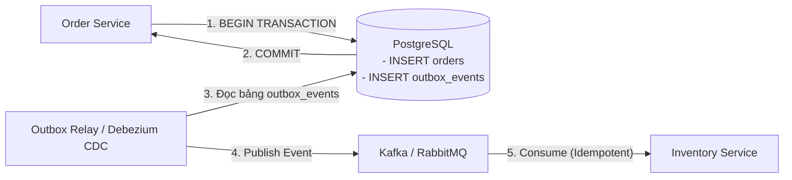
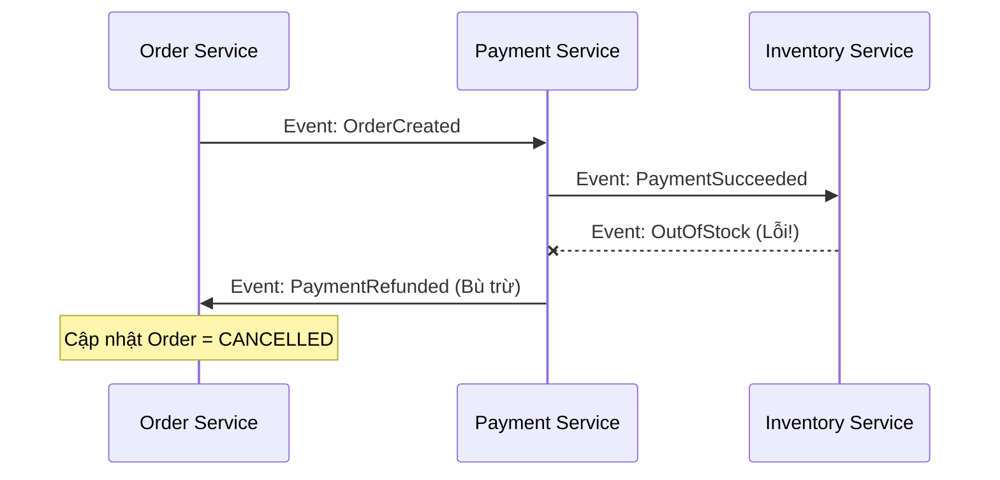
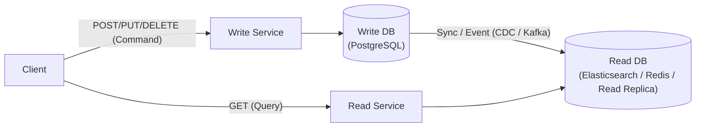

Khi chuyển từ Monolith sang **Microservices** (hoặc chỉ đơn giản là một backend vừa ghi Database vừa bắn event sang Kafka/RabbitMQ), ta không thể dùng một `@Transactional` duy nhất để bọc cả Database lẫn Message Broker.

Bài viết này đi sâu vào **3 pattern cốt lõi** giúp giữ dữ liệu nhất quán mà không cần khóa phân tán nặng nề (2PC).

---

## 1. Transactional Outbox Pattern (Chống Lỗi Dual-Write)

### 1.1 Bài toán Dual-Write
Giả sử khi user đặt hàng thành công, `Order Service` cần làm 2 việc:
1. Lưu đơn hàng vào PostgreSQL (`INSERT INTO orders ...`).
2. Bắn event `OrderCreated` sang Kafka để `Inventory Service` trừ kho.

Nếu bạn viết code tuần tự:
- **Ghi DB trước, bắn Kafka sau:** Ghi DB xong thì Kafka sập hoặc app crash $\rightarrow$ đơn hàng có trong DB nhưng kho không bao giờ được trừ.
- **Bắn Kafka trước, ghi DB sau:** Bắn Kafka xong nhưng DB rollback vì lỗi constraint $\rightarrow$ kho bị trừ cho một đơn hàng không tồn tại!

### 1.2 Cách hoạt động của Outbox Pattern
Thay vì gọi thẳng Message Broker trong request, ta **lưu event vào một bảng `outbox_events` nằm trong chính Database đó**, dùng chung **1 ACID Transaction** với dữ liệu nghiệp vụ.

Sau khi transaction commit thành công, một tiến trình nền (**Polling Publisher** hoặc **CDC như Debezium**) sẽ đọc các bản ghi chưa gửi từ `outbox_events` và đẩy sang Kafka.

> **Lưu ý:** Outbox Pattern đảm bảo **At-Least-Once Delivery** (có thể gửi trùng event nếu relay crash sau khi publish nhưng chưa kịp đánh dấu đã gửi). Do đó, phía Consumer luôn cần **Idempotency** (hoặc **Inbox Pattern** — lưu `event_id` đã xử lý vào DB).

---

## 2. Saga Pattern (Giao Dịch Phân Tán Không Dùng 2PC)

Trong hệ thống nhiều service mỗi nơi một DB riêng, **Two-Phase Commit (2PC)** thường quá chậm và dễ gây khóa dây chuyền. **Saga Pattern** thay thế bằng một chuỗi các **Local Transaction** nối tiếp nhau. Nếu một bước thất bại, Saga chạy ngược lại các **Compensating Transaction (giao dịch bù trừ)** để hoàn tác.

Có 2 cách triển khai Saga:

### 2.1 Choreography-Based Saga (Dựa trên Event)
Không có nhạc trưởng trung tâm. Mỗi service làm xong việc của mình thì bắn event ra, service khác tự nghe và làm tiếp.

- **Ưu điểm:** Đơn giản, ít phụ thuộc, phù hợp luồng nhỏ (2–4 bước).
- **Nhược điểm:** Khi luồng lên 8–10 bước rất khó theo dõi, dễ tạo vòng lặp event.

### 2.2 Orchestration-Based Saga (Có Nhạc Trưởng)
Có một **Saga Orchestrator** đứng giữa điều phối: ra lệnh cho từng service làm gì và chủ động gọi bù trừ nếu có lỗi.

- **Ưu điểm:** Luồng nghiệp vụ tập trung một chỗ, dễ debug, dễ quản lý timeout/retry, tránh phụ thuộc chéo.
- **Nhược điểm:** Thêm một thành phần điều phối cần vận hành (thường dùng state machine hoặc công cụ như Temporal, Camunda).

---

## 3. CQRS (Command Query Responsibility Segregation)

Thông thường, ứng dụng dùng chung 1 model và 1 DB cho cả Đọc (Read) và Ghi (Write). Nhưng ở hệ thống tải cao, nhu cầu của Read và Write hoàn toàn trái ngược nhau:
- **Write (Command):** Cần chuẩn hóa dữ liệu (3NF), kiểm tra nghiệp vụ chặt chẽ, transaction ACID.
- **Read (Query):** Cần tốc độ cực nhanh, thường phải JOIN nhiều bảng, lọc phức tạp, full-text search.

**CQRS** tách hẳn hệ thống thành 2 luồng độc lập:

- **Ưu điểm:** Scale độc lập Read và Write; tối ưu schema riêng cho từng bên (SQL chuẩn cho Write, NoSQL/Elasticsearch cho Read).
- **Nhược điểm (Trade-off lớn nhất):** **Eventual Consistency** (Nhất quán cuối cùng) — vừa tạo đơn hàng xong, đọc ngay ở Read DB có thể chậm vài chục mili-giây mới thấy dữ liệu. Ngoài ra kiến trúc phức tạp hơn hẳn CRUD truyền thống, **không nên lạm dụng cho app nhỏ**.

---

## Tóm Lại

- Dùng **Transactional Outbox** bất cứ khi nào bạn cần *"vừa ghi DB vừa gửi message"* mà không được phép mất đồng bộ.
- Dùng **Saga Pattern** cho quy trình nghiệp vụ xuyên nhiều service; chọn **Choreography** cho luồng đơn giản và **Orchestration** cho luồng phức tạp.
- Chỉ áp dụng **CQRS** khi tỷ lệ Đọc/Ghi chênh lệch quá lớn hoặc truy vấn đọc quá nặng không thể tối ưu trên cùng một model ghi.
