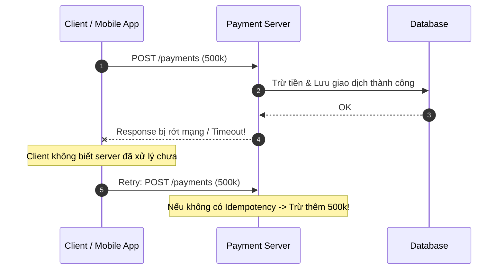
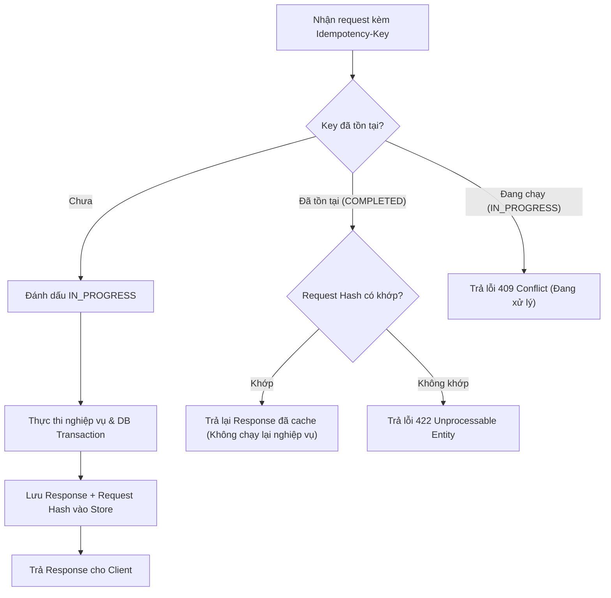

Bạn bấm nút **"Thanh toán 500.000đ"** trên một ứng dụng. Mạng chập chờn, vòng xoay loading quay mãi rồi báo *"Request Timeout"*. Bạn bấm lại một lần nữa. Kết quả: tài khoản bị trừ **1.000.000đ** cho cùng một đơn hàng.

Đây chính là kịch bản kinh điển xảy ra khi hệ thống **thiếu Idempotency** (tính lũy đẳng). Trong lập trình backend và hệ thống phân tán, mạng luôn có thể rớt, client luôn có thể retry — nhưng kết quả nghiệp vụ thì chỉ được phép xảy ra **đúng một lần**.

---

## 1. Idempotency Là Gì?

Trong toán học, một phép toán $f$ được gọi là **idempotent** (lũy đẳng) nếu áp dụng nó nhiều lần cho ra cùng một kết quả như khi áp dụng một lần:

$$f(f(x)) = f(x)$$

Ví dụ: hàm trị tuyệt đối $|x|$ là idempotent vì $||-5|| = |-5| = 5$. Ngược lại, hàm $f(x) = x + 1$ **không** idempotent vì gọi 2 lần sẽ ra kết quả khác gọi 1 lần.

Trong thiết kế API và hệ thống phần mềm:

> **Idempotency** là tính chất mà một thao tác (API request, message queue event, job...) dù được thực thi **1 lần hay $N$ lần giống hệt nhau**, **trạng thái sau cùng của hệ thống vẫn hoàn toàn như nhau** và không tạo ra tác dụng phụ ngoài ý muốn (như trừ tiền 2 lần, tạo 2 đơn hàng trùng).

### Lưu ý cực kỳ quan trọng về Response
Idempotency nói về **trạng thái hệ thống (system state)**, **không bắt buộc** response trả về ở các lần gọi phải giống hệt nhau từng byte:

- Gọi `DELETE /orders/123` lần 1: đơn hàng bị xóa, server trả `200 OK` (hoặc `204 No Content`).
- Gọi `DELETE /orders/123` lần 2: đơn hàng vẫn ở trạng thái đã xóa, server có thể trả `404 Not Found` hoặc `200 OK`.
- Vì trạng thái hệ thống sau lần 1 và lần 2 là **như nhau** (đơn hàng `123` không còn tồn tại), nên `DELETE` vẫn được xem là **Idempotent**.

---

## 2. Phân Biệt Idempotent vs Safe Trong HTTP

Nhiều người hay nhầm lẫn giữa **Safe** (an toàn) và **Idempotent** (lũy đẳng).

- **Safe Method**: Không làm thay đổi trạng thái dữ liệu trên server (chỉ đọc). Mọi Safe method đều tự động là Idempotent, nhưng chiều ngược lại thì **không**.
- **Idempotent Method**: Có thể làm thay đổi dữ liệu trên server, nhưng lặp lại nhiều lần không làm thay đổi thêm nữa.

| HTTP Method | Safe? | Idempotent? | Giải thích ngắn gọn |
| :--- | :---: | :---: | :--- |
| `GET` | ✅ Có | ✅ Có | Chỉ đọc dữ liệu, gọi 100 lần dữ liệu vẫn y nguyên. |
| `HEAD` / `OPTIONS` | ✅ Có | ✅ Có | Chỉ lấy metadata/header, không đổi state. |
| `PUT` | ❌ Không | ✅ Có | Thay thế toàn bộ tài nguyên bằng payload mới. Ghi đè $N$ lần với cùng payload thì kết quả cuối vẫn vậy. |
| `DELETE` | ❌ Không | ✅ Có | Xóa tài nguyên. Xóa 1 lần hay $N$ lần thì tài nguyên đó vẫn không còn. |
| `POST` | ❌ Không | ❌ Không | Thường dùng để tạo mới (`POST /orders`). Gọi 2 lần sẽ tạo ra 2 đơn hàng khác nhau (nếu không tự cài đặt cơ chế chống trùng). |
| `PATCH` | ❌ Không | ⚠️ Tùy thiết kế | `PATCH` set `{"name": "An"}` là idempotent; nhưng `PATCH` `{"incrementBalance": 100}` thì **không** idempotent. |

---

## 3. Tại Sao Idempotency Sống Còn Trong Hệ Thống Phân Tán?

Trong hệ thống phân tán, có một sự thật phũ phàng: **không có giao tiếp mạng nào đảm bảo "chính xác một lần" (exactly-once delivery) ở tầng truyền tải**.



Ba nguyên nhân phổ biến nhất khiến một request bị gửi lại:
1. **Network Timeout:** Server đã xử lý xong, nhưng response trên đường về bị rớt mạng. Client tưởng lỗi nên retry.
2. **User hành động lặp:** Người dùng double-click nút Submit hoặc F5 trang web khi đang gửi form.
3. **Message Queue (Kafka, RabbitMQ, SQS):** Cơ chế phổ biến nhất là **At-Least-Once Delivery** (giao ít nhất 1 lần). Nếu consumer xử lý xong nhưng chưa kịp gửi ACK trước khi crash, broker sẽ giao lại message đó cho consumer khác.

---

## 4. Ba Cách Triển Khai Idempotency Thực Chiến

### Cách 1: Idempotency Key (Chuẩn API / Payment Gateway)

Đây là cách mà Stripe, PayPal và các cổng thanh toán lớn sử dụng cho các endpoint `POST`.

**Cơ chế hoạt động:**
1. Client sinh một mã duy nhất (thường là **UUIDv4**) trước khi gửi request, gắn vào header: `Idempotency-Key: 9b1deb4d-3b7d-4bad-9bdd-2b0d7b3dcb6d`.
2. Server nhận request, kiểm tra xem key này đã từng được xử lý chưa (lưu trong Redis hoặc bảng `idempotency_keys` trong DB).
3. Nếu **chưa có**: khóa key lại (trạng thái `IN_PROGRESS`), thực thi logic nghiệp vụ, lưu lại response (status code + body), rồi trả về cho client.
4. Nếu **đã có và đã xong (`COMPLETED`)**: không chạy lại nghiệp vụ nữa, lấy đúng response đã lưu trả về ngay lập tức.
5. Nếu **đang xử lý (`IN_PROGRESS`)**: trả về `409 Conflict` hoặc chờ kết quả tùy thiết kế.



Ví dụ minh họa bằng Spring Boot + Redis/DB ở mức ý tưởng:

```java
@PostMapping("/payments")
public ResponseEntity<PaymentResponse> createPayment(
        @RequestHeader("Idempotency-Key") String idempotencyKey,
        @RequestBody PaymentRequest request) {

    String requestHash = HashUtils.sha256(request);
    Optional<IdempotencyRecord> existing = idempotencyRepo.findByKey(idempotencyKey);

    if (existing.isPresent()) {
        IdempotencyRecord record = existing.get();
        if (!record.getRequestHash().equals(requestHash)) {
            throw new ResponseStatusException(
                HttpStatus.UNPROCESSABLE_ENTITY,
                "Idempotency-Key đã được dùng cho payload khác"
            );
        }
        return ResponseEntity
            .status(record.getHttpStatus())
            .body(record.getCachedResponse());
    }

    // Lưu ý: cần cơ chế lock hoặc unique constraint để tránh race condition
    PaymentResponse response = paymentService.process(request);
    idempotencyRepo.save(idempotencyKey, requestHash, 201, response);

    return ResponseEntity.status(HttpStatus.CREATED).body(response);
}
```

---

### Cách 2: Unique Constraint & Upsert Ở Database

Nếu bài toán chỉ là chống tạo dữ liệu trùng (ví dụ: chống xử lý trùng một `event_id` từ Kafka hoặc webhook), cách đơn giản và tin cậy nhất là đẩy trách nhiệm đó xuống **Database Unique Constraint**.

```sql
CREATE TABLE processed_events (
    event_id VARCHAR(64) PRIMARY KEY,
    processed_at TIMESTAMP NOT NULL DEFAULT CURRENT_TIMESTAMP
);

-- Khi xử lý event, thử insert trước trong cùng transaction nghiệp vụ
INSERT INTO processed_events (event_id)
VALUES ('evt_12345')
ON CONFLICT (event_id) DO NOTHING;
```

Nếu `INSERT` trả về `0 rows affected`, nghĩa là event này đã được xử lý trước đó -> bỏ qua an toàn mà không cần code phức tạp.

---

### Cách 3: State Machine (Chuyển Trạng Thái Có Điều Kiện)

Khi đối tượng có vòng đời trạng thái rõ ràng (ví dụ đơn hàng: `PENDING` $\rightarrow$ `PAID` $\rightarrow$ `SHIPPED`), hãy ràng buộc điều kiện trạng thái ngay trong câu lệnh `UPDATE`:

```sql
UPDATE orders
SET status = 'PAID', paid_at = NOW()
WHERE id = 1001 AND status = 'PENDING';
```

- Lần 1: `status` đang là `PENDING` $\rightarrow$ cập nhật thành `PAID`, trả về `1 row updated`.
- Lần 2 (retry): `status` đã là `PAID` $\rightarrow$ điều kiện `WHERE status = 'PENDING'` không khớp $\rightarrow$ `0 rows updated`, không thực hiện cộng điểm hay gửi email xác nhận lần 2.

---

## 5. Những Cạm Bẫy Kinh Điển Khi Làm Idempotency

1. **Quên kiểm tra Request Hash:** Client gửi `Idempotency-Key: abc` với số tiền `100k`, sau đó vô tình tái sử dụng key `abc` cho số tiền `500k`. Nếu không so sánh hash của payload, server sẽ trả về kết quả cũ của `100k` và làm sai lệch dữ liệu nghiêm trọng.
2. **Đụng độ đồng thời (Concurrent Requests):** Hai request có **cùng** `Idempotency-Key` đến server tại **cùng một mili-giây**. Cả hai đều đọc thấy "key chưa tồn tại" và cùng chạy logic trừ tiền! Do đó, Idempotency luôn phải đi kèm kiểm soát đồng thời (như `SET NX` trong Redis hoặc `UNIQUE` constraint trong DB) — đây là chủ đề mình sẽ phân tích kỹ ở bài tiếp theo về **Concurrency**.
3. **Không dọn dẹp key (Missing TTL):** Lưu `Idempotency-Key` mãi mãi sẽ làm phình Redis/Database. Thực tế thường đặt TTL hợp lý theo nghiệp vụ (ví dụ: 24 giờ hoặc 7 ngày đối với thanh toán).
4. **Lỗi giữa chừng (Partial Failure):** Nếu bạn đã lưu `Idempotency-Key` vào Redis trước, rồi gọi DB bị lỗi `500` và không xóa/cập nhật trạng thái key, các lần retry sau của client sẽ kẹt vĩnh viễn ở lỗi cũ. Hãy đảm bảo chỉ đánh dấu `COMPLETED` sau khi nghiệp vụ thành công, hoặc dùng chung một DB transaction.

---

## Tóm Lại

- **Idempotency** giúp thao tác chạy 1 lần hay $N$ lần đều cho ra **cùng một trạng thái hệ thống**.
- Đừng nhầm với **Safe**: `PUT` và `DELETE` làm thay đổi dữ liệu nhưng vẫn là idempotent.
- Trong thực tế, hãy kết hợp **Idempotency Key** (tầng API), **Unique Constraint** (tầng DB/Queue) và **Conditional Update** (tầng nghiệp vụ) để hệ thống miễn nhiễm với việc retry.

