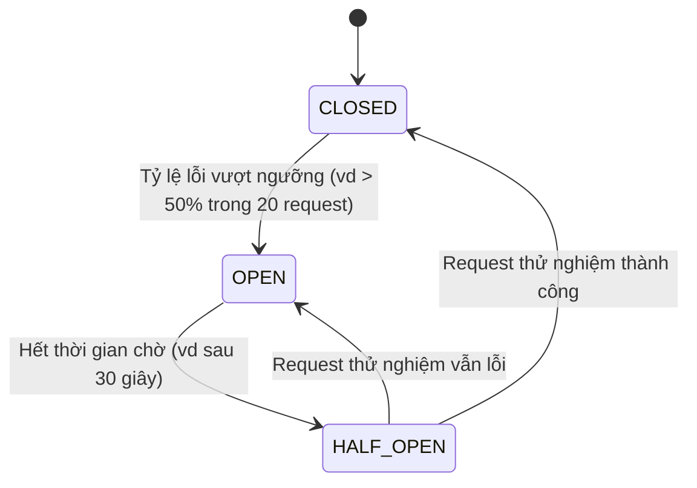
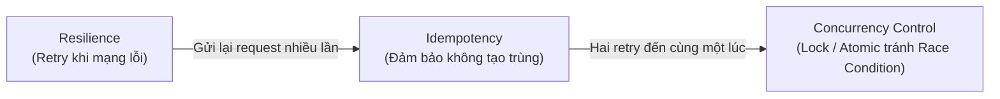

Trong thế giới phần mềm phân tán, có một nguyên tắc vàng: **"Everything fails, all the time"** (Werner Vogels — CTO Amazon). Ổ cứng sẽ hỏng, mạng sẽ rớt gói tin, service bên thứ ba sẽ chậm đột ngột, và database sẽ có lúc quá tải.

**Resilience** (khả năng phục hồi) không phải là xây dựng một hệ thống *"không bao giờ gặp lỗi"* — vì điều đó là bất khả thi. Resilience là nghệ thuật xây dựng hệ thống sao cho **khi sự cố xảy ra, nó không sập dây chuyền, biết cách cô lập thiệt hại và tự đứng dậy được**.

---

## 1. Khả Năng Phục Hồi (Resilience) Là Gì?

> **Resilience** là khả năng của một hệ thống trong việc **hấp thụ tác động từ sự cố**, **duy trì chức năng cốt lõi ở mức chấp nhận được** (có thể ở trạng thái suy giảm có kiểm soát) và **tự động phục hồi** về trạng thái bình thường khi nguyên nhân lỗi được khắc phục.

Để không nhầm lẫn các khái niệm hay đi chung trong System Design:

| Khái niệm | Trọng tâm chính | Ví dụ dễ hiểu |
| :--- | :--- | :--- |
| **High Availability (HA)** | Hệ thống luôn sẵn sàng phục vụ (uptime 99.99%), ít downtime. | Chạy 3 server sau Load Balancer; 1 server chết vẫn còn 2 server chạy. |
| **Fault Tolerance** | Hệ thống tiếp tục chạy **không gián đoạn** ngay cả khi có thành phần hỏng. | RAID ổ cứng, Database Replication tự động failover. |
| **Resilience** | Bao quát rộng hơn: **chịu đựng được lỗi, ngăn lỗi lan rộng, suy giảm nhẹ nhàng và tự hồi phục**. | Khi service gợi ý sản phẩm chết, trang chủ vẫn hiện bình thường (chỉ ẩn mục gợi ý), đồng thời ngắt mạch để không làm nghẽn toàn bộ app. |

---

## 2. Kẻ Thù Lớn Nhất: Cascading Failure (Sập Dây Chuyền)

Tại sao một lỗi nhỏ ở một service phụ lại có thể đánh sập cả hệ thống lớn?

Hãy hình dung:
1. `Order Service` gọi sang `Notification Service` để gửi SMS, nhưng **không đặt Timeout**.
2. `Notification Service` bị treo do DB chậm.
3. Mỗi request đặt hàng giữ chặt 1 thread của `Order Service` để chờ `Notification Service` trả lời.
4. Sau 30 giây, toàn bộ thread pool của `Order Service` cạn sạch $\rightarrow$ `Order Service` cũng chết theo, kéo theo `API Gateway` nghẽn theo!

Để chặn đứng hiệu ứng domino này, chúng ta cần bộ các **Resilience Patterns** dưới đây.

---

## 3. Bộ Công Cụ Xây Dựng Hệ Thống Có Khả Năng Phục Hồi

### 3.1 Timeout — Quy Tắc Sinh Tồn Số 1

Mọi lời gọi qua mạng (HTTP, gRPC, Database query, Redis) **bắt buộc phải có Timeout** (gồm *Connect Timeout* và *Read Timeout*).

- Không có timeout = bạn đang cho phép một dịch vụ bên ngoài **treo vô thời hạn** tài nguyên thread/connection của chính mình.
- Nên đặt timeout ngắn và thực tế (ví dụ 2s–5s cho HTTP call nội bộ) thay vì dùng giá trị mặc định 60s hoặc vô cực.

---

### 3.2 Retry Với Exponential Backoff & Jitter

Nhiều lỗi mạng chỉ là **tạm thời (transient errors)** như rớt gói tin thoáng qua hoặc server đối tác vừa khởi động lại. Thử lại (Retry) giúp tăng tỷ lệ thành công, nhưng **Retry ngu ngốc sẽ giết chết hệ thống**.

Nếu 10.000 client cùng bị lỗi và đồng loạt retry ngay lập tức sau mỗi 1 giây, chúng sẽ tạo ra cơn sóng thần (**Thundering Herd**) đánh sập luôn server đang cố gắng hồi phục.

**Giải pháp chuẩn:**
1. **Exponential Backoff (Lùi thời gian theo cấp số nhân):** Chờ 1s $\rightarrow$ 2s $\rightarrow$ 4s $\rightarrow$ 8s...
2. **Jitter (Thêm độ trễ ngẫu nhiên):** Thay vì chờ đúng 2s, chờ ngẫu nhiên trong khoảng `1.5s – 2.5s` để dàn đều lưu lượng retry.

```text
WaitTime = min(MaxBackoff, BaseDelay * 2^attempt) + random_jitter()
```

> **Nguyên tắc vàng khi Retry:**
> - Chỉ retry các lỗi tạm thời (`502`, `503`, `504`, `Timeout`). **Tuyệt đối không retry** lỗi logic (`400 Bad Request`, `401 Unauthorized`, `404 Not Found`).
> - Chỉ retry các thao tác có tính **Idempotent** (hoặc đã gắn `Idempotency-Key`), nếu không bạn sẽ tạo ra dữ liệu trùng lặp!

---

### 3.3 Circuit Breaker (Cầu Dao Ngắt Mạch)

Nếu một service đối tác đã chết hẳn, việc cứ tiếp tục gọi rồi chờ timeout + retry 3 lần chỉ làm chậm trải nghiệm user và tốn tài nguyên vô ích.

**Circuit Breaker** hoạt động giống cầu dao điện trong nhà, với 3 trạng thái:



- **CLOSED (Đóng mạch):** Bình thường, mọi request đi qua. Hệ thống đếm tỷ lệ lỗi.
- **OPEN (Ngắt mạch):** Khi lỗi vượt ngưỡng, cầu dao ngắt! Mọi request gọi đến sẽ **fail-fast (trả lỗi hoặc chạy Fallback ngay lập tức trong 1ms)** mà không thèm gọi sang service đang chết, giúp service kia có thời gian thở để hồi phục.
- **HALF-OPEN (Nửa mở):** Sau một khoảng thời gian (vd 30s), cầu dao cho phép **vài request thử nghiệm** đi qua. Nếu thành công $\rightarrow$ đóng mạch lại (`CLOSED`); nếu vẫn lỗi $\rightarrow$ tiếp tục ngắt (`OPEN`).

---

### 3.4 Bulkhead (Vách Ngăn Chống Đắm Tàu)

Tên gọi lấy cảm hứng từ thiết kế khoang kín của tàu thủy: nếu 1 khoang bị thủng, nước chỉ tràn vào khoang đó chứ không làm chìm cả con tàu.

Trong phần mềm, **Bulkhead** nghĩa là **chia tách tài nguyên (Thread Pool hoặc Connection Pool)** cho từng dependency riêng biệt:
- Service A được cấp tối đa 20 thread.
- Service B được cấp tối đa 10 thread.
- Nếu Service B bị treo và nuốt hết 10 thread của nó, Service A và các tính năng khác của hệ thống vẫn còn nguyên tài nguyên để hoạt động bình thường.

---

### 3.5 Fallback & Graceful Degradation (Suy Giảm Có Kiểm Soát)

Khi một thành phần bị lỗi hoặc Circuit Breaker đang mở (`OPEN`), thay vì trả về màn hình trắng xóa `500 Internal Server Error`, hệ thống chọn cách **suy giảm nhẹ nhàng**:
- **Dùng dữ liệu dự phòng (Fallback):** Không lấy được giá theo thời gian thực? Trả tạm giá từ Cache cũ kèm ghi chú.
- **Tắt tính năng phụ để cứu tính năng chính (Graceful Degradation):** Trên trang sản phẩm thương mại điện tử, nếu service *"Gợi ý sản phẩm tương tự"* hoặc *"Đánh giá"* bị sập, hãy ẩn khối đó đi — người dùng vẫn xem được sản phẩm và bấm **"Đặt hàng"** bình thường.

---

### 3.6 Rate Limiting & Load Shedding

- **Rate Limiting:** Giới hạn số request từ mỗi client/IP trong một đơn vị thời gian (ví dụ 100 req/phút) để chống spam, DDoS hoặc một client lỗi gửi request vô hạn.
- **Load Shedding (Xả tải):** Khi hệ thống chạm ngưỡng quá tải (CPU 95%, hàng đợi đầy), chủ động từ chối sớm (`503 Service Unavailable`) các request mới ít quan trọng để bảo vệ các request đang xử lý dở không bị chết chùm.

---

### 3.7 Dead Letter Queue (DLQ) Cho Xử Lý Bất Đồng Bộ

Với các hệ thống dùng Message Queue (Kafka, RabbitMQ, SQS), nếu một message bị lỗi liên tục sau $N$ lần retry (ví dụ dữ liệu bị hỏng — *poison pill*):
- Đừng để nó chặn đứng cả hàng đợi hoặc lặp vô tận.
- Hãy đẩy nó sang **Dead Letter Queue (DLQ)** để cảnh báo cho team kỹ thuật kiểm tra, sửa lỗi rồi *replay* (chạy lại) sau mà không làm mất dữ liệu.

---

## 4. Mối Liên Hệ Giữa 3 Trụ Cột: Idempotency – Concurrency – Resilience

Ba khái niệm này không đứng độc lập mà bổ trợ chặt chẽ cho nhau:



1. **Resilience** cần **Retry** để tự phục hồi khi mạng chập chờn.
2. **Retry** bắt buộc hệ thống phải có **Idempotency** để không xử lý trùng.
3. **Idempotency** khi gặp hai request giống nhau đến cùng mili-giây lại cần **Concurrency Control** (Lock / Unique Constraint) để không bị Race Condition!

---

## Tóm Lại

- **Resilience** là khả năng hệ thống chịu được lỗi, không sập dây chuyền và tự hồi phục.
- Luôn bắt đầu bằng những thứ cơ bản nhất: **đặt Timeout ở mọi lời gọi mạng** và **Retry có Backoff + Jitter**.
- Kết hợp **Circuit Breaker**, **Bulkhead** và **Graceful Degradation** để cô lập sự cố, bảo vệ trải nghiệm cốt lõi cho người dùng.

